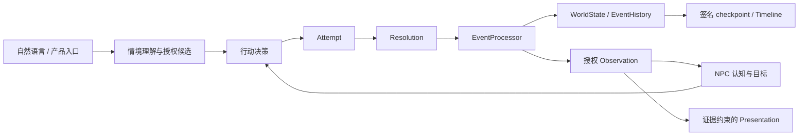

# Ankorgine-CognitiveWorld

中文 · [English](#english)

## 概览

CognitiveWorld 是一个持续演进的认知世界模拟引擎：NPC 拥有各自的观察、信念、经历与目标，通过决策和行动参与一个能够保存、恢复和分叉的世界。

自然语言是玩家的主要交互入口。语言模型理解意图、提出候选并组织叙述；行动效果由世界规则、正式裁定和事件处理决定。NPC 可以获得不同信息、作出不同判断，并在获准的证据基础上改变后续行为。

## 示例世界：《灰域之外》

Anchor 桌面宿主默认提供《灰域之外》（Gray Domain Beyond）的序章与门／通道交互。世界包承载设定和内容，序章文本不会自动成为世界事实或 NPC 记忆。

仓库另提供可运行的社会化房间与 JSON 物体示例，用于观察独立认知、目标完成、物理交互和授权观察的真实因果链。

## 研究问题与设计原则

- **独立认知。** NPC 根据自己的信息、经历和目标决策；接收陈述不等于相信陈述。
- **世界权威。** WorldState 保存规范事实；模型提案、角色信念和玩家叙述各有边界。
- **证据与权限。** Observation 按主体授权，认知摄取验证来源和历史资格，呈现只使用获准证据。
- **正式因果。** 行动经过 Attempt、Resolution 和 EventProcessor；反馈不能跳过裁定或直接改变世界。
- **连续性。** 签名 checkpoint、事件历史和 Timeline 谱系支持恢复与分叉；运行许可与历史证据分开管理。

完整原则见 [Core Doctrine](docs/COGNITIVEWORLD_CORE_DOCTRINE.md) 和 [系统架构](docs/ARCHITECTURE.md)。

## 架构概览



这是职责概览。玩家输入、NPC 回合与保存各有自己的生产入口，并非每次输入都执行整张图。

## 当前实现

| 能力 | 已实现的纵切 |
|---|---|
| 独立 NPC 社会化 | 正式言语事件、接收方授权观察、SocialExperience/v1，以及支持／反驳／证据不足的类型化评估；不同接收者可有不同决策偏好。 |
| Goal 生命周期 | 通过认知治理创建目标；实际消费满足条件的正式证据后完成目标，后续回合不再由该已完成目标重复驱动行动。支持明确区分状态目标与自身行动目标。 |
| JSON 实体与物理交互 | 严格解析、局部引用、稳定身份、位置及所有权；已安装的门锁、钥匙和通道机制通过正式事件改变世界。 |
| 可替换的声明式物理 | JSON v5 配置类型化状态、物性和组成／连接／控制／所有权／持有关系；纯引擎提出布尔转换候选，Resolution 与 EventProcessor 复验后正式提交。 |
| 授权观察精度 | 同一实体可随实际位置、配置阈值和披露权限产生粗略或细节证据；观察距离与交互距离独立。 |
| 行为适应 | 保留旧版锁门失败反馈；新增距离不足结果在主体真正完成合格 L1 摄取并发布可验证消费证明后影响后续评分。确定性 NPC 回合验证失败、接近、再开门。 |
| 持久化与分叉 | 签名世界／认知／反馈快照，历史绑定验证、冷恢复、祖先证据继承和子／兄弟时间线隔离。 |
| 桌面输入 | Qt 界面、后台输入、情境澄清、开门／移动和证据约束的结果呈现，可显式接入本地 Ollama。 |

## 开发状态与局限

当前重点是可运行、可验证的小型世界。新增物理纵切使用可替换的声明式布尔规则，数值物性声明尚不等于数值动力学；距离观察和交互采用显式配置的一维共享坐标域。它们不是完整 3D、FOV、遮挡或通用物理引擎。行为反馈按明确行动与方法匹配，不等于通用学习或 Belief 修订。

当前已实现操作特定的生命状态转换及接收者授权绑定；完整的死亡观察／L1 消费链和死亡后自动物品处置仍未完成。这不构成完整死亡生命周期，也不提供通用契约准入、通用冲突仲裁、补偿、全局 exactly-once 或跨 Store 崩溃原子性。

恢复以已发布 checkpoint 为准。命令行与生产组件回归覆盖不替代完整可见桌面或真实模型验收。声明最低 Python 3.10；本轮验证环境为 Python 3.14.7，未重新验证所有受支持版本。

## 环境与启动

核心模拟源码经 import 检查未发现第三方运行时依赖；下列三个确定性 CLI 示例已用 `-S` 禁用 site-packages 验证，可直接从仓库根目录运行，不需要 API Key 或 Ollama。此范围不包括 Qt 桌面、可选模型／embedding 服务或 pytest 测试工具。

以下为 Windows PowerShell 示例。Core 不要求 Qt；桌面依赖通过可选项安装。

```powershell
py -3.14 -m venv .venv
$python = Join-Path $PWD '.venv\Scripts\python.exe'
& $python -m pip install -e '.[desktop]'
& $python -m anchor_desktop
```

使用本地 Ollama 理解自由输入时，在启动桌面的同一会话中显式设置提供方和已安装的聊天模型：

```powershell
$env:COGNITIVEWORLD_INPUT_UNDERSTANDING_PROVIDER = 'ollama'
$env:COGNITIVEWORLD_OLLAMA_MODEL = 'qwen2.5:7b' # 替换为本机已有的聊天模型
$env:COGNITIVEWORLD_OLLAMA_BASE_URL = 'http://127.0.0.1:11434/v1'
$env:COGNITIVEWORLD_INPUT_UNDERSTANDING_TIMEOUT = '8.0'
& $python -m anchor_desktop
```

输入提供方默认不启用；模型没有默认名称。这里使用 Ollama 的 OpenAI 兼容端点。

无需模型即可运行确定性世界示例：

```powershell
& $python run_json_objects.py examples/data/position_observation.json --scenario visit --approach
& $python run_json_objects.py examples/data/physical_assembly.json --scenario visit
& $python run_social_room.py --save-root "$env:TEMP\cognitiveworld-social-demo" --contrasting-receivers
```

物理示例由 handle 的已安装规则检查 latch 条件并改变 panel 的布尔状态；调整 JSON 中的前提或关系即可改变裁定。

标准库运行方式（仓库根目录；Windows 使用 `py -3.14`，macOS/Linux 使用可用的 Python 3.10+，本轮仅实际验证 Windows Python 3.14）：

```sh
python3 -B -S run_json_objects.py examples/data/position_observation.json --scenario visit --approach
python3 -B -S run_json_objects.py examples/data/physical_assembly.json --scenario visit
python3 -B -S run_social_room.py --save-root /tmp/cognitiveworld-social-new-run --contrasting-receivers
```

请为每次独立实验指定尚未使用的存档目录。Windows 示例继续在该目录使用原有 DPAPI `trust.json`，初始化失败不降级。Linux 文件 HMAC 根位于 `~/.local/share/CognitiveWorld/social-room-hmac-v1.json`；macOS 位于 `~/Library/Application Support/CognitiveWorld/social-room-hmac-v1.json`，不存入仓库或存档。POSIX 要求密钥目录 0700、文件 0600、当前用户所有且无符号链接。文件密钥未加密，不等同于 DPAPI；同用户恶意进程不在保护范围内。保留原信任根才能恢复原存档；缺失、损坏或替换不会自动修复或重签历史。有既有存档但缺根时拒绝初始化。该选择仅适用于 CLI 示例，未改桌面宿主。

社会化示例在指定目录创建本地签名存档；请为独立实验使用不同目录。示例是开发宿主，不是完整桌面玩法。

`--contrasting-receivers` 展示面对同一陈述时，不同行动偏好如何导致不同的行为。最终终端汇总本身不证明接收者获得了不同证据，也不证明完整的信息隔离。

## 验证与测试

本次物理里程碑发布复验（Python 3.14.7）：定向回归 **339 passed，0 skipped，0 failed**（55.61 秒）；完整回归 **1832 passed，9 skipped，0 failed**（148.17 秒）。9 项跳过为显式启用的本地模型、嵌入或语义评估。另完成 16 个 Python 文件编译检查及上述三个命令行示例；未进行真实模型或可见桌面验收。

以上数字及检查范围均为该里程碑的历史报告，不代表当前工作区已经通过完整测试套件。最近一次只读发布审查未运行 pytest。

本地完整回归命令：

```powershell
& $python -m pytest -q -rs
```

详细能力边界、历史验收和技术债见 [仓库状态](docs/REPOSITORY_STATUS.md)。

## 路线图与文档

下一步继续深化实际物理机制与授权感知 LOD：每次增加一个能够改变真实行为的纵切，并验证事件链、保存和分叉连续性。更丰富的几何、交互入口、反馈历史规模与完整桌面流程按独立验收推进。

- [架构](docs/ARCHITECTURE.md)：世界、认知、叙述和呈现的责任边界。
- [数据契约](docs/DATA_CONTRACTS.md)：身份、授权、证据、版本和恢复。
- [工程规则](docs/ENGINEERING_RULES.md)：实现与验证约束。
- [社会因果设计](docs/SOCIAL_CAUSAL_DESIGN.md)：社会经验、判断与目标。
- [开发路线图](docs/DEVELOPMENT_ROADMAP.md)：后续纵切和技术债。
- [AI 边界](docs/AI_BOUNDARY.md) 与 [记忆设计](docs/MEMORY_DESIGN.md)：模型职责与角色认知。

## 许可证

项目代码采用 **AGPL-3.0-only**，见 [LICENSE](LICENSE)。依赖、模型和外部材料保留各自许可；参见 [PROVENANCE.md](PROVENANCE.md)、[THIRD_PARTY_NOTICES.md](THIRD_PARTY_NOTICES.md) 和 [贡献说明](CONTRIBUTING.md)。

<a id="english"></a>

# English

## Overview

CognitiveWorld is an evolving cognitive world simulation engine. NPCs maintain their own observations, beliefs, experiences and goals, then make decisions and act within a world that supports checkpoints, restoration and timeline forks.

Natural language is the player's primary interface. Models interpret intent, propose candidates and organize narrative feedback. World rules, formal adjudication and event processing determine what actually happens. Different NPCs can receive different evidence, reach different judgments and adapt their subsequent behavior.

## Sample World: Gray Domain Beyond

The Anchor desktop host opens with Gray Domain Beyond, including an opening sequence and door/passage interactions. World packages provide content; opening prose does not automatically become world state or NPC memory.

Runnable social-room and JSON-object examples demonstrate independent cognition, Goal completion, physical interaction and authorized perception.

## Research Questions and Design Principles

- **Independent cognition:** receiving a statement does not establish belief in it.
- **World authority:** canonical facts, model proposals, character beliefs and narrative remain distinct.
- **Evidence and permissions:** owner-authorized Observations undergo source and history qualification before cognitive intake.
- **Formal causality:** actions pass through Attempt, Resolution and EventProcessor; feedback cannot bypass execution rules.
- **Continuity:** signed checkpoints and verified ancestry support restoration and branching, separately from live execution permits.

See the [Core Doctrine](docs/COGNITIVEWORLD_CORE_DOCTRINE.md) and [Architecture](docs/ARCHITECTURE.md).

## Architecture

Player interpretation and NPC decisions produce action proposals. Resolution evaluates supported mechanisms; EventProcessor commits formal effects to WorldState and EventHistory. Authorized Observations feed owner-specific cognition and evidence-grounded Presentation. Signed checkpoints preserve the governed state needed for restoration.

These are responsibility boundaries; individual product and simulation entry points use the relevant paths.

## Implemented Capabilities

- **Social interaction:** formal speech, authorized reception and SocialExperience/v1 distinguish supported, contradicted and insufficient evidence. Recipient preferences can produce different decisions.
- **Goal lifecycle:** governed creation and evidence-based completion prevent completed Goals from repeatedly driving the same action. State commitments and actor-action commitments have explicit meanings.
- **Data-driven entities:** strict JSON content resolves local identities, placement, ownership and installed key/door/passage mechanisms into canonical state.
- **Replaceable declarative physics:** JSON v5 defines typed properties, state and explicit composition/connection/control/ownership/possession relations. A pure engine proposes Boolean transitions; Resolution and EventProcessor independently validate and commit them.
- **Authorized detail:** coarse/detail evidence depends on actual position, configured thresholds and disclosure permission. Observation range and interaction reach are independent.
- **Behavior adaptation:** legacy lock-failure feedback remains compatible. The additional reach-failure path affects scoring only after actual qualified owner L1 intake and verified consumption-proof publication. Deterministic NPC turns exercise failure, approach and successful opening.
- **Persistence:** signed world, cognitive and feedback components support cold restoration, verified ancestor evidence and isolated timeline branches.
- **Desktop input:** Qt UI, background processing, contextual clarification and validated action-result presentation, with optional local Ollama interpretation.

## Development Status and Limitations

The new physics slice uses replaceable declarative Boolean rules; numerical property declarations do not imply numerical dynamics. Configured distance uses a one-dimensional shared coordinate domain, not general 3D, FOV or occlusion. Exact action/method feedback is not generalized learning or semantic Belief revision.

The current implementation includes an operation-specific life-state transition and recipient-authorization binding. The complete death-observation/L1-consumption path and automatic death-related item disposition remain unfinished. This is not a complete death lifecycle and does not provide generic contract admission, generic conflict arbitration, compensation, global exactly-once execution or cross-store crash atomicity.

Durability begins at a published checkpoint. Production-component tests and CLI demos do not replace complete visible-desktop or real-model acceptance. Package metadata declares Python 3.10 minimum; this review used Python 3.14.7 and did not revalidate every supported interpreter.

## Installation and Usage

Windows PowerShell:

```powershell
py -3.14 -m venv .venv
$python = Join-Path $PWD '.venv\Scripts\python.exe'
& $python -m pip install -e '.[desktop]'
& $python -m anchor_desktop
```

The core simulation and the three selected deterministic CLI examples run on the Python standard library alone. The imports were checked and the examples were run with `-S` to disable site-packages. This excludes the Qt desktop, optional model/embedding integrations and pytest tooling. No API key or Ollama is needed for these examples.

Core does not require Qt. For local-model input interpretation, explicitly select the provider and an installed chat model before launching:

```powershell
$env:COGNITIVEWORLD_INPUT_UNDERSTANDING_PROVIDER = 'ollama'
$env:COGNITIVEWORLD_OLLAMA_MODEL = 'qwen2.5:7b' # Use an installed chat model
$env:COGNITIVEWORLD_OLLAMA_BASE_URL = 'http://127.0.0.1:11434/v1'
$env:COGNITIVEWORLD_INPUT_UNDERSTANDING_TIMEOUT = '8.0'
& $python -m anchor_desktop
```

The input provider is disabled by default and there is no default model name. This configuration uses Ollama's OpenAI-compatible endpoint.

Deterministic examples need no model:

```powershell
& $python run_json_objects.py examples/data/position_observation.json --scenario visit --approach
& $python run_json_objects.py examples/data/physical_assembly.json --scenario visit
& $python run_social_room.py --save-root "$env:TEMP\cognitiveworld-social-demo" --contrasting-receivers
```

In the physics example, an installed handle rule checks the latch and changes the panel's Boolean state. Adjusting JSON preconditions or relations changes the adjudicated result.

From the checkout root, use these standard-library-only commands (replace `python3` with `py -3.14` on Windows):

```sh
python3 -B -S run_json_objects.py examples/data/position_observation.json --scenario visit --approach
python3 -B -S run_json_objects.py examples/data/physical_assembly.json --scenario visit
python3 -B -S run_social_room.py --save-root /tmp/cognitiveworld-social-new-run --contrasting-receivers
```

Choose a fresh save directory for each independent experiment. Windows retains the existing DPAPI `trust.json` in that directory, with no fallback on failure. Linux uses `~/.local/share/CognitiveWorld/social-room-hmac-v1.json`; macOS uses `~/Library/Application Support/CognitiveWorld/social-room-hmac-v1.json`, outside saves and the checkout. POSIX requires owner-only directory/file modes 0700/0600 and rejects symlinks. File keys are unencrypted and are not equivalent to DPAPI protection; neither protects against malicious same-user code. Keep the original root to restore its saves. Missing, corrupt or replaced keys do not trigger repair or historical re-signing; existing demo data without its root blocks initialization. This adapter affects the CLI example, not the desktop host. Only Windows Python 3.14 was actually exercised here; real macOS/Linux execution and Python 3.10 runtime validation remain open.

The social demo writes signed local saves to the chosen directory; use separate directories for independent runs. These are developer hosts.

`--contrasting-receivers` demonstrates how different action preferences can lead to different behavior under the same reported statement. The final terminal summary alone does not demonstrate that receivers obtained different evidence or prove complete information isolation.

## Validation and Testing

Publication verification for this physics milestone used Python 3.14.7: **339 focused tests passed, 0 skipped, 0 failed in 55.61 seconds**; the **full suite had 1832 passed, 9 skipped, 0 failed in 148.17 seconds**. The nine skips require explicit local-model, embedding or semantic-evaluation opt-ins. Compilation checks covered 16 Python files, and all three CLI examples above completed successfully. Live-model and visible-desktop acceptance were not run.

These numbers and verification scopes are historical reports for that milestone; they do not establish that the current working tree has passed the complete suite. The latest read-only release audit did not run pytest.

To run the full local suite:

```powershell
& $python -m pytest -q -rs
```

See [Repository Status](docs/REPOSITORY_STATUS.md) for detailed scope and historical evidence.

## Roadmap and Documentation

Next work extends real physical mechanisms and authorized perceptual LOD one tested vertical slice at a time. Richer geometry, interaction entry points, feedback-history scale and desktop acceptance have separate validation needs.

- [Architecture](docs/ARCHITECTURE.md)
- [Data Contracts](docs/DATA_CONTRACTS.md)
- [Engineering Rules](docs/ENGINEERING_RULES.md)
- [Social Causal Design](docs/SOCIAL_CAUSAL_DESIGN.md)
- [Development Roadmap](docs/DEVELOPMENT_ROADMAP.md)
- [AI Boundary](docs/AI_BOUNDARY.md) and [Memory Design](docs/MEMORY_DESIGN.md)

## License

Project code uses **AGPL-3.0-only**; see [LICENSE](LICENSE). Dependencies, models and external material retain their own license conditions. See [PROVENANCE.md](PROVENANCE.md), [THIRD_PARTY_NOTICES.md](THIRD_PARTY_NOTICES.md) and [CONTRIBUTING.md](CONTRIBUTING.md).

Contact: ankorgine@outlook.com

## AI-assistance Notice / AI 协助声明

项目设计、架构决策、功能选择与最终验收由维护者主导。AI 参与代码编写、修改、测试、审查以及技术文档起草与修订；这不表示每一行均由人工独立编写。完整来源与权利范围声明见 [PROVENANCE.md](PROVENANCE.md)。

Project design, architecture decisions, feature choices and final acceptance are led by the maintainer. AI assisted in writing, modifying, testing and reviewing code and in drafting and revising technical documentation. This is not a claim that every line was written manually without AI assistance. See [PROVENANCE.md](PROVENANCE.md) for the full declaration and its scope.
