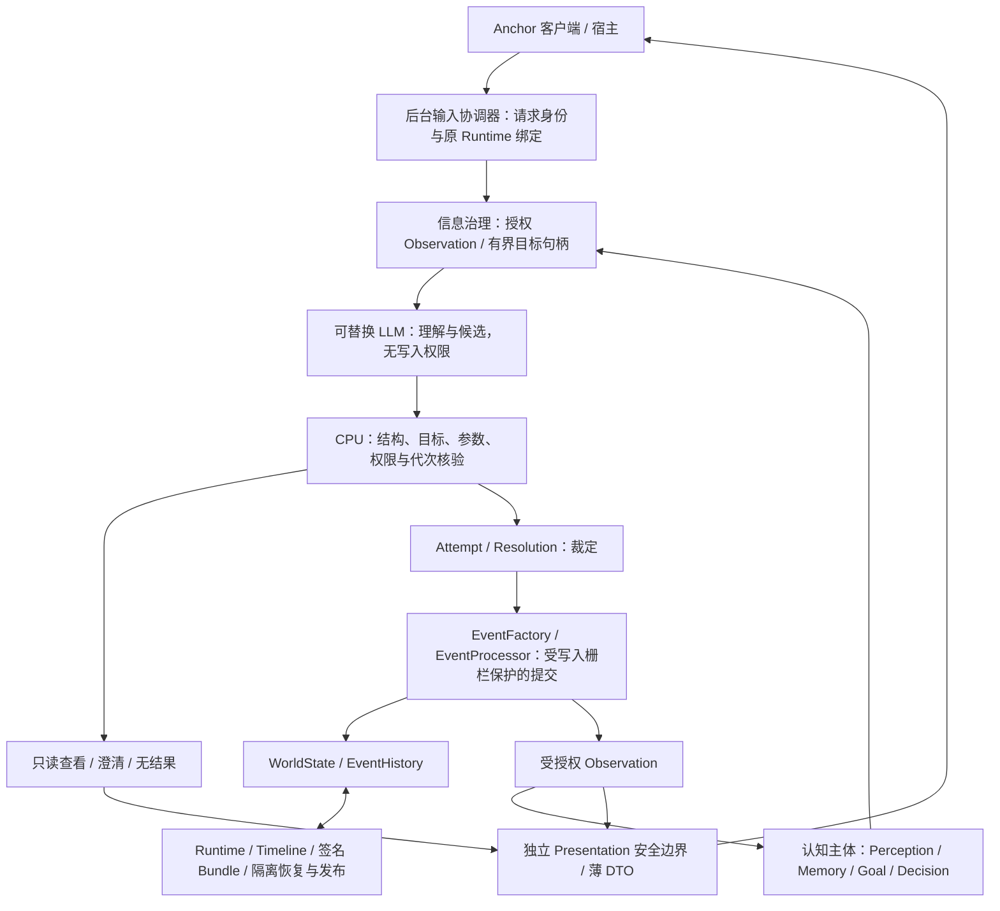

# CognitiveWorld · Anchor

自然语言驱动、以授权认知与可验证因果事件为基础的多智能体沙盒引擎。Anchor 是随仓库提供的实验性 Windows 桌面客户端。

## 目标与设计

让角色根据自己实际获得的信息行动，让世界根据规则演化，并让结果能够追溯和恢复。项目目前是开发者预览，**尚未完成完整可见桌面 MVP 验收**。

与普通 LLM 聊天应用不同，模型负责理解输入和提出候选，不能直接声明世界事实。CPU 层核验授权、目标与约束，正式事件链负责提交变化。角色记忆是带来源的主观认知，不自动证明内容为真；叙事文字也不是世界状态。



这是职责图，不表示每次输入都会执行全部认知过程。Core 不依赖 Qt；安全、世界规范、认知决策、裁定和展示保持独立。进程内凭据不是抵御恶意同进程 Python 代码的安全沙箱。

## 当前能力与限制

| 范围 | 已实现 | 边界 |
|---|---|---|
| 世界加载 | 两套独立 JSON 世界包，校验、安装与 Runtime 装配 | 不是通用 ECS 或任意机制运行器 |
| 玩家交互 | 本地 Ollama 可选接入、授权目标句柄、澄清生命周期、只读查看 | 自然语言稳健性仍需验证；有效 JSON 不等于合法行动 |
| 正式行动 | 已安装门/通道机制、Resolution、事件提交与状态感知反馈 | 不是通用物理；未知机制不能确认效果 |
| 异步展示 | 单协调器后台串行、请求幂等、原 session/generation/permit 绑定，执行与展示状态分离 | 无跨协调器全局 FIFO、持久化 Outbox 或跨进程任务恢复；阻塞 Provider 不保证物理中止 |
| 认知检索 | owner/Character 范围词汇检索、可信 Event—Memory 索引、可选语义通道与本地 Ollama embedding；有界自主决策 | 相似度不是事实证明；真实 embedding 小语料未证明质量提升；不是完整联想网络 |
| 保存恢复 | ScenarioRuntimeState 显式编解码、签名 Bundle、原 Timeline 冷启动恢复与隔离发布 | Windows DPAPI 不承诺跨用户/设备迁移；自动化不代替桌面实操 |
| 桌面 | 世界选择、历史交互流、独立世界状态页、真实存档列表与恢复 | 完整 NPC 对话产品流程、授权过去历史浏览尚未完成；可见桌面全流程未验收 |

正式 D3 Memory 写入要求宿主显式注入策略和授权依赖；接口存在不意味着默认策略已实现。SelfModel 仅有 opt-in、owner-scoped 的 tentative evolution；Personality 没有正式治理演化路径。兼容记录可读取不等于具有当前新写入权限，见 [Memory 版本契约](docs/DATA_CONTRACTS.md#memory-record-provenance-and-snapshot-compatibility-source-checked)。

## Windows 安装与启动

独立验收使用 Python **3.14.7**、PySide6/Qt **6.12.0**。项目最低要求为 Python **3.10**（源码使用运行时联合类型注解及 `zip(strict=True)`）；3.10 的完整运行兼容性尚未验证，其他版本与桌面依赖组合也尚无完整兼容矩阵。桌面依赖为可选 `PySide6>=6.7`，Core 可以单独安装。

在仓库根目录使用普通 Windows PowerShell：

```powershell
py -3.14 -m venv .venv
$python = Join-Path $PWD '.venv\Scripts\python.exe'
& $python -m pip install -e '.[desktop]'

ollama --version
ollama list
# 本地服务未运行时，在另一终端执行 ollama serve。
# 用 list 中已安装的对话模型替换占位符；以下步骤不会下载模型。
$env:COGNITIVEWORLD_INPUT_UNDERSTANDING_PROVIDER = 'ollama'
$env:COGNITIVEWORLD_OLLAMA_MODEL = '<已安装的对话模型名称>'
$env:COGNITIVEWORLD_OLLAMA_BASE_URL = 'http://127.0.0.1:11434/v1'
$env:COGNITIVEWORLD_INPUT_UNDERSTANDING_TIMEOUT = '10.0'
& $python -m anchor_desktop
```

安装不会安装 Ollama 或下载模型。变量由桌面进程继承；当前理解适配器仅允许本机 loopback HTTP，超时上限为 10 秒。未配置 Provider 时仍可启动，但自由输入会返回可恢复的服务不可用反馈。

等效入口为 `.\.venv\Scripts\anchor-desktop.exe`，对应 `anchor_desktop.app:main`。仅安装 Core 使用 `& $python -m pip install -e .`。不要从未跟踪的 `build/` 运行产品。

默认存档位于 `%LOCALAPPDATA%\AnchorCognitiveWorld\saves`。保留用户信任根，不要编辑签名存档；验证失败必须拒绝恢复。结束会话会丢弃最后一次保存之后的未保存变化。

### 世界包与交互示例

资源在 [src/anchor_desktop/worlds/](src/anchor_desktop/worlds/)，包括“钟楼藏书馆”和“雨港观测站”，各有 `manifest.json` 和 `content.json`。世界专属内容留在包中；新内容仍须经过模板、引用、能力和 P0 校验，不代表任意 JSON 行为都受支持。

进入世界后可尝试“观察周围”，依据实际可见对象提出行动，或按正式澄清选项补充信息。这是输入示例，不是保证成功的命令或固定剧情。只读查看使用当前授权 Observation，不创建虚假 World Event。重新提交已满足的行动可以记录无状态效果的正式裁定 Event；这与同请求 ID 的幂等重放不同。

## 测试与验收状态

以下是**历史证据，不是本轮重新运行的结果**：

| 代码身份 | 证据 |
|---|---|
| GitHub 干净检出 `c6d16b9f8357ecd329f784bfec320e15aedc9327`，独立 Windows venv | `1251 passed, 9 skipped in 78.32s`。独立进程冷启动和离屏 Qt 测试通过；两世界真实物理交互成功，随后只读失败，完整真实探针未通过 |
| 基于 `c6d16b9` 的未提交只读修复，候选 wheel 与源码身份核对 | `1259 passed, 9 skipped in 64.96s`。真实 `qwen2.5:7b` 两世界只读→打开→重复打开→只读小样本通过；只读前后 Event 数不变 |
| Memory 文档提交 `29aad11e80e2b65d57ffbe659bb4a6784b3e8173` | 仅文档审查和差异检查，没有重跑测试 |

第二行不是已提交 GitHub 版本的验收。维护者独立验收目录的 `acceptance-results/` 保留 `ACCEPTANCE_REPORT.md`、`full-pytest.log/.xml`、`READONLY_FIX_REPORT.md`、`readonly-final-full.log/.xml` 和真实模型记录；这些本地材料未随仓库发布。公开状态摘要见 [REPOSITORY_STATUS.md](docs/REPOSITORY_STATUS.md)。9 项显式模型 opt-in 跳过不计作通过，单独模型探针不改写原全量跳过数。

真实 embedding 固定小语料 Recall@5=`5/7`、MRR=`9/14`，与词汇基线相同；确定性替身提升不是实际模型收益。完整普通可见桌面进入、保存、退出、重启、恢复和继续行动仍缺操作验收。离屏 Qt 和窗口启动不能替代它。

复核命令（目前没有测试 extra）：

```powershell
& $python -m pip install pytest pytest-qt
& $python -m compileall -q src tests
& $python -m pytest -q -ra
```

保留 `.pytest_tmp` 配置。真实模型测试按各测试显式开关启用，普通全量不依赖模型在线。Windows 受限沙盒曾阻塞 loopback/socketpair，应与普通 PowerShell 结果分开记录，不为通过而跳过安全测试或切换全局事件循环策略。

## 权威文档与路线图

- [ARCHITECTURE.md](docs/ARCHITECTURE.md)：职责、边界和规划。
- [DATA_CONTRACTS.md](docs/DATA_CONTRACTS.md)：数据、授权、版本和持久化。
- [ENGINEERING_RULES.md](docs/ENGINEERING_RULES.md)：工程与安全规则。
- [REPOSITORY_STATUS.md](docs/REPOSITORY_STATUS.md)：当前状态和证据来源。
- [DEVELOPMENT_ROADMAP.md](docs/DEVELOPMENT_ROADMAP.md)：任务、依赖和验收。
- [SOCIAL_CAUSAL_DESIGN.md](docs/SOCIAL_CAUSAL_DESIGN.md)：社会因果边界。
- [MEMORY_DESIGN.md](docs/MEMORY_DESIGN.md)：记忆治理与用途。

`ANCHOR-M2-01` 保留通用交互稳健性工作；`ANCHOR-M3-01/02` 保留可见桌面验收。动态 Character–Memory 授权、可恢复社会经历、完整联想网络、通用物理和持久通知仍属延期。ECS、声明式复合实体、通用类型化关系、完整自主世界动力和任务信息规划是未来方向，不是当前能力。Timeline 祖先校验债务保持开放，D3.2.4 冻结，不因公开材料而进入 D4。

## 贡献与许可

见 [CONTRIBUTING.md](CONTRIBUTING.md)。[CLA.md](CLA.md)、[CCLA.md](CCLA.md) 是待法律审阅、尚未生效的草案，没有自动签署门禁。

项目选定许可标识 **AGPL-3.0-only**：GNU Affero General Public License 第 3 版，仅此版本，完整原文见 [LICENSE](LICENSE)，来源为 [GNU 官方文本](https://www.gnu.org/licenses/agpl-3.0.txt)。LICENSE 内应用示例不改变本项目的 only 选择。依赖、模型和第三方资源遵守各自许可，本项目不替它们授权。版权所有者：**[待维护者核实并填写真实权利人及对应年份]**；公开发布前须核实既有与迁入材料授权链。

AGPL 允许合规商业竞争。未来商业许可仅能涵盖已取得相应权利的材料；CLA 再许可权不撤销既有 AGPL 权利。[TRADEMARKS.md](TRADEMARKS.md) 保护品牌身份，不能改变代码许可或垄断架构思想。
