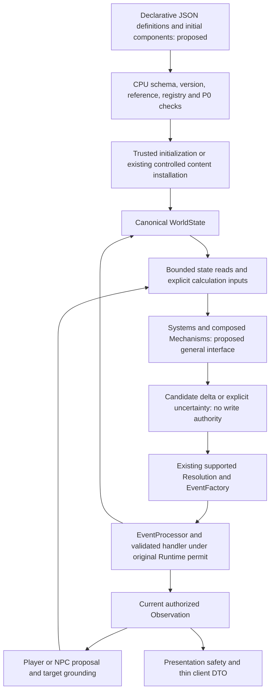
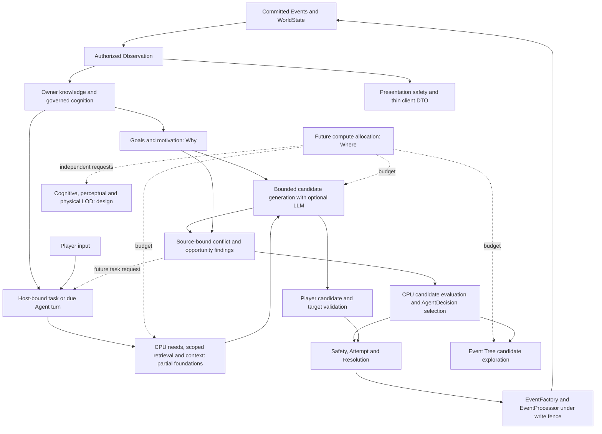

# CognitiveWorld Architecture

Version: 1.0

---

# Project Definition

## Behavior Adaptation — current verified boundary

Behavior Adaptation v0.1–v0.3a established a narrow locked-door failure signal: only a Resolution-confirmed, EventProcessor-committed failed Attempt may affect the acting owner's feedback; the failed Event has no WorldUpdate and does not alter WorldState slot provenance. Its signed Attempt projection and cited condition evidence are checked before commit. Event commit and feedback application share the RuntimeWriteFence commit scope; an application failure after Event append enters recovery-required isolation.

v0.3b adds BehaviorFeedbackSnapshot v1 as a signed SnapshotBundle v2 component. SaveManager captures it under the same snapshot scope; isolated reconstruction verifies each failure against the signed Event/Attempt projection and the cited processor-issued observation evidence. Legacy Bundle v1 is explicitly legacy_not_captured, not interpreted as a failure-free past. Child timelines reconstruct independent mutable feedback state.

v0.4 has a deterministic production-decision comparison in tests/test_autonomous_world_runner.py: with the same owner, DecisionContext, candidates and configuration, changing only trusted feedback changes the adjusted score and selected candidate. The penalized action remains available. tests/test_save_restore_end_to_end.py checks checkpoint score/choice equivalence after restoration, time-based decay, and parent/child isolation; its post-restore decision re-establishes equivalent authorized observations rather than restoring old L1/WorkingMemory caches.

This remains a narrow, exact-structure locked-door adaptation mechanism. It does not establish general behavioral learning, semantic action similarity, broad outcome feedback, or personality change. Feedback does not write Goal, Emotion, WorldState or EventHistory. See DATA_CONTRACTS.md and REPOSITORY_STATUS.md for the persistence and acceptance boundary.

CognitiveWorld is a natural-language-driven AI role-playing sandbox.

The system allows players to interact with a persistent world through natural language.

The goal is not to automatically generate stories. The goal is:

> Build a world that understands player intentions, resolves attempts according to world rules, and maintains long-term consistency through causal memory.

---

# 1. Core Philosophy

## 1.1 AI Understands, World Decides

AI is responsible for:

- understanding language;
- extracting intentions;
- proposing possibilities;
- organizing memories.

AI is NOT responsible for:

- changing reality;
- creating facts;
- directly modifying world state.

The World Core is the only authority.

## 1.2 Events Are The Only Reality Changes

Nothing changes directly. All changes must follow:

```text
Proposal
  ↓
Validation
  ↓
Event
  ↓
World State Update
  ↓
Memory
```

Events are the only source of confirmed world changes.

## 1.3 Natural Language Is Not Commands

Players do not interact through predefined actions. The system does not map `Text → Action ID`.

Instead:

```text
Natural Language
  ↓
Semantic Understanding
  ↓
Intent
  ↓
Attempt
  ↓
Resolution
  ↓
Event
```

## 1.4 Memory Is Not Chat History

The system separates:

- short-term experience;
- long-term world memory.

Short-term memory preserves context. Long-term memory preserves important facts and causal relationships.

---

# 2. Overall Architecture

## Current committed product boundary (2026-10-22)

The diagrams below describe responsibilities, not an assertion that every planned subsystem is complete. For the committed Anchor slice, use four cooperating responsibility groups: **world authority** (Runtime, WorldState, Resolution, EventFactory, EventProcessor and verified EventHistory); **owner-scoped cognition and decision** (Observation consumption, authorized Memory retrieval, candidate proposals and AgentDecision); **application/host coordination** (world-package validation, player session, bounded background input, saves and Runtime publication); and **Presentation/client** (recipient-authorized fact and interaction projections, thin desktop DTOs and Qt navigation). Persistence, signatures, Timeline ancestry and RuntimeWriteFence protect the applicable authority crossings; they are not a fifth source of world facts. `anchor_desktop` depends on CW application interfaces; CW Core never imports Qt.

The installed player path is bounded raw input → shared Safety → authorized Observation/context → optional LLM interpretation of a bounded request-local candidate set → CPU validation of candidate handle, method, current target authority and Runtime generation → read-only Observation projection **or** Safety/Attempt/Resolution → EventFactory/EventProcessor commit → processor-issued Observation → Presentation safety/authorization → desktop DTO. Clarification and no-result messages use separate non-fact Presentation channels. Model text and retrieval similarity cannot declare an Event, fact, target grant or successful effect. A confirmed action with no authorized visible fact receives bounded action feedback, not a fabricated Observation. Candidate methods currently come from the installed typed causal adapter; unsupported mechanisms remain unresolved.

The default product catalog lists one authored Gray Domain Beyond preview, retaining its legacy `rain-harbor` identity and working door/passage mechanisms. The unlisted Clockwork Library package remains solely for legacy save access and compatibility tests. A new session displays package-owned, safety-reviewed opening prose in a skippable Qt presentation; initial scene evidence remains available to explicit observation while a separate bounded local-model inference warms the configured interpreter; neither operation acquires world or cognition authority. See the [opening and warm-up contract](DATA_CONTRACTS.md#world-pack-opening-and-local-model-warm-up). The product includes asynchronous desktop input, explicit scenario-state persistence, signed Bundle verification and first-publication cold resume of the original Timeline. Cold resume rechecks the signed checkpoint, complete Event lineage and ancestor resources before publishing an isolated Runtime with a new session/generation; it does not fabricate an active parent or promise recovery of transient tasks, Observations or UI delivery. The later detailed layer descriptions retain their historical and future-design scope. Current product acceptance and evidence limits are indexed in [REPOSITORY_STATUS.md](REPOSITORY_STATUS.md).

## Entity composition, declarative JSON and mechanisms (proposed evolution; not implemented)

ECS is a **candidate representation model to validate**, not a description of the current engine or an instruction to replace Runtime. This direction refines the existing Entity-state/anti-enumeration design below. The four responsibility groups above stay unchanged: composition belongs within world modeling; Systems and Mechanisms calculate candidates; Resolution confirms supported outcomes; EventProcessor is the controlled commit boundary. No ECS Store, alternative world writer, new Runtime, or private-cognition copy is authorized. The proposed contracts are in [DATA_CONTRACTS.md](DATA_CONTRACTS.md#proposed-entity-component-and-relation-contracts-not-a-runtime-api); staged acceptance is owned by `POST-MVP-07` in [DEVELOPMENT_ROADMAP.md](DEVELOPMENT_ROADMAP.md).

| Concept | Proposed responsibility | Existing foundation and limit |
|---|---|---|
| Entity | Stable world identity, independent of name, temporary condition and capability | `core/entity.py` has `id`, `type`, attributes/state and explicit capability/safety fields. It is not a generic component container. |
| Component | Versioned, typed data describing state, properties, capability or relation endpoints under an explicit authority | Current Entity mappings and typed `DoorState`/`PassageState` are narrow records, not a general component schema/registry. Private Memory, Belief, Goal, Emotion and SelfModel remain in their canonical owner Stores. |
| System | Select eligible component inputs and compute bounded assessments or candidate deltas | Existing causal policies and `InteractionStateAggregator` are reusable seams. Their access to live state, clock, providers and orchestration does not establish functional purity or an ECS scheduler. |
| Mechanism | Replaceable, composable interaction calculation with declared inputs/outputs, applicability, constraints and version | Current `MechanismTemplate` and causal adapters support installed door/passage semantics; the template name does not imply a general mechanism framework. |
| Resolution / EventProcessor | Independently validate candidates, confirm supported effects, and apply authorized updates | Reuse Resolution confirmation, EventFactory, typed handlers, EventHistory and RuntimeWriteFence; a System result or JSON field is not confirmation. |

### Proposed loading and interaction flow



The diagram overlays proposed representation/calculation stages on existing authority crossings; it is not an implemented ECS pipeline. Initial content is not a historical Event. Before Runtime starts, only the trusted initialization path may install validated initial data. Later creation or assembly changes require the applicable controlled content-installation or Resolution Event path. Editing JSON on disk never patches an active WorldState, changes an existing save, or proves that an Event occurred. Current `WorldPackageCatalog → parse_generation_proposal → ContentValidator/ContentRegistry → ContentInstantiator` can be reused for its supported scope; a general component declaration needs its own reviewed schema and explicit adapter into those authorities.

JSON may describe identities/display names, initial components, references, composition and schema versions. It must remain data: no executable expressions, Python import/class selectors, automatic plugin installation or authorization fields supplied by content. Host-installed registries define understood component semantics and permitted mechanisms; JSON cannot register behavior. If existing components/mechanisms suffice, a new box-like object should be a new data composition, not a required Python subclass. A truly new behavior needs a reviewed component/mechanism contract. The concrete declaration shape, registry API and migration format remain unimplemented and unfrozen.

### Pure calculation and effect ownership

Prefer explicit immutable inputs → candidate changes, assessments or uncertainty. Inputs include only necessary trusted state reads, request/Attempt identity, mechanism parameters/version, units and the relevant tick/state revision. With identical inputs and mechanism versions, deterministic Systems must reproduce their output. Inject any clock sample or seeded random sample explicitly; LLM/network calls, random draws, clocks, I/O, scheduling, persistence and commits remain separately bounded side effects. Capturing an input or producing a deterministic delta does not establish authorization or applicability.

Calculation cannot mutate canonical state, issue a permit or submit an Event. Validate mechanism applicability, evidence, hard constraints, affected slots and expected prior values at the existing adjudication/commit boundary; stale state requires fresh assessment or an unresolved outcome, never a replacement permit for an old result. Composed mechanisms must make ordering, read/write dependencies and incompatible deltas explicit; conflicting proposals cannot be silently resolved by last-writer-wins. No claim is made that current Systems/policies are all pure, or that a generic multi-component atomic update handler already exists.

### Composite identity and independent relations

A composite may reference independently identified parts. A door panel, handle, lock, hinge and frame are design examples, not an installed simulation. A part can be targeted independently only after current Observation/target authorization, existence, relevant state and Runtime generation are rechecked. Knowing a parent does not authorize every hidden child; composition traversal is not a knowledge grant. The parent's behavior must not unconditionally determine all part outcomes.

Keep these relation meanings separate: structural parent/part hierarchy; assembly/attachment; motion or force transmission; physical constraint; spatial location/containment; ownership; and organization membership/employment/business links. A structural hierarchy organizes parts and must enforce its own cycle/cardinality rules. Mechanical or organizational graphs may have different valid topology; do not impose one tree or one universal acyclicity rule on every relation. Cross-hierarchy links use explicit typed endpoint references and domain invariants, not display names or nested JSON paths as identity.

Detaching a handle would change its validated attachment relation and any explicitly affected dependencies through formal effects. The part keeps its identity; unrelated ownership, history and other relations remain intact unless their separate contracts justify a change. Detachment alone does not imply a new location, possession, destruction, loss of visibility, or permission. Relation creation/removal, dangling-reference handling and multi-record consistency need acceptance before that domain is enabled. This is not evidence that current `Relationship(source, target, attributes)` implements these transitions.

### Polymorphic mechanisms and unknown combinations

A common interaction request can yield different candidate responses according to components, current state, typed relations, actor capabilities/resources, mechanism applicability and causal/physical constraints. For example, a proposed force interaction may be assessed differently for a door, stone or machine; this does not install a general force/material solver. Dispatch should select registered contracts by applicability, not accumulate branches for particular names/worlds. Mechanisms may specialize a real domain while sharing generic composition; neither arbitrary dynamic execution nor a closed catalogue of every object is required.

LLMs may propose unfamiliar entities, organizations, component combinations or relations. CPU review must check schema/version, identity collisions, endpoint integrity, registered component meaning, applicability, evidence and budgets. Unknown schemas cannot execute or be installed; unknown mechanisms cannot confirm effects. A bounded completion/evaluation/alternative query may retain the candidate outside canonical state under `POST-MVP-02`; if no supported validation becomes available, stop unresolved. Lack of an installed model alone is not proof of impossibility, while verified hard constraints, missing authority and P0 refusals remain binding. No model output auto-installs code, grants access or creates a fact.

### Compatibility and implementation gate

Preserve existing stable references and canonical authorities during any future incremental adapter work. A proposed component representation is not currently accepted by `PersistedValueCodec`, WorldState, Bundle or typed handlers. New persistent records require explicit symmetric encoding/decoding, version/field allowlists, signature coverage and reviewed compatibility; unknown types/versions fail closed. General signed component/relation persistence is not supplied by the existing codec registration mechanism alone.

Reuse verified EventHistory lineage, Bundle validation, isolated assembly, RestoreCoordinator for active replacement and ColdRuntimeFactory/ColdRuntimePublisher for verified original-Timeline cold publication. Keep resume, fork and new-world semantics distinct; do not fabricate parent history or re-sign unknown historical data. Inherited identities/source Timelines remain intact, branch-local updates stay isolated, and outstanding tasks retain their original session/generation/permit. General graph restoration, registry dependency reconstruction and component migrations still need tests. Observation and Presentation require reviewed projections for each newly supported fact family; never dump components/relations into player DTOs. This direction starts no D4 work and does not close D3.2.4 ancestor debt. Current MVP acceptance remains the real interaction, read-only feedback, visible desktop and save/restart/restore flow, without a full ECS prerequisite.

## World dynamics, task information and bounded exploration

**Approved architectural direction; foundations are partial.** The four responsibility groups above retain their authority. “势能 A / Why” means endogenous reasons for actors or the world to change; “势能 B / Where” means allocating finite computation among relevant tasks. These are explanatory concepts, not physical energy values, new canonical Stores, or a single plot score. Information governance determines what a task may know, LOD determines calculation detail/cadence, and Resolution determines what can actually happen. None can substitute for another.

### CPU governance and open unknown paths

**严格限制不可能的结果，开放对未知可行路径的探索。** CPU governance includes retrieving known evidence, identifying missing conditions, preparing authorized model context, managing candidates and budgets, and deciding whether another query or candidate evaluation is worthwhile. Enforcing authority at commit does not require treating the installed mechanism vocabulary as a complete catalogue of possible reality.

| Evidence at the decision boundary | Required handling | Current implementation and remaining gap |
|---|---|---|
| A verified applicable hard constraint rules out the candidate, or authorization/P0 denies it | Reject that candidate/effect with the appropriate bounded reason. A P0 refusal creates no punishment, relationship change or NPC memory. | Existing authorization, Safety and typed causal checks remain binding. A subjective belief or speculative constraint is not a verified physical prohibition. |
| A path is not described by the installed model, but no verified constraint excludes it | It may enter a budgeted proposal, mechanism/condition review or alternative-path search; it cannot commit an unverified effect. | Optional effect suggestions can be translated only into already installed typed semantics. No general mechanism discovery/installation or recursive alternative-path planner is implemented. |
| Critical evidence is missing, conflicting or stale | Keep the gap explicit; query, ask, defer, lower optional exploration detail or finish unresolved according to scope and budget. | `AssessmentStatus.INSUFFICIENT_INFORMATION` and unconfirmed `ResolutionResult(outcome="unresolved")` exist. They do not establish impossibility. No-match, no-budget and no-answer remain different from confirmed failure. |

The candidate-mode desktop interpreter currently selects only offered handles/methods. This is the capability boundary of the MVP adapter, not proof that every unoffered natural-language action is impossible. A future completion proposal must name its assumptions, evidence gaps and needed installed capability; CPU validation must reject invented authority, effect claims and unsupported execution. Reducing compute may end this attempt without declaring all alternatives infeasible. Failure diagnostics may preserve safe next information needs internally; Presentation must not invent a reason or expose private evidence.

### Endogenous dynamics: the current Why path

`Goal` is an owner-held objective with priority/status and optional structured resource demands. It is one input to dynamics, not a complete state of need, intent, pressure or objective distance-to-goal. `AgentTurn.prepare_decision_context` reads owner-authorized cognition, performs bounded retrieval, and derives `MotivationAssessment` and `DecisionModulation`. The current policy uses active Goal priorities, configured personality/emotion weights, configured Goal-tension pairs and SelfModel capability requirements. “Blocked” therefore describes that narrow subjective capability test, not a general proof of physical obstruction or a measurement of resource/time pressure.

`AgentDecision` forms a `SituationAssessment` and candidates, then the installed `ConflictOpportunityScheduler` discovers configured owner-local Goal tensions, observed affordance opportunities and the separate Runtime-verified cross-Agent resource-demand comparisons. The scheduler can add bounded relevance to existing linked candidates. It cannot create a Goal, force a candidate, decide another NPC's beliefs or guarantee an opportunity succeeds. Shared resource identity/exclusive demand is not proof of actual scarcity, occupancy, hostility or cooperation. Knowledge asymmetry remains: a trusted system comparison does not grant an NPC the other owner's private Goal or evidence.

The existing Core has a narrow scheduled loop: due Agent → authorized context → motivation/candidates/findings → AgentDecision selection → ordinary Attempt/Resolution/EventProcessor → new state and authorized Observation → later scheduled turn. The host must drive `SimulationRuntime.run_step` and schedule subsequent turns; the desktop host currently creates schedulers but does not implement a continuous autonomous-world driver. General goal-versus-reality gap measurement, resource/deadline pressure, Event-driven Goal lifecycle updates, cooperation discovery, durable finding lifecycle and a unified endogenous-dynamics loop are not established. The earlier Narrative Pressure Layer is a design umbrella; the concrete scheduler and opt-in `content.expansion` coordinator are partial foundations, not an installed global narrative director. Content expansion requires an explicit host need policy/factory and uses existing content validation/installation Events; no default policy generates a plot or new entity.

### Compute allocation: the current Where path and future scheduler

The present budgets are local: AgentScheduler/EventScheduler choose due work by simulation time; owner findings rank by bounded importance/relevance; AgentTurn limits query/round/result counts; semantic retrieval limits authorized scan IDs; EventTreeExplorer limits materialized branches and optional provider calls; causal advice has its own call bound. These limits are not an aggregate Token, latency or cross-agent resource scheduler. EventTreeExplorer consumes an already selected proposal's checked decision trace; its lazy children and optional unassessed provider children are diagnostic alternatives, not simulated futures or a replacement decision. No live branch Provider, branch WorldState rollout or reusable cross-turn exploration cache is configured.

A future host/CPU allocation policy may consider endogenous pressure, task/player relevance, affected scope and consequence, uncertainty/information value, cost, diversity/duplicate effort and expiry/decay. These are experimental policy dimensions, not implemented global weights, success probabilities or hard world constraints. It must record why a task/branch was expanded, reused, deferred, degraded or stopped and distinguish budget pruning from causal rejection. Reuse requires unchanged evidence, scope, Timeline/session/generation and relevant state versions; no existing cached trust is implied. It must not always pick the easiest-to-succeed path or force all agents toward one global story goal.

Cognitive, perceptual and physical-computation LOD keep independent inputs, budgets and escalation requests. A shared future envelope may arbitrate work; it may not trade away permissions, confirmed consequences, collision/hard constraints or Event validity. Lower perceptual detail grants no extra knowledge, lower cognitive effort changes no belief without governance, and lower physical precision must conservatively escalate or remain unresolved when important effects cannot be validated. None of the three-axis coordinator, general physics precision ladder or global model/Token scheduler is implemented.

**Future cross-domain coordination, beyond the approved three axes:** one bounded allocation policy may compare cognitive reasoning, authorized perception/spatial queries, physical assessment, social-causal review, Memory retrieval/update and Event Tree exploration by uncertainty, importance, causal coupling, downstream consequences and cost. This extends resource accounting; it does not merge those domains' validators, owners or results into one authority. Social conflict or inconsistent evidence may request local review along known source/participant/mechanism links, but may remain legitimate disagreement or deception. No unified conflict vocabulary, cross-domain propagation algorithm, global budget ledger or production coordinator is specified or implemented. Spatial distance alone neither determines detail nor excuses neglecting a consequential remote event.

### Task-driven information and production context

The approved flow is **task/recipient binding → need analysis → scoped retrieval → authorization and freshness checks → relevance/sufficiency review → bounded structured model context → explicit gap disposition**. Authorization restricts searchable sources before any private text reaches a Provider and is rechecked on returned candidates and before use. Finding one relevant Memory is not proof that all task preconditions are known. No uniform production-context service currently implements this full flow.

| Existing seam | What can be reused | Contract still needed |
|---|---|---|
| `AgentTurn` / `CognitionContext` / immutable `DecisionContext` | L1-consumed owner Observations, linked canonical cognition and bounded L5 Memory queries; no Store reference enters the decision snapshot | General task identity/need vocabulary, per-condition sufficiency and aggregate context/Token accounting. Current L5 stops after a matching query and retains uncertainty when none matches. |
| `MemoryRetriever`, `HybridMemoryRetriever`, `MemoryEventIndex` | Owner/Character ID scope, canonical Store rechecks, optional local embeddings and verified current L1 Event anchors | General entity/temporal/causal retrieval, semantic sufficiency, cross-channel evidence fusion and spreading activation. An index hit is not truth, a grant or a mechanism. |
| `AuthorizedStateQuery` / `AuthorizedQuerySession` | Bounded current-actor Observation evidence for an Attempt; source/tick/visibility checks | A task-wide source plan and gap lifecycle. EventHistory verification authenticates history; it does not expose all Events to the NPC/model. |
| `InteractionStateAggregator` / installed causal policies | CPU-only Attempt-bound canonical physical reads and verified effect preconditions | General structure/material/force models and safe review of unmodeled mechanisms. These internal objective reads do not grant NPC knowledge. |
| Player service / pending clarification / read-only Presentation result | Session/generation-bound handles, finite follow-up state and trusted Observation re-projection | A generic information planner must preserve these contracts rather than using UI text concatenation or a new parallel result path. |

NPC decision tasks may receive only the owner's current authorized knowledge and explicitly distinguished beliefs/inferences. A system/world-planning task needs a separately host-issued purpose and source capability; even a wider system view cannot be copied into an NPC prompt or treated as an Observation. The current cross-Agent resource projection is one narrow system capability, not a general world-model prompt. Keep objective evidence, subjective cognition, installed causal rules, hypotheses and candidate futures distinct, with provenance, temporal scope and uncertainty. Narrative text cannot supply authoritative state. Database presence is neither permission nor relevance; relevance is not permission either. Context construction must bound query work, candidates and model input; the general Token/latency envelope remains proposed.

Future LLM-proposed information needs are a later extension to this CPU foundation: the model may request a structured information type, while CPU policy checks caller, source class, necessity, cost and permissions, performs or declines retrieval, and filters the result again. The requestor gains no access by asking. Optional dual-LLM isolation does not replace this policy and is not a current MVP dependency. Task/context/exploration state is transient unless an explicitly reviewed persistence contract includes it; current Bundle v2 excludes provider work, scheduler/tree diagnostics and pending clarification. World replacement or restore invalidates old results under the original Runtime permits. The signed Event/ancestor, cold-resume and publication contracts remain mandatory for every real effect.

The conceptual flow below does not assert that all of its future planning stages are installed. Current capability and missing links are specified above and in the roadmap.



This diagram omits non-fact clarification/read-only/error branches for readability; they retain the separate contracts above. Player candidate validation and NPC AgentDecision are separate branches that meet at the ordinary Attempt/Resolution boundary; the player path does not require NPC scoring or a scheduler finding. A tree branch has no arrow that commits it directly. System-level findings require their own host-authorized source projection, and only owner-filtered findings enter an NPC decision. The future compute/LOD envelope does not replace the current Runtime schedulers. “Narrative Pressure” is the earlier design term for part of the Why/attention direction; UI remains a consumer of authorized Presentation, not an arbiter of the loop.

## 2.1 Layer Separation

The system is divided into layers with distinct responsibilities.

### World Layer

The World Layer provides the foundation for world records:

- Entity;
- Relationship;
- Event;
- WorldState;
- CausalGraph.

The World Layer describes what exists in the world, its relationships and state, and recorded causal links. As a future modeling direction, an Entity is best understood as a stable identity with a set of permission-bounded state slots, rather than as a behavior-rich object whose type dictates what it does. Categories and interfaces may define which slots exist, their initialization, and permitted readers/writers; they do not prescribe runtime actions. This direction does not erase the current Entity model or merge private cognition into WorldState.

Agent/Character autonomy is compatible with this state-centered model. An Agent is an autonomous decision subject because `AgentDecision` reasons from that owner's available Observations, Goals, and authorized cognition, not because an Entity subtype contains a prewritten behavior script. Personality, Memory, Belief, Goal, Emotion, and SelfModel remain in their existing authoritative owner-scoped Stores and cognition boundaries; treating them conceptually as subject state does not authorize a duplicate Entity field or parallel Store.

It does not contain:

- AI logic;
- personality systems;
- character behavior decisions;
- story generation;
- specific world settings.

### Cognition Layer

The Cognition Layer simulates the cognitive structures of individual characters. It does not store world state, execute events, or directly modify reality.

#### Personality

Personality describes a character's relatively stable tendencies, including:

- personality traits;
- behavior preferences;
- value orientations.

Personality is not an Entity field. Entity represents an existence in the world; personality belongs to a character with cognitive capabilities.

#### Memory

Memory preserves and organizes a character's experiences. It distinguishes:

- short-term memory;
- long-term memory.

Long-term memory is stored in a structured form and preserves important events and causal relationships.

#### Belief

Belief represents a character's cognition of the world. A character's belief may differ from the actual WorldState.

#### Goal

Goal represents a character's current objectives and motivations.

#### Emotion

Emotion represents a character's short-term psychological state.

### Cognition Store Ownership

`CognitionContainer` is a compatibility facade: Personality, Belief, Goal, and SelfModel records are owned by their dedicated authoritative Stores and the container delegates reads/writes instead of keeping duplicate copies. Emotion remains container-owned. Long-term Memory is owned only by `MemoryStore`; CognitionContainer does not store Memory. `CognitiveRuntime` builds transient CognitionState and maintains WorkingMemory through its WorkingMemoryStore. Its optional direct Belief/Goal/SelfModel Store inputs remain for legacy callers; AgentTurn obtains authoritative snapshots through CognitionContext.

### Cognitive LOD (Approved Design, Not Implemented)

Cognitive Level of Detail allocates reasoning resources dynamically according to NPC importance, player interaction needs, relevance to current events, and available cognition-compute budget. Future scheduling may include a reasoning priority queue, dynamic NPC wake-up, batched background updates, and upgrades or downgrades in reasoning precision.

All precision levels operate on the same authoritative cognition Stores and canonical state. Lower precision may reduce update frequency or reasoning granularity, but must not discard an already-confirmed important Event or its resulting experience. Returning to higher precision may reconstruct analysis from recorded facts and existing cognition, but must not invent objective Events or character experiences that did not occur. LOD controls computation only; it grants no authority to alter WorldState or confirm Events.

Cognitive LOD does not add or redefine cognition layers: L1 Perception, L2 Working Memory, L3 Long-term Memory, L4 Beliefs & Self-Model, and L5 Metacognition remain the same. Emotion and Motivation remain cross-layer modulators. Cognitive LOD and Causal LOD are separate design concerns and must not be conflated. Every item in this section is approved future design, not implemented behavior.

#### Cognition Update Validation Layer

Cognition state changes must not directly modify stored cognition data. Changes are first represented as proposals and then checked before applying them:

```text
BeliefUpdateProposal
  ↓
CognitiveUpdateValidator
  ↓
CognitiveUpdateApplier
  ↓
BeliefStore
```

```text
GoalUpdateProposal
  ↓
CognitiveUpdateValidator
  ↓
CognitiveUpdateApplier
  ↓
GoalStore
```

```text
MemoryProposal
  ↓
Memory decision and write authorization
  ↓
MemoryPersistence
  ↓
MemoryStore
```

A Proposal describes a candidate change; it does not mean that the change has occurred. `CognitiveUpdateValidator` and `CognitiveUpdateApplier` govern Belief/Goal proposals and now also a narrow SelfModel evolution proposal. SelfModel evolution only appends an explicitly tentative self-understanding entry supported by this owner's newly L1-consumed Observation references; the canonical SelfModelStore checks owner, exact prior snapshot, source Observation/Event pairing, and that no stable identity/capability/limitation field changed. Personality evolution remains unimplemented because its relatively stable fields have no approved bounded-change contract. Cognition updates do not directly modify WorldState; changes to reality still follow the Event Pipeline.

The current narrow Cognitive Causality slice is an opt-in, owner-scoped semantic review in `AgentTurn`: newly L1-consumed trusted Observations and that Character's existing Beliefs may be presented to a review provider. The provider may describe uncertainty and propose at most one revision of an existing Belief. AgentTurn binds the revision to the exact newly consumed Observation IDs and their source Event IDs, then uses the existing CognitiveUpdateValidator and CognitiveUpdateApplier against the canonical BeliefStore. The refreshed Belief snapshot is available to the same turn's DecisionContext and later turns. `SimulationRuntime` can explicitly inject a provider per Agent turn; its optional Ollama provider is selected only by `COGNITIVEWORLD_COGNITIVE_REVIEW_PROVIDER=ollama`, reuses Dialogue's loopback-only transport and shared Ollama model/URL/timeout/token settings, and never falls back to a remote endpoint. Enabling dialogue Ollama alone does not enable transmission of cognition data. The local model adapter is a semantic proposer, not a cognitive authority. This is evidence-grounded subjective revision, not a general psychological or cognitive causal engine. Provider failure or invalid output leaves prior cognition in place; neither this path nor a Belief revision creates a world Event. A local synthetic end-to-end model run has now validated this narrow path, including canonical BeliefStore update and a later turn reading it. It does not establish general semantic reliability or eliminate intermittent model latency.

### Observation Layer

The Observation Layer converts objective world changes into information available to a subject:

```text
World Fact
  ↓
Observation
  ↓
Character Cognition
```

Observation does not modify WorldState or create facts. It is the only entry point through which Cognition receives external information. Different characters may receive different Observations of the same world fact.

The Phase 12.0c-2 ingestion boundary is fail-closed: a manually constructed Observation or a record merely retrieved from ObservationStore is not trusted input. `CognitiveEvolutionEngine` validates source provenance and unchanged payload before forming event-driven proposals; `CognitiveRuntime` and the lower-level `PerceptionProcessor` validate provenance and observer ownership before forming Percepts. ObservationStore remains copy-isolated storage, not an authorization authority. Phase 12.0c-3 adds immutable `ObservableFact` and `EventTimeObservationContext` contracts. EventHandler defaults to producing no facts; EventProcessor issues event-bound facts only from explicit typed drafts after the trusted Event has been successfully applied, and EventHistory stores the associated evidence without authenticating it. Phase 12.0c-4 adds a narrow production path for a controlled room-light state transition. SimulationRuntime supplies the simulation clock and registered Agent identities; EventProcessor applies the update and captures registered observers' WorldState positions and typed sensory capabilities at the same synchronous post-update event boundary, with relevant environment conditions from that state. The Event timestamp is retained as descriptive source data and is not used as the simulation clock. A default-deny VisibilityPolicy issues a signed Observation only for a registered observer with known sight capability at the event location, when the resulting room state confirms the light is on. The Observation contains only the typed ObservableFact, never Event metadata. The legacy `process()` return remains `None`; `process_with_evidence()` remains available. EventTimeObservationContext labels its captured state as post-update. The in-process receipts guard ordinary misuse only; they are not a security boundary against malicious same-process code.

Phase 12.0c-R adds narrow in-process reliability markers to the existing EventHistory. EventProcessor reserves an Event ID before handler work, marks entry into the WorldState update boundary, then records the Event and evidence before Observation delivery. A repeated Event with matching source content reuses recorded evidence and never invokes the handler or applies its WorldUpdate again. A failure before WorldState application releases the reservation and can be retried; once application begins, failures are marked `RECOVERY_REQUIRED` and automatic replay is denied because WorldState has no rollback or durable transaction support. Observation delivery is marked pending before saves; retry reuses EventHistory evidence and regenerates the same observer/fact-scoped Observation IDs, so it does not reapply the Event. ObservationStore overwrites the same ID, making a repeated save idempotent for this path. These markers are process-local and do not provide crash recovery, durable atomicity, or cross-process coordination.

`CognitiveRuntime` now keeps WorkingMemory percept references unique by stable `percept:{observation_id}` identity. Re-consuming the same Observation is a no-op for stored percept references; distinct Observation IDs remain distinct even when text/content matches, and Agent memories remain owner-scoped. CognitiveEvolutionEngine continues to produce proposals only; Belief/Goal writes still require the existing validator/applier, including stale-value checks. This does not make arbitrary external proposal application globally exactly-once.

For bounded stepwise execution, `CognitiveRuntime` also retains process-local L1 consumption receipts in the runtime instance, bound to owner, intact Observation snapshot, source Event, and its existing WorkingMemoryStore. `CognitionState.percept_ids` continues to mean newly ingested percepts for that call; an empty list on replay does not negate a previously validated receipt. Stepwise continuation checks the receipt rather than accepting an ObservationStore row or a caller-supplied percept ID. Receipts do not survive process restart and are not a security boundary against malicious same-process code.

### Decision Layer

Player Decision and Agent Decision are separate flows. They share the Attempt-to-Resolution path, but their decision inputs are not mixed.

#### Player Decision

```text
Natural Language
  ↓
Intent
  ↓
Attempt
```

#### Agent Decision

Agent Decision receives Cognition State, Goal, Emotion, Relationship, and Belief:

```text
Cognition
  ↓
Action Proposal
  ↓
Attempt
```

Both flows continue through:

```text
Attempt
  ↓
Resolution
  ↓
Event
```

Player Decision and Agent Decision remain distinct up to their common Attempt boundary.

Phase 12.1 extends `AgentTurn`'s owner check into a deep immutable `DecisionContext` snapshot. L1 is populated only from Percepts created from verified, owner-matched Observations; L2 is the owner's isolated WorkingMemory snapshot; the initial L3 input included Memory records referenced by that Character and owned by the same Agent; L4 includes owner-scoped Beliefs, Goals, Personality, and SelfModel; Emotion remains cross-layer input. Source references remain attached to Percepts, Memories, Beliefs, and Goals so subjective claims are not reclassified as objective world facts. The snapshot contains no Store or WorldState references and rejects mixed-owner records.

Phase 12.2 adds owner- and Character-reference-scoped retrieval over the existing `MemoryStore`. `MemoryRetriever` ranks only supplied Character-linked IDs by deterministic lexical overlap, then by stored finite importance when every record in an equal-overlap group has a valid value, and otherwise by ID; it returns immutable snapshots preserving each source Event ID. Importance and relevance do not establish truth or confidence. No time or emotional-salience scoring is claimed because `Memory` has no such fields.

`AgentTurn` now provides bounded L5 retrieval feedback through a replaceable `MetacognitionPolicy`; the default `BoundedMetacognitionPolicy` may request a distinct second query only when the first search found no matching memory. A per-turn hard bound is two retrievals, two feedback rounds, and five results per query; duplicate queries are skipped, and exhausted/no-cue cases preserve uncertainty. Feedback is turn-local and cannot write cognition Stores. Memory retrieval reads the canonical Store without mutation. Phase 12.2 represented Motivation through Goals; Phase 12.3 adds a derived MotivationAssessment and DecisionModulation without changing persistent Goal values or adding a cognition layer. Phase 12.4 adds a bounded autonomous proposal policy for `DecisionContext`. Direct `CognitionState` and Mapping inputs retain the legacy placeholder proposal. `AgentActionLoop` preserves its historical placeholder path for an uncustomized base `AgentDecision`; explicitly supplied policies and AgentDecision subclasses use the DecisionContext strategy path. `AgentTurn` continues owner-scoped snapshot assembly before dispatch.

### Hybrid associative retrieval (Approved Design; Narrow Channels Implemented)

The approved direction extends the current lexical retriever with complementary, selectively invoked retrieval channels: exact lexical/entity lookup; semantic similarity; time/event lookup; entity and evidence-constrained causal lookup; and bounded activation spreading over a rebuildable associative index. A query need not invoke every channel. Direct and associative candidates are merged, deduplicated, and reranked with provenance and evidence state retained. A bounded metacognitive follow-up may request another search when the current evidence is missing, conflicting, or insufficient for the response need.

Keep four scopes distinct: what the current Agent is authorized to know; which derived indexes may be searched for that Agent; which records entered this query's candidate set; and which candidates fit the current DecisionContext budget. A record omitted from this turn's context is not thereby nonexistent, permanently unsearchable, or evidence of absence. Index scope never expands authorization: every candidate is re-read from canonical Memory and rechecked against the active owner/Character access contract before it can enter cognition.

The derived graph may contain entity nodes (people, places, objects, organizations, and concepts), event nodes (source, participants, time, and linked Memory records), directed causal relations, and semantic labels/relations for aliases, paraphrases, and indirect association. Anchors may come from authorized entities/events, semantic labels, and the current query. Bounded activation may spread over typed edges, but the graph is a discovery index: it does not replace canonical Memory, EventHistory, or world-fact storage and cannot establish a new fact or causal claim.

Keep record attributes separate from query-time node activation, edge propagation weight, context fit, temporal validity, and evidence reliability. A future implementation may bound hop count, fan-out, repeated-path contribution, cycle revisits, visited-node state, and total compute. Causal edges must follow direction, time, and verified source constraints; semantic edges only expand candidates and never prove causality. Activation decay is not forgetting; a low score is not permanent exclusion; a traversed path is not proof that a causal relation holds; and retrieval failure is not proof that a fact does not exist. Exact formulas and weights remain experimental rather than frozen architecture.

Candidate ranking must preserve source IDs, association path, time, authorization scope, evidence status, and known conflicts. Similarity, activation, and stored importance are relevance signals, not truth or confidence. Metacognition may request bounded additional retrieval rounds/candidates under explicit per-turn and aggregate compute budgets; it cannot write Memory or silently fill evidentiary gaps. If evidence or budget is insufficient, keep the answer uncertain or unresolved.

The index is derived and rebuildable from validated canonical records and authorized identity links. Retrieval and association do not give an NPC global WorldState access and do not mutate WorldState, EventHistory, Memory, Belief, Goal, or relationship state. Confirmed world changes still follow the existing Resolution → EventFactory → EventProcessor → WorldState path. This design may later request cognitive LOD budget, but retrieval, perception, and physical-computation policies remain separate responsibilities.

Current capability includes the Phase 12.2 lexical `MemoryRetriever` over Character-linked IDs, with immutable source-preserving snapshots and a bounded L5 follow-up. An opt-in `HybridMemoryRetriever` adds a narrow, disposable semantic candidate channel through a host-injected `EmbeddingProvider`. It rebuilds from at most 64 current authorized Memory IDs per query, keeps lexical results in their existing order, then fills unused result slots by cosine similarity with stable ID ties. The provider receives only text from owner-matched, Character-linked, semantically retrievable canonical Memory; no network or model adapter is installed by default. A timeout, invalid vector, or Runtime-generation change leaves lexical results intact. An explicitly injected `OllamaEmbeddingProvider` now supports only a validated local HTTP loopback origin and Ollama `/api/embed`; it uses bounded native batches and supplies only authorized Memory content text or the bounded query text. It does not make AgentTurn asynchronous, enable remote disclosure, or change Event/Memory authority. The index is rebuilt for each query, retains only IDs, source references, text digests and vectors, and re-reads current canonical Memory before returning a detached snapshot. This is candidate discovery, not source Event verification, a read grant, or a factual or causal judgment. A host using a slow or remote provider must separately approve its data scope and schedule the AgentTurn away from a UI main thread; the retrieval slice has no general background AgentTurn executor.

The separate narrow Event-anchored candidate locator used by `AgentTurn` is rebuilt from the current authorized Memory IDs and a completely verified Runtime EventHistory. Its anchors are issued only from a trusted Observation that matches the verified source Event and Timeline, carries the issuing Runtime's session and restore-generation binding, and has passed this turn's L1 consumption receipt. An Observation from another Runtime or an earlier restore generation cannot anchor retrieval even when its Event ID and Timeline match. Event-linked candidates are re-read from canonical MemoryStore and merged after lexical and optional semantic results under the existing result limit. Without a verified anchor, this Event channel adds nothing; a consumed Observation that cannot produce a valid anchor, or a later Runtime/history binding failure, marks it unavailable in metacognitive feedback and retains the authorized direct retrieval results. This slice does not provide natural-language event-anchor extraction, temporal search, general entity/causal links, activation spreading, cross-channel evidence ranking, or a shared global retrieval-budget coordinator. Those remain approved design only and are not implemented or tested as production capabilities.

The task-driven information section above defines the proposed need-analysis, sufficiency, context and gap lifecycle that these retrieval channels may serve. Existing bounded L5 queries are its reusable foundation, not a completed general planner. Roadmap `POST-MVP-01` stages CPU-only governance before optional model-proposed information needs; `POST-MVP-02` owns bounded alternative/future exploration. Neither depends on dual-LLM deployment or extends NPC access.

### Narrative Layer

The Narrative Layer provides conflict possibilities, opportunities, Event Tree expansion, and narrative pressure. It presents possibilities; it does not decide character behavior or control the world.

### Worldbook Layer

The Worldbook Layer is an emotional connection layer between the player and the world. It is a special user-facing entry point that supports emotional connection, a sense of belonging to the world, and a long-term sense of companionship.

It preserves the player's long-term understanding, creations, and emotional accumulation related to the world, including:

- World Lore;
- Player Notes;
- Archives;
- Collections;
- Meaningful Records.

Worldbook is an external layer for collecting the meaning the player gives to the world. It is not WorldState, Memory, Entity data, or an AI Prompt.

These concepts have distinct roles:

- **WorldState** represents the world's current true state.
- **Memory** represents experiences of a character or system.
- **Worldbook** represents meaning the player gives to the world and what they choose to collect over time.

Worldbook does not directly affect world operation. Any desired world change must follow the normal flow:

```text
Intent
  ↓
Attempt
  ↓
Resolution
  ↓
Event
  ↓
WorldState
```

### Layer Relationships

The World Layer records world existence, relationships, events, state, and causal links. The Cognition Layer uses its own state to understand the world and form decision tendencies. The Decision Layer turns intentions into attempts and results. Any resulting change must still be represented by an Event before WorldState is updated.

## LLM Abstractor Layer

The LLM Abstractor is an optional extension layer for text abstraction, knowledge extraction, structured resource generation, and assistance with cognitive analysis.

```text
External Knowledge
  ↓
LLM Abstractor
  ↓
Structured Resource
  ↓
Cognition / Narrative / Scenario
```

The LLM Abstractor must not:

- store raw source-work text;
- copy specific characters;
- copy specific plots;
- directly generate World Events;
- directly modify WorldState;
- replace the Resolution System.

LLM outputs are Proposals or Resources, not Reality. AI provides understanding and suggestions; World Core remains the authority for reality.

## Third-Party Implementation Independence

Public projects and papers may inform general architecture ideas, algorithmic principles, and trade-off analysis. Record sources that inform a design. Do not copy, translate, rewrite, port, or closely imitate third-party project code, Prompt templates, or distinctive implementations, including section-by-section reproduction; do not copy project-specific classes. Design implementations independently for CognitiveWorld's requirements, data contracts, architecture, and authority boundaries. The detailed engineering rule is in `ENGINEERING_RULES.md`.

---

# 3. Cognitive Layer

The Cognitive Layer understands player behavior.

## 3.1 Semantic Understanding

Input: player natural language.

Example:

```text
"I want to convince the guard to let me enter."
```

Output meaning representation:

- goal;
- target;
- motivation;
- method preference.

It does not execute actions.

## 3.2 Cognitive Process Model

The cognitive process is modeled as:

```text
L1 Perception
  ↓
L2 Working Memory
  ↓
L3 Long-term Memory
  ↓
L4 Belief / Self Model
  ↓
L5 Metacognition
```

This is a process model, not a strict one-way pipeline. Bounded feedback is allowed during a decision turn (for example, a Goal may focus Perception, or Metacognition may request another relevant retrieval). Turn-local recalculation is distinct from persistent cognition evolution, which must use the existing authoritative Stores and their update governance. Existing Personality, Goal, Emotion, Belief, and Memory data models remain cross-cutting state; the process model does not replace them.

Emotion and Motivation are cross-layer modulators, not additional cognition layers. NPC decisions use all five layers through the Phase 12.4 owner-scoped SituationAssessment. Individual emotion thresholds, impulse ceilings, and growth curves come from character cognition; irrational tendencies remain bounded and context-grounded. Decision emits proposals only; Resolution determines outcomes. Phase 12.4 implements a bounded proposal policy, while the default ResolutionEngine remains unresolved without an installed world-rule policy.

The Phase 12.2 retrieval/review baseline is context preparation, not itself an autonomous action policy. Phase 12.4 adds bounded Emotion/Motivation-aware candidate ranking, but does not implement Belief/Memory truth evaluation, general contradiction resolution, persistent metacognitive learning, or changes to Resolution.

### Hybrid cognition execution levels (architectural direction; unified policy not implemented)

The five layers above describe **cognitive functions**, not mandatory compute tiers. A complementary three-level allocation view is: (1) deterministic fast paths for authorized fact queries, installed rule checks, known-state operations and inexpensive reactions; (2) structured cognition over owner-held Beliefs, Goals, intentions, plans, expectations, Memory retrieval, conflicts and execution monitoring; and (3) optional LLM-assisted interpretation, hypotheses, complex planning or contextual social reasoning when uncertainty, complexity, importance or causal impact warrants the cost. These levels can cooperate within one turn; they do not require separate packages, a model call for every NPC action, or a second cognition Store. A model receives only the task's authorized context and returns a proposal, never a fact or decision authority. Current deterministic decisions, bounded retrieval and opt-in model adapters are partial foundations, not a unified level-selection policy.

The intended feedback loop is authorized Perception/evidence → owner-governed Belief and Goal assessment → intention/plan and ActionProposal → authorization/Resolution → formal Event and any applicable WorldState update → authorized Observation of the actual outcome where available → comparison with the proposal's expected result → targeted Memory/Belief or method-assumption review → later decision. Its trace must retain the relevant evidence, owner, expected result, Attempt and confirmed outcome, including partial failure, unexpected effects and unresolved uncertainty. A discrepancy is a review signal, not permission to rewrite every related Belief: each update must identify the specific claim or method assumption it addresses and pass that Store's existing governance. The current locked-door BehaviorFeedback slice above establishes one narrow, persisted decision effect; it is not this general learning loop. Historical evidence and causal links needed after restore must follow the existing signed EventHistory, cognition snapshot and Timeline contracts; transient expectations or plans are not thereby durable.

### Open-ended Action Semantics (Approved Design; NPC Proposal Support Implemented)

Player and NPC behavior is not constrained to a fixed action enum. Natural-language interpretation should preserve the described behavior, intent, target, tools, method, conditions, and sequence as open-ended attempt data. This interpretation does not establish outcomes.

Player claims that an action succeeded, changed world state, or caused an NPC reaction are not facts. A novel method must not be rejected solely because it is absent from a predefined action category. A concrete, feasible method may affect the conditions Resolution evaluates; verbosity, rhetoric, or token count must not independently increase success.

Phase 12.4's NPC ActionCandidate retains open text intent, target, method, tools, preconditions, conditional steps, expected result, and uncertainties. The no-model fallback is intentionally a small deterministic baseline, not general open-ended language generation. An optional provider may propose varied methods; programmatic schema, owner, length, step, and candidate-count validation runs before evaluation. Provider output remains an untrusted proposal and cannot become a fact.

Multi-step plans are proposals, not pre-confirmed outcomes. Each step is evaluated against actual prior results; intermediate results may change or terminate later steps. Players control their own attempts; NPC cognition determines NPC responses; Resolution determines world outcomes. Players may attempt unreasonable actions, whose failure and consequences follow world rules rather than wording penalties.

## 3.3 Intent

Intent represents what the player wants to achieve.

Example:

```text
Goal: enter_castle
```

Intent does not contain a specific method.

## 3.4 Attempt

Attempt represents how the player tries to achieve the goal.

Example intent: Enter castle.

Possible attempts:

- Persuade guard
- Climb wall
- Steal key

Different attempts under the same intent may create different consequences.

---

# 4. World Core

World Core maintains reality. It contains:

- World State;
- Entity Graph;
- Causal Graph.

## 4.1 World State

Current world status, including:

- entities;
- locations;
- relationships;
- facts;
- environment.

### WorldState Authority

WorldState is the authoritative source for the current world state.

#### World Initialization

WorldState may be populated through an initialization or restoration flow using:

- Scenario Loader;
- Save Loader;
- Initial World Builder.

These flows create an initial world state or restore an existing state. They are not runtime world changes.

WorldState `load_*` methods are reserved for trusted initialization and restoration. Starting `SimulationRuntime` or beginning the first EventProcessor processing attempt closes these methods before any handler runs. Event is the only source of runtime world changes; those changes must enter through the Event Pipeline and be applied through `WorldState.apply_event`.

#### Runtime World Mutation

Runtime world changes must follow:

```text
Event
  ↓
WorldState Update
```

No runtime system may directly modify WorldState. Events are the only record of runtime world changes, and WorldState stores the resulting state after those changes.

The current code provides the `EventProcessor.process()` path: a registered `EventHandler` returns a `WorldUpdate`, the processor passes it to `WorldState.apply_event()` inside a short-lived, content-bound process-local capability scope, and successful processing may append the Event to `EventHistory`. Caller-supplied causal links can also be recorded; causes are not inferred. Direct `apply_event()` without that scope is rejected. Initialization `load_*` methods close when SimulationRuntime starts or before EventProcessor invokes the first handler. These are application-level misuse guards, not protection against malicious code in the same Python process; EventProcessor and SystemEventFactory remain trusted application composition boundaries.

## 4.2 Entity Graph

Represents what exists, including characters, objects, and places.

## 4.3 Causal Graph

Represents why something happened.

Example:

```text
Player helped NPC
  ↓
NPC trust increased
  ↓
NPC may help player later
```

Causality is essential for long-term consistency.

## Character and Agent Model

Entity represents an existence in the world. Not every Entity has cognition, goals, or decision capability.

### Agent Model

An Agent is an Entity with autonomous behavior capability. An Agent may have:

- Cognition Layer;
- Goals;
- Decision Capability.

### Character Model

A Character is an Agent with a narrative identity. A Character may have:

- Personality;
- Memory;
- Belief;
- Emotion;
- Goals.

These terms describe identity and capability associations, not a required runtime inheritance chain or state transition: an Entity has world identity; an Agent is an Entity registered for autonomous cognition/decision; a Character is an Agent with narrative identity. Becoming unconscious, dying, or being otherwise unable to act does not remove an Agent's identity or turn it into another entity category.

Cognition does not belong to Entity as a general world record. It belongs to Agents or Characters with cognitive capability.

Agents and Characters cannot directly modify WorldState. All changes must follow:

```text
Intent
  ↓
Attempt
  ↓
Resolution
  ↓
Event
  ↓
WorldState
```

## Agent Context Layer

AgentContext is the initialized runtime state for an Agent. Its initialization relationship is:

```text
Scenario Character Template
  ↓
AgentContext
  ↓
RuntimeAgent
```

Character represents narrative identity and serves as a character template. AgentContext holds initial references and state for:

- identity;
- initial Personality;
- initial Goals;
- initial Relationships;
- initial Memories;
- initial Beliefs;
- initial Emotion state.

RuntimeAgent represents the subject instance participating in simulation. AgentContext does not execute behavior, modify WorldState, or create Events.

---

# 5. Resolution System

## Resolution Engine

### Import and Dependency Direction

Resolution is a lower-level adjudication boundary. It may validate the
`SimulationTime` value issued by the simulation clock, but it must not import
RuntimeContext, SimulationRuntime, Agent orchestration, or Decision policy as a
side effect of importing core Resolution result/engine types. Runtime issues
trusted clock values and invokes Resolution through explicit orchestration;
Resolution returns a bound result for EventFactory/EventProcessor and does not
call back into Runtime. Package `__init__` modules are public API facades and
must keep optional higher-level exports lazy when eager exports would reverse
this dependency direction. This changes import loading only; it does not
weaken trusted clock validation or the ActionProposal → Attempt → Resolution →
EventFactory → EventProcessor → WorldState authority chain.

The Resolution Engine produces a Resolution based on an Attempt, WorldState, rules, and context.

```text
Attempt
  ↓
Resolution Engine
  ↓
Resolution
```

The Resolution Engine does not:

- modify WorldState;
- generate final history;
- replace the Event System;
- directly control characters.

A Resolution describes a judgement result. The result is later converted into a world change by the Event Pipeline.

Future implementations may support:

- deterministic rules;
- probability;
- threshold judgement;
- AI-assisted interpretation.

AI cannot directly determine or modify world state. Any interpreted result remains subject to the Event Pipeline and WorldState authority rules.

`ResolutionEngine.resolve()` delegates to `_adjudicate(Attempt)`. The base implementation returns no decision, so an unconfigured engine remains unresolved and creates no Event. An installed policy returns a `ResolutionDecision`; the engine issues a `ResolutionResult` bound to a snapshot of its resolution and outcome fields. A caller-created `ResolutionResult(confirmed=True)` has no valid confirmation receipt. `EventFactory` verifies the receipt before creating an Event, and `EventProcessor` verifies the Event source and snapshot before invoking a handler or applying a WorldUpdate. The current Python seals and snapshots prevent ordinary application misuse and post-issuance mutation; they are not a security boundary against malicious code in the same process. Phase 12.5B installs only the narrow door and passage policies; unsupported causes remain unresolved.

### Attempt-bound physical effect proposals (implemented narrow slice)

The current door and known-passage policies express a supported change as an
immutable `PhysicalEffectProposal`, bound to the Attempt fingerprint, target,
clock-issued simulation tick, the exact aggregate read-source references, and
the conditions the policy verified. This is still a proposal: the Resolution
engine rejects stale/unbound proposals and does not write state. The issued
Resolution receipt binds its effect payload; EventFactory carries a bounded
provenance record into the Resolution Event; the installed Event handler checks
that binding and rechecks the current typed state and actor conditions before
EventProcessor applies the WorldUpdate. The resulting processing evidence then
binds the confirmed Observation to the Resolution Event.

The envelope is reusable, but its effect evaluator is not general-purpose: the
only installed physical state transitions remain door operation and known
passage movement. `source_refs` identify the canonical WorldState read
locations; the new `WorldStateSlotRead` records the exact addressed value,
fingerprint, and origin classification separately. A slot changed by a
successfully processed Event can expose its latest Event ID only when the
canonical EventHistory contains that intact Event and its processor-issued
processing evidence validates. Initialization is recorded as initialization,
and absent/unverifiable lineage stays unknown; this is current-slot provenance,
not full event sourcing or causal reconstruction. EventProcessor revalidates
the captured slot reads before applying a physical update. The Resolution Event
does bind the exact Attempt, tick, target, source-read labels, and effect digest,
and EventProcessor revalidates the expected state at application time. An
explicitly injected, loopback-only Ollama proposer can now read a bounded
Attempt/physical-view projection and return possible effects and open-text
participant relations. The original actor, initiator, potential direct cause,
and possible affected entities remain separate references. The suggestion is
locally bound to the exact Attempt fingerprint, actor, initiator, target, tick,
and read-source labels; it is not a `PhysicalEffectProposal` or authorization.
`SupportedPhysicalEffectTranslator` is the shared conversion boundary between
open semantic suggestions and installed legal state transitions. It accepts
unanticipated effect labels, but returns a bounded assessment or explicit
missing-contract diagnostics; it never turns free text into a WorldUpdate.
For an installed single-target door/passage transition only, Resolution may
reassess the suggested effect using the existing typed rule, create its own
`PhysicalEffectProposal`, and continue through the existing Event chain.
Those two effect labels describe verified compatibility paths, not a closed
set of effects the LLM is allowed to suggest.
Additional entities or multiple proposed changes remain representable but
unresolved because current physical state and handlers cannot prove them.
Model-listed requirements are advisory; only rule-verified conditions authorize
the effect. The model cannot confirm a collision, injury, or other unsupported
change, and no Event is created for an unresolved suggestion.

Effect-local participant relations and the global participant summary are
untrusted model claims. WorldState aggregation verifies identity only for the
current actor, target, owned tools, and bounded references explicitly present
on the Attempt; it does not disclose unrelated entity state. A successful
single-target compatibility effect may retain actor/target relation claims as
`model_proposed_unverified` metadata in the signed Resolution/Event chain.
EventProcessor validates that metadata shape and scope, but it is not an
ObservableFact and cannot establish that a proposed causal relationship
occurred. Attempt initiator attribution remains separately bound. Other direct
causes, recipients, and cross-entity effects remain unresolved until trusted
state and transition contracts can verify each link.

### Trusted Event Confirmation (Phase 12.0b foundation implemented)

For Agent actions, the authority chain is `Attempt → ResolutionEngine policy → ResolutionDecision → issued ResolutionResult → EventFactory → Resolution-sourced Event → EventProcessor → WorldState.apply_event()`. A confirmation receipt binds the concrete result snapshot; editing its outcome or other bound fields invalidates it. EventFactory rejects caller-constructed or modified results. EventProcessor independently checks intact provenance before any handler or world write.

`SystemEventFactory` is the explicit trusted-application ingress for Events that do not arise from an Attempt, including environment/system events. The subsystem that owns this factory is trusted application composition; the factory is not caller authentication. `EventScheduler` only schedules an already-issued Event and grants no provenance. A scheduled hand-built Event is rejected by EventProcessor when dispatched. `EventHistory` remains a record system, not an authentication system; inserting an Event there does not authorize it. No second EventHistory or WorldState was introduced.

This foundation does not evaluate whether an Attempt is feasible: the default ResolutionEngine still returns unresolved when no policy exists. Prose-supplied success, confirmation, outcome, and world-change claims are not consumed as trusted resolution decisions. Open-ended Attempts remain valid inputs; no fixed action enum was added.

Resolution describes the judgement result and its consequences. It does not itself change the world. Example consequence descriptions include:

```text
Gate opened; guard remembers the actor.
```

Example attempt: Persuade guard.

Possible result descriptions:

- Success: gate opened; guard remembers player.
- Partial success: temporary permission; suspicion increased.
- Failure: access denied; relationship decreased.

The visible result may use RPG-style labels. The internal result must contain concrete world changes.

---

# 6. Event System

## Event Pipeline

An Event is the only record form for runtime world changes.

```text
Intent
  ↓
Attempt
  ↓
Resolution
  ↓
Event
  ↓
WorldState Update
  ↓
CausalGraph Update
```

### Pipeline Responsibilities

- **Intent** represents a character's or player's purpose.
- **Attempt** represents a specific action try, including its method, target, and expected effect.
- **Resolution** determines the outcome of an Attempt. It does not directly modify the world; it produces an Event.
- **Event** records a fact that has already happened.
- **WorldState** stores the current state resulting from Events.
- **CausalGraph** stores causal relationships between events.

## Event Application

```text
Event
  ↓
EventProcessor
  ↓
WorldState Update
```

**EventProcessor** interprets the effect of an Event on the world and produces a state change request. **WorldState** accepts valid updates and stores the resulting state.

EventProcessor:

- does not judge outcomes;
- does not generate Events;
- does not call AI;
- does not bypass WorldState to modify its internal data.

All runtime state changes must be traceable to an Event.

The generic handler registration and `WorldUpdate` dispatch boundary are implemented. Future Event Handlers may process different changes based on Event type. Concrete event rules are not implemented at this stage.

AI cannot directly modify WorldState. AI may only propose Intent or Attempt data, or explain a result. Event is the sole source of runtime state changes.

Events are the only way reality changes.

## Runtime Architecture

This section describes the runtime lifecycle of CognitiveWorld.

### World Initialization

World initialization may come from:

- Scenario Loader;
- Save Loader;
- Initial World Builder.

```text
Scenario / Save
  ↓
Initial World State
```

Initialization creates an initial state or restores an existing state. It is not a runtime world change.

#### Scenario Layer

The Scenario Layer defines world initialization templates, including:

- world templates;
- initial world state;
- initial character templates;
- initial relationship configuration;
- configuration validation.

```text
Scenario
  ↓
Scenario Loader
  ↓
World Bootstrap
  ↓
Initial World State
```

Scenario is not runtime WorldState and does not directly modify WorldState. It only describes and creates the initial state. Scenario describes how a world begins; WorldState describes its current true state.

### Runtime Loop

The implemented Agent action cycle provides orchestration across these boundaries when supplied with components that produce a confirmed result:

```text
Observation
  ↓
CognitionContext
  ↓
AgentDecision
  ↓
ActionProposal
  ↓
Attempt
  ↓
Resolution
  ↓
Event
  ↓
EventProcessor
  ↓
WorldState
```

AgentActionLoop coordinates the AgentDecision, ActionProposal-to-Attempt conversion, and
Attempt resolution through Event creation. The resulting Event is handed to EventProcessor;
it is not applied by AgentActionLoop or SimulationRuntime.

For `DecisionContext`, `AgentDecision` now selects a bounded cognition-grounded proposal. Its legacy `CognitionState`/Mapping inputs and the uncustomized built-in `AgentActionLoop` compatibility route retain the placeholder proposal. The default `ResolutionEngine` remains unresolved without an installed world rule, so no action outcome is confirmed by default. `SimulationRuntime` can advance time, poll Event and Agent schedulers, run due Agent turns, and dispatch generated Events. It does not itself apply Events or write EventHistory.

```text
Natural Language Input
  ↓
Semantic Understanding
  ↓
Intent
  ↓
Attempt
  ↓
Resolution Engine
  ↓
Resolution
  ↓
Event
  ↓
EventProcessor
  ↓
WorldState Update
  ↓
CausalGraph Update
  ↓
Memory Update
```

Responsibilities by stage:

- **Cognition** understands the input.
- **Decision** produces Intent and Attempt.
- **Resolution** produces a judgement result.
- **Event** records a fact that has already happened.
- **WorldState** stores the current state of reality.

No module may bypass Event to modify WorldState.

### Persistence

The current persistence foundation has two distinct layers. An Event is ordinary
data until the trusted `EventProcessor` completes its normal validation and
WorldState application. When a host explicitly injects a `PersistenceTrust`
signer, successful processing also emits a versioned attestation tied to the
Event digest, processor evidence, actual WorldUpdate digest, simulation tick,
changed slot fingerprints, and preceding attestation. The attestation is
stored alongside the canonical EventHistory entry; it does not replace
EventHistory or grant an Event new authority.

`WorldState` can export a versioned, signed checkpoint from its canonical
collections and slot provenance. Restore verifies the checkpoint trust,
attested EventHistory chain, current slot fingerprints, and each Event-origin
slot's attested resulting value, then constructs an isolated WorldState and
EventHistory pair. A failed verification returns no restorable pair and does
not mutate an active WorldState. Initialization and unknown provenance remain
distinct from Event provenance. `WindowsDpapiPersistenceTrust` provides an
explicitly initialized, current-user DPAPI-protected HMAC key ring for local
Windows desktop use. It stores only protected keys under the user's LocalAppData
profile by default; signature envelopes carry format version, algorithm, key
ID and purpose. Opening a missing or corrupt ring fails closed, and signing
never initializes it implicitly. Rotation activates a new key while retaining
older keys for verification until explicit revocation. DPAPI protects at the
Windows user-profile boundary, not against malicious same-user processes or
cross-device migration. HMAC is shared-key trust, not non-repudiation.
`HmacPersistenceTrust` remains a raw-key adapter for tests and explicitly
managed hosts. No production root is initialized by default. Snapshot capture
does not itself freeze Runtime writes.

WorldState checkpoint schema v2 signs the canonical body digest together with
schema/version, simulation tick, and explicit Timeline ID. Cognitive snapshot
signatures cover the canonical serialized body, including the Agent manifest,
six store contents/owner links, source statuses, capture scope, tick, Timeline,
session, and Restore Generation. Event attestations bind Event and processing
evidence digests, update digest, changed-slot records, tick, and preceding
attestation digest. `SnapshotBundleManifest` signs exact WorldState and
cognition component byte digests, shared tick/Timeline, Agent roster digest,
and Event-chain head. Verification checks the manifest signer first, then
validates each component and its cross-references. The manifest prevents
cross-file mixing; it does not provide Timeline isolation or active Runtime
restore.

This is not full runtime persistence. Long-term persistence is expected to
include:

- WorldState;
- Event History;
- Memory;
- Causal Records.

Persisted data must be sufficient to restore world consistency. Runtime
quiescence, timeline identity/forking, cognitive stores, stale-task fencing,
crash recovery, automatic/manual save policies, and dependency-safe data
reclamation remain future work. Unsigned legacy EventHistory is not silently
upgraded or restored as trusted.

### Runtime write fencing (narrow in-process foundation)

`SimulationRuntime` owns one `RuntimeWriteFence` for its process-local session.
Each step captures a session/generation permit distinct from simulation tick
and any future timeline identity. Provider work inherits that permit through
Python task context; newly constructed ActionProposal, Event and cognitive
update proposals retain their originating permit. AgentActionLoop rejects an
old ActionProposal before creating an Attempt; EventProcessor,
CognitiveUpdateApplier and EmotionUpdateApplier validate the permit at their
final write boundaries.
The shared lock spans validation and commit, so a generation advance either
waits for an already-linearized commit or invalidates the operation before
write. Freezing blocks new steps and commits; unfreezing permits fresh work
without reviving old permits.

This covers the Runtime EventProcessor path; the final Belief/Goal/SelfModel
Store update boundaries; the Emotion container commit boundary; and Memory
proposal/request/persistence commits when the canonical MemoryStore has been
bound by AgentTurn or MemoryPersistence. Player dialogue also captures the
EventProcessor's fence before L1/provider work, so persuasion writes retain the
starting permit. Personality has no governed runtime evolution path; after
Runtime binding, its legacy `update` method rejects rather than opening one.
Initialization before binding remains supported.

Private-field mutation, unbound standalone Memory persistence, trusted
initialization APIs used outside an operation, custom callbacks/providers that
discard task context, and cross-process work remain outside this guarantee.
`freeze_writes()` is not a complete Context Freeze or restore transaction and
does not cancel model requests.

---

## Runtime Layer

The Runtime Layer coordinates simulation time and lifecycle, schedules existing Events, and calls the EventProcessor. It is a scheduling layer and does not own world or cognition rules.

### Shared Observation Facts (General Design; Narrow 12.0c-4 Slice Implemented)

Agent Observation and player Presentation share a lower-level observable-fact evaluation boundary while keeping separate identity, permissions, and output contracts. Evaluation may use trusted event facts, necessary world state for the event time, resolved observer identity, location/environment conditions, and applicable sensory/visibility rules. Missing required inputs mean deny/no observation.

An Event cannot grant itself presentation permission through metadata. Full Event metadata must not be copied into Observation or Presentation. Objective world facts, facts available to a particular observer, and facts allowed to a player are separate. NPC private cognition remains outside Presentation access.

WorldState owns locations and environment values; `Entity.sensory_capabilities` is an optional typed world-state field, where `None` means unknown. Event has generic changes and open metadata, neither of which grants visibility. Phase 12.0c-4 supports only the explicit `room_light_changed` system-event handler and the positive `room_light_on=True` perception rule. Unknown location, sensory capability, or simulation clock means no Observation. Hearing, occlusion, geometry, and arbitrary environmental visibility are not implemented. Do not substitute Event metadata, participant membership, current/default locations, or assumed senses. `ObservationGenerator.generate()` remains a fail-closed compatibility API; the controlled production path consumes EventProcessor evidence through its authorized issuance method. Phase 12.0d adds a player Presentation path only for this already-authorized narrow Observation slice; it does not expand Agent perception rules.

## Presentation Safety Foundation (Phase 12.0)

### Trusted Player Presentation and Chat Output (Phase 12.0d, narrow slice)

```text
RuntimeContext host-bound PlayerSessionBinding
  → PerspectiveResolver + AgentRegistry/Character binding
  → EventHistory Event + EventProcessingEvidence
  → existing authorized Observation for the resolved Agent
  → restricted visible input
  → deterministic MinimalComposer
  → PresentationValidator-issued ValidatedMessageBatch
  → ChatOutputGateway
  → InMemoryChatOutputGateway (current adapter)
```

`RuntimeContext.player_session` is optional and defaults to absent; no session is synthesized. The host must supply a `PlayerSessionBinding` from its trusted session setup. Roleplay resolves the bound registered `RuntimeAgent` and requires its Character ID. Observer mode uses only its host-bound registered view Agent and grants no action-control capability. Director mode is denied because no director visibility policy exists. The resolver accepts no recipient, observer, mode, audience, or scope arguments from the presentation caller; current visible scope is a policy-derived environment scope. This is an application contract, not network authentication or a same-process security boundary.

The filter ignores `Event.metadata`, including legacy `presentation_facts`. It requires an intact trusted Event and its EventProcessor evidence, then reads only an unchanged Observation from the existing ObservationStore whose observer and source Event match, whose ObservableFact is included in that evidence, and whose authorization still passes the shared `VisibilityPolicy`. The Observation is the existing per-Agent authorization result; Presentation does not read cognition or memory. Unknown/missing session, event evidence, Observation, or view-agent binding denies output. This historical Phase 12.0d slice began with room-light-on; later trusted door and passage facts are documented in their respective phases.

`VisibleInput` contains closed typed fact data and source IDs, not backend objects or arbitrary text. `MinimalComposer` renders only explicitly supported typed facts. Door open/closed/locked and passage presence use generic nouns when no verified display-name contract exists; internal subject IDs, location IDs, predicates and raw values never become fallback prose. Unknown facts fail closed. It cannot invent dialogue, inner thoughts, outcomes, or other facts. `PresentationValidator` rechecks the source Observation and exact deterministic text, binds recipient/session/view/source snapshots, and issues `ValidatedMessageBatch`; a `PlayerVisibleMessage` alone is not accepted by the gateway. The private Python receipts address ordinary misuse only and do not resist malicious same-process code.

`ChatOutputGateway` is the sole approved player-chat send interface. `InMemoryChatOutputGateway` is the current callable Core adapter and stores validated batches. The former CWUI live adapter remains in the untouched source backup. After M0.5, the `anchor_desktop` host consumes this adapter through narrow display entries for a fresh world session; this is an in-process projection, not durable delivery. The Core adapter rejects raw strings, Events, Observations, manually built messages/batches, session mismatches, and post-validation mutation. It records only a non-sensitive error code. Presentation does not modify WorldState, EventHistory, ObservationStore, or cognition stores.

Player chat must never receive backend cognition, private memory, EmotionState or parameters, probabilities, decision analysis/traces, Prompts, debug output, or internal state objects. A Python in-process seal or type check is an application misuse guard, not protection from malicious code in the same process. Stronger adversarial isolation would require a separate security boundary and is long-term planning, not a current capability.

Within Core, `InMemoryChatOutputGateway` is the callable adapter. The desktop launcher is no longer Demo-backed; its host starts either validated local world definition and projects observed initial Events and later committed action facts as typed display entries. Clarification and narrative entries retain distinct channels. The desktop back action closes the original session before returning to world selection; Qt polls a request-scoped, allowlisted task snapshot on the UI thread without waiting for the worker and discards the old page on world switch. A completed task with pending non-Event delivery terminates its temporary progress display. Local player input echo is marked as player speech, never a confirmed Event. Signed cold resume has a separate verified first-publication path. This in-process display connection does not provide general NPC dialogue, director policy, durable delivery, or full observer simulation. Narrow LLM-backed input understanding, clarification, and no-result narrative generation are documented in the later D3.3.1 section. The narrow visibility path is not a general player-visibility system. Event metadata, caller scopes, private cognition, EmotionState, thresholds, probabilities, scores, prompts, decision trajectory, and debug data are excluded from player-chat inputs.

### Framework-neutral Core and asynchronous host boundary (approved constraint; implementation partial)

#### First player-input async slice (implemented narrowly; in-process)

The synchronous player chain remains input classification → target/Safety authorization → ActionPipeline → Resolution/EventFactory → EventProcessor → authorized Presentation → Gateway. `PlayerInputTaskCoordinator` is a framework-neutral host boundary around `PlayerActionService.submit_input`; it does not create a Runtime, Store, alternate Resolution path, or UI adapter. Hosts that use the coordinator receive an opaque handle at admission and can observe an allowlisted `PlayerInputTaskSnapshot` through a `concurrent.futures.Future`. Callbacks run on the worker thread and client adapters must marshal them to their own UI thread. The original synchronous service entry point remains available and still blocks its caller.

The coordinator uses one `ThreadPoolExecutor` worker per coordinator. Admission is serialized and captures the request fingerprint, player session/actor, RuntimeWriteFence session and restore generation, and the original write permit. It explicitly copies the permit's `ContextVar` context into the worker. The potentially expensive authorized-target projection is computed by the worker at task start inside the original permit's snapshot scope, then passed to interpretation; current target/Safety/Resolution checks still run before action. Identical request IDs and content join the same in-process task; changed content conflicts. The single worker gives that coordinator a defined admission-order execution sequence but can suffer head-of-line delay when a provider cannot be interrupted. A submission acknowledgement means accepted for processing, not action success. Authority objects, target snapshots and provider inputs are not fields in the client status projection.

Blocking input interpretation and fallback work run on the worker, outside the Runtime commit lock. `PlayerActionService` uses the admission-time target allowlist, checks the task binding after provider work, and still applies current target/Safety/Resolution validation. EventProcessor receives the original propagated permit; no fresh permit is minted for a returning result. RuntimeWriteFence can revoke that individual permit until its `commit_scope` begins. Cancellation, timeout, shutdown, generation advance and commit therefore serialize at the fence: if revocation wins, late work cannot commit; once `commit_scope` begins, cancellation returns false and the already-authorized commit is allowed to finish. Provider computation itself is advisory and may continue after cancellation or timeout.

Execution state and Presentation delivery state are tracked independently. Execution states include accepted, running, completed, cancelled, expired, stale and failed; delivery states include pending, delivered, retryable and stale. They are application statuses, not world Events. If EventHistory reports a request Event as COMPLETE after Presentation throws, execution is completed and delivery is retryable. `retry_presentation` re-reads that request's canonical Event, requires COMPLETE processing, and re-enters current Presentation authorization, Safety/visibility checks and Gateway deduplication; it does not reinterpret input, rerun Resolution or dispatch the Event. The retry runs under the original permit's Runtime snapshot scope: if it acquires the scope first, delivery completes before restore can advance the generation; if restore wins, the retry is stale. A queued retry cancelled by coordinator close resolves its Future and remains pending for higher-level recovery. Recovery is same-service and in-process; replacement Runtime/application-service recovery is not implemented. Cancellation and shutdown do not roll back a committed Event; uncertain partial application retains the existing recovery-required protocol. Client status exposes only bounded outcome/recovery codes, never exceptions or domain objects.

The coordinator itself provides no durable outbox, restart recovery of tasks, client acknowledgement protocol, cross-process task cancellation, or arbitrary subscriber stream. The later `anchor_desktop` host integrates it through a separate thin adapter. EventHistory remains the fact authority, not a task or subscription ledger. Replaying every Event to a client is not safe: current recipient authorization, branch identity, retention and cursor semantics must be defined first. Durable delivery would require a separate reviewed publication/transaction contract; do not claim atomic outbox-plus-world writes from today's in-memory EventProcessor.

The narrow slice has deterministic tests for duplicate admission, serialized requests, admission-time target authorization, cancellation/timeout/shutdown before commit, generation changes while inference is pending, old-task isolation from a running replacement Runtime, cancellation after the commit boundary, post-commit Presentation retry without re-execution, retry ordering against Runtime generation advance, and resolving a queued retry when the coordinator closes. The snapshot scope may hold Runtime freeze while synchronous Presentation/Gateway work completes; adapters must keep that work bounded and avoid waiting synchronously on a thread that is itself trying to freeze the Runtime. It does not establish cancellation of in-flight provider computation, process-crash recovery, reconnect across Runtime generations, or a universal UI DTO boundary. Preserve existing world/cognition authority tests. Cross-process durability, arbitrary subscribers, physical work scheduling and general multi-agent concurrency remain outside this slice.

#### Established boundary requirements

The CW Core and domain packages must remain independent of PySide6, Qt, Web frameworks, and UI controls. A client integration depends on typed application interfaces and consumer-specific projections; Core must not import a client toolkit or call UI code. M0.5 places the desktop client in a separate `anchor_desktop` package within this repository; the package boundary and read-only authorized projection contract remain in force.

LLM inference, memory retrieval, and physical computation that may exceed a short deterministic interaction budget must not run synchronously on a UI main thread. The application/host boundary must provide an asynchronous submission and result-notification contract. The host may choose an event loop, thread, process, or another mechanism according to the runtime; this architecture does not prescribe one. UI toolkit Signals, Web callbacks, and similar mechanisms belong in client adapters, not Core.

An asynchronous operation is not a write capability. Task inputs and results must bind to the initiating request and the Runtime session/restore generation when they can affect a Runtime. Cancellation, timeout, duplicate submission, provider failure, shutdown, and stale completion after restore must have explicit outcomes. A stale result cannot continue into an action, cognitive write, or Event commit; any accepted state change re-enters the existing RuntimeWriteFence, authorization, Resolution, and EventProcessor boundaries. This contract does not claim that such a general task manager currently exists.

Progress may be coalesced or rate-limited. Confirmed Event delivery and UI projection refresh are separate concerns: a slow or disconnected subscriber cannot roll back a committed Event, and a committed Event cannot be silently lost from the authoritative history. Adapters must be able to reconcile from an authorized current projection or an ordered Event cursor after reconnect. Presentation failure is a delivery failure, not a world-state result.

Client DTOs are explicit, immutable, consumer-specific allowlisted projections, never a serialization of full Event, Observation, EventHistory, WorldState, RuntimeContext, or internal cognition objects. Each projection is authorized before construction and exposes only fields necessary for that recipient. Confirmed fact projections, owner-authorized Observation projections, clarification requests, Narrative Fallback asides, generation progress, and error/recovery notifications remain distinct types and channels. Internal provenance, signatures, cognition analysis, hidden metadata, and mutable domain references are excluded unless a separately reviewed contract explicitly authorizes a safe projection. Current Presentation message contracts are narrow examples; a universal client DTO and task-result protocol remain unimplemented.

### Components

- **SimulationClock** manages simulation time.
- **RuntimeContext** holds references to runtime dependencies.
- **EventScheduler** manages the scheduled execution times of future Events.
- **AgentScheduler** manages when registered Agents are due to take a turn.
- **AgentActionLoop** coordinates one Agent turn through Event creation.
- **SimulationRuntime** controls the `step()` and `run()` lifecycle.
- **RuntimeSnapshot** captures Runtime-owned state only.

The Runtime Layer does not:

- create Events;
- interpret Events;
- modify WorldState directly;
- make AI decisions;
- update Cognition;
- generate Memory.

SimulationRuntime supports clock progression, EventScheduler dispatch, AgentScheduler turn
triggers, AgentActionLoop execution, and EventProcessor dispatch. Runtime does not directly
modify WorldState or write EventHistory. EventProcessor remains responsible for applying
Events through WorldState and recording successfully processed Events in EventHistory.

### Future Runtime Architecture

The Runtime may later be separated into specialized runtime components:

```text
Runtime
├── Simulation Runtime
├── Cognitive Runtime
├── Narrative Runtime
└── World Runtime
```

The current implementation provides SimulationRuntime. Cognitive Runtime, Narrative Runtime, and World Runtime are future extensions only.

### Phase 12.6 Autonomous Multi-Agent Runtime

`AutonomousWorldRunner` is a bounded orchestration wrapper over the existing
`SimulationRuntime`, not a second Runtime or state authority. Each requested
round schedules every registered Agent once, in stable Agent ID order, and
delegates to the production AgentTurn, owner-scoped cognition snapshot,
AgentDecision, ActionPipeline, Resolution, EventFactory, and EventProcessor
chain. A confirmed Agent Event is processed and authorized Observations are
distributed before the next Agent turn, so a later Agent can react only
through its own Observation and cognition path. Per-Agent exceptions are
recorded; a recovery-required EventProcessor state stops the remaining work.
Round, Agent, and Event budgets are bounded. Stable ordering determines
scheduling only; it does not select an action.

The deterministic autonomy baseline derives a small set of installed-domain
affordances from the current Agent's trusted Percepts (currently a known
closed door and a known passage), then relates those affordances to that
Agent's active Goals. Candidate scores and factors are retained in a
developer-only report to explain Proposal selection. No Runner or demo branch
chooses an action based on Agent ID, list index, or round number. Resolution
rechecks current authoritative state and remains the only result authority.
This is a narrow production loop, not general autonomous behavior:
deterministic goal matching is limited, and causal outcomes are implemented
only for doors and known passage traversal. Unsupported methods remain
unresolved. The Runner currently submits one Proposal/Attempt per Agent turn;
the separate `StepwisePlanExecutor` remains caller-driven rather than
automatically scheduled here.

#### Cognitive Runtime

Cognitive Runtime manages cognitive processes. Its inputs are Observation and Cognition State. It processes:

- Perception;
- Memory Retrieval;
- Belief Evaluation;
- Goal Evaluation;
- Emotion Influence.

It produces Action Proposals and Cognitive Update Proposals. Cognitive Runtime does not modify WorldState, create Events, or execute Actions.

Any proposed reality change must follow:

```text
Action Proposal
  ↓
Attempt
  ↓
Resolution
  ↓
Event
  ↓
WorldState
```

---

# 7. Event Tree System

Event Tree manages future possibilities. It is NOT a fixed story tree.

Not:

```text
A → B → C
```

Instead:

```text
Current State
  ↓
Potential Events
  ↓
Conditions
  ↓
Expansion
```

## Lazy Expansion

The system does not generate all possibilities. Expansion happens only when relevant, nearby, important, or required by player interaction.

Event nodes support:

- importance;
- relevance;
- decay;
- deletion;
- expansion.

---

# 8. Narrative Pressure Layer

**Design umbrella with narrow implemented foundations.** This section describes proposed discovery responsibilities; it is not a claim that separate general Conflict, Opportunity or NarrativePressure engines are installed. The concrete current module is `ConflictOpportunityScheduler`, connected to owner-local AgentDecision and a narrow Runtime-issued Goal-resource comparison. Its actual source checks, lifecycle and limits are specified in the production-slice section below. Optional content expansion uses a separate injected host need policy and the existing validated installer.

The Narrative Layer direction covers:

- conflict possibilities;
- opportunities;
- Event Tree expansion;
- narrative pressure.

The Narrative Layer offers possibilities but does not determine character behavior. In the Why/Where architecture above, discovery suggests why an issue may matter; independent information governance checks what may be known, and CPU allocation decides whether/when to investigate. LOD and Resolution remain separate. There is no default global story goal or implemented narrative-pressure scalar. The conceptual relationship is:

- **Narrative Layer** provides possibilities.
- **Cognition Layer** chooses based on its own state.
- **Decision Layer** forms Intent and Attempt.
- **World Core** validates and records facts.

```text
Narrative Possibility
  ↓
Cognition Choice
  ↓
Attempt
  ↓
Resolution
  ↓
Event
  ↓
WorldState
```

The Narrative Layer must not force character behavior, directly create Events, or modify WorldState.

## Conflict System

The future responsibility is to discover potential relationship/goal/information conflicts with explicit sources and uncertainty. Current production coverage is limited to configured owner Goal tension and structured exclusive-resource-demand comparison; no general relationship, scarcity or information-conflict detector exists. A potential finding is not an enacted conflict or proof that an NPC knows another actor's intentions.

## Opportunity System

The future responsibility is to discover possible cooperation, relationship development and goal advancement. Current production coverage is an existing candidate/Goal whose target and evidence match an observed affordance. General cooperation/relationship-opportunity discovery is not installed. An opportunity is neither guaranteed success nor a requirement to cooperate.

These responsibilities yield non-authoritative candidate findings. Each NPC still selects independently through its existing decision path; only the ordinary applicable content/Resolution/EventProcessor boundaries can enact consequences. A missing rule/evidence path stays unmodeled or unresolved and may warrant bounded inquiry, not an invented failure fact or forced plot branch.

---

# 9. Memory Architecture

Memory has two major layers.

## Short-term Memory

Format: natural language.

Purpose:

- current conversation;
- emotional context;
- recent experience.

## Long-term Memory

Format: JSON / Graph.

Stores:

- confirmed events;
- facts;
- relationships;
- causal links.

Important causal information must not disappear.

## Memory Source Chain

Memory preserves source references and confidence along with its content:

- `content`;
- `source_refs`;
- `confidence`.

Memory formation adapters can use different inputs and converge on the same proposal contract:

```text
Event → MemoryFormer → MemoryProposal
Event → EventMemoryProposalFactory → MemoryProposal
Event → Observation → ObservationMemoryFormer → MemoryProposal
Event → ShortTermMemoryFormation → ShortTermMemory
```

These are not one mandatory linear pipeline. Long-term persistence follows the authorized MemoryDecision and MemoryWriteRequest flow described below. Memory must retain source traceability. Interpretation is not a Memory field; explanations and inferences belong to Belief Formation.

## Memory Consolidation

```text
Experience
  ↓
Short-term Memory
  ↓
Importance Evaluation
  ↓
Compression
  ↓
Long-term Memory
```

Importance evaluation, compression, consolidation policy, and forgetting are future strategies; they are not implemented automatically.

### Implemented Memory Boundaries

`MemoryProposal` is the single candidate data model. `MemoryCandidate` and `CognitiveEvolutionResult.memory_candidates` are compatibility aliases/views over that model, not separate candidate types.

Proposal formation has multiple input adapters, all producing the same `MemoryProposal`:

- `EventMemoryProposalFactory` copies Event/context data into a proposal; it does not verify EventHistory itself.
- `MemoryFormer` requires an equal Event record in EventHistory before creating an event-backed proposal.
- `ObservationMemoryFormer` creates an observation-backed proposal and preserves its source Event reference; EventHistory validation occurs at persistence.
- `ShortTermMemoryFormation` creates short-term experience from an EventHistory-confirmed Event. It does not itself create or store a long-term MemoryProposal.

The protected write path is:

```text
MemoryProposal
  ↓
MemoryDecisionAuthority-issued MemoryDecision
  ↓
MemoryWriteFactory-issued MemoryWriteRequest
  ↓
MemoryPersistence (snapshot and EventHistory validation)
  ↓
MemoryStore
```

The legacy `MemoryDecisionAuthority.issue(accepted=...)` API remains for Memory/v1 compatibility and seals a caller-supplied result; it is not formal policy authorization. The D3 path uses an explicitly assembled `MemoryDecisionEngine` with a host policy, Authority, timeline-bound EventHistory and RuntimeWriteFence. It builds a bounded canonical input, checks the typed policy output and seals an invocation-bound accepted result. Factory emits a Memory/v2 request only for that path. Persistence rechecks the original permit, source, timeline and request inside the fence; the Store rejects direct v2 commits without the persistence capability and refuses conflicting immutable revision identities.

For formal Memory/v2 writes, `SimulationRuntime` binds its canonical `EventHistory`, persistence codec and trust verifier to its `RuntimeWriteFence` during assembly. In the final `MemoryPersistence` commit scope, the fence requires the supplied history to be that same object and verifies its complete persisted signature lineage; Persistence then requires the source Event in the verified result before Store commit. A separate history with the same Timeline ID and trust root has no authority in this Runtime, even when its own signatures verify. `MemoryRevisionLineage.verify_event_history()` checks Timeline and fork structure; it does not replace canonical identity or complete signature verification. Isolated branch reconstruction assembles a new Runtime with its own child history and fence before RestoreCoordinator publishes it. These are supported in-process authority checks, not isolation from arbitrary hostile same-process code.

`EventMemoryProposalFactory` is the canonical Event-to-Proposal name. The cognition-layer `MemoryDecisionEngine` is the canonical Proposal-to-Decision interface; it has no default policy and fails closed until the host explicitly installs one. Its old `MemoryConsolidator` name remains an alias. The memory package's old `MemoryConsolidator` name aliases `EventMemoryProposalFactory`; these two compatibility aliases have different historical meanings. Policy evaluation remains host-defined, not autonomous NPC consolidation.

The `MemoryConsolidationPipeline` and `ImportanceEvaluator` are interface scaffolding: the evaluator is unimplemented and the pipeline's placeholder Decision is non-accepted. It does not authorize persistence or bypass `MemoryDecisionAuthority`.

### Remaining Cognition Governance

Belief and Goal updates have a Proposal → Validation → Apply path. SelfModel additionally has an opt-in, owner-scoped tentative-evolution path through AgentTurn; Personality evolution remains unimplemented. WorldState initialization `load_*` closes when SimulationRuntime starts or before EventProcessor invokes its first handler; runtime `apply_event()` requires the processor's short-lived capability scope.

---

# 10. Simulation Strategy

The world uses layered simulation.

## Local Simulation

High detail. Player-related area.

## Regional Simulation

Medium detail. Nearby areas and important entities.

## Global Simulation

Low detail. Only maintains large trends.

The world is expanded according to relevance.

## Simulation LOD

CognitiveWorld uses layered simulation to control the scale of large worlds. Spatial simulation scale is a scheduling concern; it is not itself a physical, perceptual, or cognitive precision setting. LOD changes computation, not the truth of the world.

### Local Simulation

High-precision simulation for:

- areas near the player;
- important characters;
- current events.

Local simulation preserves complete state, relationships, and behavior.

### Regional Simulation

Medium-precision simulation for:

- nearby regions;
- secondary characters;
- potential events.

Regional simulation preserves summarized state and key trends.

### Global Simulation

Low-precision simulation for distant parts of the world and large-scale trends. It preserves macro-level state.

Regional/global simulation may summarize or defer work only when no confirmed event, hard constraint, or required causal consequence is lost. It may not replace an unresolved physical result with a guessed outcome.

### Hybrid Physical Engine and Independent LOD Axes (Approved Design, Not Implemented)

The planned physical layer is a hybrid, world-configured causal evaluator, not a general-purpose simulator of all real-world physics. It combines (1) discrete typed rules for domain transitions and event-driven changes, (2) bounded simplified continuous approximations where motion or interaction requires them, and (3) higher-precision deterministic checks for contact, constraints, safety-critical thresholds, or outcomes whose uncertainty could change a consequential Event. Structure, material, shape, mass-like resistance, friction, elasticity, strength, and environmental conditions are typed inputs to a receiver-side response contract; world/scenario configuration supplies their values and supported models. These are parameters to a domain rule, not permission for an LLM to invent a state transition.

The longer-term composable-mechanism direction evaluates combinations of installed, typed state, properties, capabilities, preconditions, spatial relationships and permitted transitions rather than enumerating every natural-language command. Opening a door and traversing its passage remain different mechanisms and Events: a description of an open door cannot establish an installed destination. The current door/passage rules are narrow concrete mechanisms; general composition, arbitrary force or rigid-body simulation, and automatic discovery of new executable rules are not implemented. Candidate effects still need evidence, Resolution and formal Event processing.

The three LOD axes are independently scheduled:

- **Cognitive LOD** budgets an Agent's reasoning depth, candidate count, review work, and model/CPU calls. It reads only that Agent's authorized DecisionContext and cannot change a physical result.
- **Perceptual LOD** budgets which owner-authorized observations are produced and their spatial/detail resolution (for example range, coarse shape, material cues, movement trend, and local relations). It may reduce information delivered to an Agent but cannot change the canonical world or grant global-state access.
- **Physical-computation LOD** selects solver/model, step size, collision broad/narrow phase, frequency, and numeric tolerance. It operates on canonical world inputs and returns a bounded assessment, uncertainty, and any upgrade request; it cannot write WorldState.

A shared budget coordinator may account for total tick/time/compute limits and pass explicit per-axis budgets, but each axis retains its own policy, result, and upgrade reasons. Distance can inform perception and physical scheduling but is never the sole precision selector: proximity to collision, velocity, energy, constraint sensitivity, hazard, confidence interval, and consequence severity also matter. A high-impact or hard-constraint case requests an upgrade before adjudication. If the budget cannot satisfy it, the outcome is unresolved/deferred; lower precision cannot silently choose the favorable or less costly outcome. Confirmed Events and their required consequences are never dropped by an LOD downgrade.

Canonical entity positions and orientations live in the authoritative world coordinate frame (initially a configured Cartesian 3D frame). A subject-centered local frame is a derived query projection: relative displacement is computed from canonical positions, and a polar/spherical form `(r, azimuth, elevation)` may be used for radial scheduling and presentation-facing spatial relations. A deterministic frame transform records origin, axes, handedness, units, and version. Changing the observing subject changes the projection origin and orientation; it never moves an entity. Multiple Agents may hold different local projections of the same world snapshot and tick. Simulation and collision use canonical coordinates or explicitly transformed values, never a cached projection whose origin can drift. Unknown/stale position stays unknown rather than being inferred from prose.

For a horizontal slice of one canonical snapshot, subject and target positions `p_a=(x_a,y_a)` and `p_e=(x_e,y_e)`, and subject heading `phi_a`, the derived planar projection is `r=||p_e-p_a||` and `theta=wrap(atan2(y_e-y_a,x_e-x_a)-phi_a)`, with a declared normalization such as `[-pi,pi)`. Recompute it when the action subject changes; neither `r` nor `theta` is a second authoritative position. Height/elevation and full 3D constraints need their own applicable representation; planar distance alone cannot decide reachability or contact. Visual field of view is one perception condition, not a substitute for hearing, Memory or observation authorization. These equations specify an architectural projection, not a current transform API.

A future adaptive scheduler can use this projection in a conceptual request `L(a,e)=F(r,theta,importance,causal_coupling,...)`, together with uncertainty, available evidence, task requirements and budget. This is not a calibrated formula, fixed threshold or fourth authority: it requests independent cognitive, perceptual and physical precision and, if separately designed, bounded social/Memory/Event Tree work. A distant or unseen entity may deserve high precision because of its causal impact; a nearby entity receives no automatic information grant. The scheduler cannot mutate WorldState, confirm a Resolution or erase established identity and history.

Discrete event rules remain the authority for doors, passage movement, and other explicitly supported transitions. Simplified continuous models may estimate trajectories or contact candidates only inside declared validity bounds. Broad-phase collision may conservatively identify possible pairs; narrow-phase deterministic checks decide contact when contact changes a consequential result. Occlusion belongs to perception unless a typed physical rule makes it causally relevant. Force-like inputs require typed magnitude, direction/frame, application point or region, duration/impulse, and units; the receiver's supported structure/material/constraint contract determines response. Unsupported propagation, fracture, injury, multi-body chains, fluid/thermal effects, or ambiguous constraints remain unresolved until their rules and typed state slots are installed.

When low- and high-precision evaluations disagree, the low-precision result is advisory and cannot commit. The coordinator upgrades and reruns against the same immutable input snapshot/tick. If results still disagree, violate an invariant, or exceed the available budget, Resolution returns an explicit unresolved/insufficient-evidence outcome. Hard constraints and authorization checks are independent of LOD and are revalidated at the EventProcessor boundary. A physical assessment becomes a typed Resolution proposal bound to its Attempt, tick, canonical state-slot reads, model/version, and uncertainty; only an issued Resolution result may create an Event, and only EventProcessor may apply its WorldUpdate.

The current implementation does **not** provide canonical 3D position/orientation primitives, a general coordinate transform service, material/structure response models, generic collision/occlusion, continuous integration, three-axis LOD scheduling, an upgrade coordinator, or multi-body physical resolution. Current production adjudication remains the narrow door and known-passage slice described above. The approved implementation route is: (1) typed canonical 3D position/units plus pure coordinate transforms and round-trip/multi-observer tests; (2) deterministic spatial query and conservative collision candidate detection without writes; (3) one configured, bounded receiver-response model and collision Resolution proposal through EventProcessor; (4) independent per-axis budget contracts and deterministic upgrade/degrade rules; (5) optional simplified motion, only after replay determinism, state provenance, and save/restore contracts are established. Each phase must retain unresolved fallback outside supported model bounds.

---

# 11. World Creation

World creation uses the same semantic architecture.

Input example:

```text
"I want a mystery survival world."
```

Processing:

```text
Description
  ↓
Semantic Understanding
  ↓
World Seed
  ↓
Initial World State
  ↓
Lazy Expansion
```

The system does not generate the entire world immediately.

### Gray Domain Beyond world content (authored preview; mechanisms not implemented)

*Gray Domain Beyond* (《灰域之外》) is now the default authored world preview, reusing the validated door/passage sample under its stable `rain-harbor` identity. Its Chinese opening and public description introduce Heaven's Will, 灵诡、孽生、无因、恒序、血戮, experimental subjects and cognition-altering, propagating corruption as fictional background. Opening prose does not install those mechanics or grant an Agent memories or beliefs. Any causal effect of these themes still requires separately designed world-configured typed rules, identities and evidence under the ordinary installation, authorization, Resolution and Event boundaries. Their schemas, effects and cognitive influence remain unimplemented; Core stays generic.

---

# 12. Final Principle

CognitiveWorld is not an AI storyteller. It is a world simulation system where:

- AI provides understanding;
- World Core maintains reality;
- Events create changes;
- Memory preserves consequences.

## Phase 12.3 Emotion and Motivation Core

**Implemented core; test execution pending in this Codex environment.** The
five cognition layers are unchanged. `Emotion` is the existing
`CognitionContainer`-owned dynamic state and now supports multiple open-string
emotion dimensions. Its legacy `state`/`intensity` view is retained and old
single-state records migrate in memory to one dimension. Per-dimension values
must be finite and in `[0, 1]`.

Individual reaction parameters and exact typed-fact appraisal rules are an
optional `EmotionProfile` field on the existing owner-scoped `Personality`
record. `PersonalityStore` remains authoritative; no profile store is added.
Profiles are trusted initialization data. Arbitrary Personality metadata,
SelfModel prose, and player text are not interpreted as parameters. Profile
replacement is rejected until a governed growth proposal exists. Missing
profiles/dimensions are neutral and do not manufacture reactions or decay.

`AgentTurn` passes the owner's frozen DecisionContext to the deterministic
`DeterministicEmotionAppraisalPolicy`. It exact-matches typed facts in verified
Percepts against profile rules, with optional owner-local Goal, Belief, Memory,
SelfModel, and WorkingMemory gates. An appraisal is a subjective rule match
with Percept and source Event references; unmatched or incomplete evidence
creates no appraisal. This is an engineering baseline, not a psychologically
validated model.

The policy produces an immutable `EmotionProposal`. The default evolution
applies thresholded sensitivity/growth with saturating addition, then explicit
profile suppression links; elapsed integer SimulationClock ticks apply
per-dimension recovery, modified by regulation. Runtime-issued SimulationTime
is required; missing time means no update, and backward time is rejected.
EmotionUpdateValidator checks owner, current Runtime tick, same-turn authorized
Percept/Event references, appraisal provenance, and event idempotency history.
EmotionUpdateApplier and CognitionContainer recheck old levels/time before
updating the existing Emotion record. Receipts are process-local misuse guards,
not protection from malicious same-process code. Emotion evolution does not
modify Personality, Belief, SelfModel, Goal, WorldState, or EventHistory.

`DeterministicDecisionModulationPolicy` derives a turn-local
`MotivationAssessment` and immutable `DecisionModulation` from explicit profile
weights/constraints, Goals, SelfModel capability declarations, and current
Emotion levels. It reports active-goal scores, declared conflict pairs and
missing required capabilities. Modulation exposes bounded attention, risk,
impulse, review, and goal-priority adjustments plus the profile's impulse
ceiling. These are relative inputs only: the ceiling is not a calibrated action
probability. Goal.priority is not changed. No ActionProposal, success chance,
Event, or Resolution result is generated by this system. Presentation continues
to receive no DecisionContext or Emotion internals.

`goal_drive_weights` are bounded multipliers in `[0,2]`, not normalized shares:
`1.0` is neutral, `0.0` suppresses the base Goal contribution, and a value above
`1.0` amplifies it up to two times. The derived score is the stored priority
times this multiplier plus any explicitly configured emotion contribution;
this score is turn-local and never updates the persistent Goal.

The implemented path is:

```text
trusted Observation -> CognitiveRuntime Percept -> frozen DecisionContext
 -> EmotionAppraisalPolicy -> EmotionProposal -> validation -> apply
 -> refreshed Emotion snapshot -> MotivationAssessment / DecisionModulation
 -> AgentDecision Proposal
```

`SimulationRuntime` supplies clock time to the production AgentActionLoop;
legacy injected loops without the optional time parameter remain compatible
but do not advance Emotion. State is in-memory and does not provide durable
recovery or cross-process exactly-once guarantees. Probability calibration,
governed Personality growth, and comprehensive psychological modelling remain
unimplemented.

## Phase 12.4 Cognition-driven Open-ended Agent Decision

**Implemented decision proposal path; autonomous world outcomes remain Resolution-owned.** `AgentTurn` supplies the existing owner-scoped immutable `DecisionContext` to the extended `AgentDecision`. `DeterministicSituationAssessmentPolicy` projects only that Agent's verified Percepts, WorkingMemory, retrieved Memory, Beliefs, SelfModel, Personality, Goals, Emotion, Motivation/DecisionModulation, and L5 feedback into a bounded subjective view. Observable facts, subjective Beliefs, recollections, and unavailable information remain separate; no WorldState or other Agent Store is consulted.

`ModelAssistedCandidatePolicy` supports one optional `DecisionLanguageModelProvider` call per turn. `OpenAICompatibleDecisionProvider` is an optional standard-library HTTP adapter; it is not enabled by default and does not require a specific local runtime or cloud vendor. Structured model candidates are size/schema/owner checked; outcome claims and claims about NPC reactions, authority, observations, cognition, or unsupported fields are rejected rather than stripped and reused. Authority-shaped rejection is surfaced as `PermissionError`; invalid format, timeout, or no provider selects the deterministic fallback. The fallback derives open-ended attempts from active Goal text and may add a generic information-seeking alternative under uncertainty. It is an automation baseline, not a fixed action menu or general behavior generator.

The deterministic evaluator ranks candidates stably using turn-local Goal motivation, explicit conflicts, SelfModel capabilities/limitations, owner-local Belief/Memory/WorkingMemory relevance, Personality terms, uncertainty, candidate risk/cost estimates, and attention/risk/impulse/review modulation. Candidate estimates are subjective inputs, not facts or success rates. Individual impulse influence is clipped to the current DecisionModulation ceiling. One finite reassessment pass may re-rank under uncertainty/conflict; Phase 12.2 Memory retrieval remains under its existing retrieval/result/round budgets. Candidate count is at most six, plan length at most five steps, model calls at most one, model output at most 16,000 characters, and review rounds at most one.

The selected attempt uses the existing `ActionProposal`: its open string `action_type` carries the selected intent, `target_refs` carry an optional target, `parameters` carry method/tools/capabilities/preconditions/steps/expected result/uncertainties and subjective estimates, and `reasoning_refs` carry locally verified source references. It states an intended attempt only. `ActionPipeline` converts it to the existing `Attempt`; `ActionResolutionFlow` still refuses Event creation without an intact ResolutionEngine-issued confirmation. No proposal, candidate score, or model output changes WorldState, creates EventHistory records, forces NPC responses, or enters Presentation.

The production decision integration exercises the real room-light SystemEvent path through EventProcessor, ObservableFact/Observation, AgentTurn, role-specific Emotion/Motivation, AgentDecision, ActionPipeline, and the default unresolved ActionResolutionFlow. It confirms that Resolution's unresolved result produces no new Event or world change. The current deterministic rules are an engineering baseline, not validated psychology or general intelligence. General language understanding, broad world feasibility/resource facts, default universal Resolution, and Cognitive/Causal LOD remain unimplemented.

## Phase 12.5A Method-Based Causal Resolution (Narrow First Slice)

The implemented action path reuses `ActionProposal`, immutable `Attempt`, `ResolutionEngine`, `ResolutionResult`, `EventFactory`, `EventProcessor`, and the existing `WorldState.environment`. `ActionInterpreter` copies bounded attempt data, rejects structured authority/result fields, preserves open method text, and never executes it. Expected-result prose remains a plan expectation only. Player success wording does not itself change the assessment.

`MethodBasedResolutionEngine` is an opt-in policy. It reads a small immutable `CausalWorldContext` assembled from current authoritative actor position/capability, a typed `DoorState`, and held tool entity IDs. The policy does not receive a mutable Store or the full WorldState. `DoorState` is placed in the existing environment collection, not a parallel store. This first deterministic domain rule handles a closed door with known lock/operability state at an exact interaction location; missing door, position, capability, or clock evidence stays unresolved. A confirmed lock blocks direct operation. A key helps only when the matching authoritative `tool` Entity has a matching typed `owner_id` and is explicitly named in the attempt. It does not infer possession from co-location. This is a narrow causal slice, not a general physical engine or a fixed action taxonomy.

The engine signs a result containing a typed prospective door effect bound to the Attempt snapshot. `EventFactory` carries that effect into the trusted Resolution Event. `DoorResolutionHandler` rechecks the relevant door, actor location/capability, and key at application time, then returns a `WorldUpdate`; only `EventProcessor` applies it and records an ObservableFact. Existing `VisibilityPolicy` / Observation issuance is reused for the narrow `door_open` fact when the registered observer has known sight, occupies the exact interaction location, and the event-time state is known. The clock is supplied as a captured `SimulationTime`; a caller-provided Event timestamp is not used as simulation authority.

The original Phase 12.5A slice assessed only the first ordered step and had no general plan executor. Phase 12.5B below adds a bounded caller-driven stepwise executor, a non-door passage domain, and a scoped WorldState write capability. There is still no rollback, durable transaction, or cross-process idempotency. Other methods and domains remain unresolved unless a trusted policy can evaluate them. `CausalReasoningProvider` is advisory and cannot authorize effects.

## Phase 12.5B Open-ended Causal Execution (Implemented; validation pending)

The existing `ActionProposal` and immutable `Attempt` remain the only proposal/attempt contracts. `ActionInterpreter` accepts open method text, rejects structured authority fields, and does not treat success prose as a result. The optional OpenAI-compatible provider extracts only allowlisted target references, method/tool/precondition/step/uncertainty fields; ordered steps can be bounded strings or structured method/target/observable-condition proposals with nested allowlists. Actor identity and proposal source remain locally assigned, and targets/conditions are checked against trusted state or authorized Observations. Input/output size and timeout are bounded; a stepwise plan allows at most one provider call in its running executor, including across retryable exceptions. Network unavailability falls back to the submitted attempt; malformed or authority-shaped output is rejected. The same replaceable provider can return causal suggestions, but these are never facts or effects. The adapter is opt-in and has not been validated against a live endpoint.

`MethodBasedResolutionEngine` remains the single engine and dispatches to typed door and passage policies through the shared ResolutionResult/EventFactory/EventProcessor chain. The non-door production slice uses a `PassageState` in the existing `WorldState.environment`, exact actor position and known locomotion capability. The signed prospective location effect is rechecked by its EventHandler, including a successful typed result summary, before the existing locations collection is updated. A typed arrival ObservableFact can enter the existing Observation path for a registered co-located observer with known sight. Unknown target, route, capability or time remains unresolved. Model output cannot grant routes, capabilities, world rules or outcomes.

`StepwisePlanExecutor` processes at most one ordered step per call, binds step identity to proposal content, routes effects through `ActionResolutionFlow` and `EventProcessor`, and requires a trusted owner-scoped Observation of the preceding Event that has an intact L1 consumption receipt before continuing. A first valid L1 ingestion during the continuation call is accepted; a prior ingestion is also accepted even though that call produces no new `CognitionState.percept_ids`. A missing Observation, another Agent's ingestion, or a caller-supplied percept ID is insufficient. It can check exact predicate/value/subject conditions against trusted ObservableFacts. A missing condition is unresolved; a confirmed mismatch stops the plan. Stable step IDs and EventHistory prevent reapplying a completed world update. Progress is integrity-bound to its issuing executor, WorldState, EventHistory, and proposal content before terminal status is considered; the executor also retains the one-call provider budget across retries after an exception. Progress and budget remain process-local, not durable. General natural-language condition evaluation and automatic replanning are not implemented.

`WorldState.apply_event()` now rejects calls outside EventProcessor's short-lived capability scope bound to the exact WorldState, intact Event snapshot, and WorldUpdate snapshot. Initialization `load_*` methods close when SimulationRuntime starts or before the first EventProcessor handler runs. This also prevents a handler from using initialization loaders as a runtime write path. These are ordinary application misuse protections, not a same-process Python security sandbox. State application, evidence/History writes, and Observation delivery remain non-atomic and rely on existing in-process recovery markers. Implemented causal coverage is still narrow (direct door and passage traversal); no production partial-effect rule, general physics/social reasoning, or live model validation exists.

## Phase 12.5C — Universal Safety and World Norms (implemented slice; validation pending)

### One product, two implementation projects

CognitiveWorld is one product. M0.5 migrates the former `D:\CWUI` prototype source to the independent `src/anchor_desktop/` package inside `D:\CognitiveWorld`; the original directory is retained as a recoverable source backup. This document remains the shared architecture authority. CW is the final authority for generated worlds, WorldState, NPC cognition/decisions, causal Resolution, trusted Events, safety, WorldNorms, saves/restores, and branches. The desktop package owns world selection, page/navigation return depth, composited avatars, narrative stage, archive interaction, save/restore interaction, and law accordion state. It must consume closed read-only projections; it must not import or mutate CW WorldState, cognition Stores, EventHistory, or saves directly. The first UI uses composited avatars rather than character portraits. Navigation and expanded/collapsed state belong to the desktop package.

The CWUI prototype currently exposes a `WorldProjection` with `public_rules: tuple[str, ...]` and a local `EngineGateway`; its demo gateway is not a CW runtime integration. CW now defines the richer `WorldNormsProjection` below. Adapting CWUI to it is a later integration task; no CWUI files were changed in this phase.

### Safety, conflict, and world-law responsibility

`UniversalSafetyGovernance` is a fixed P0 content-safety boundary shared by all worlds, players, NPCs, modes, and providers. World configuration, scenario packages, player/NPC text, director commands, and model output cannot disable it or add exemptions. It runs on the application path and is not merely a Prompt instruction. Deterministic checks protect known structured/patterned high-risk cases; a bounded semantic provider may add contextual assessment through the existing OpenAI-compatible transport. Provider output is strictly schema-checked and never issues world facts, permissions, Events, or Resolution credentials. Provider failure preserves explicit refusal and sends ambiguous high-risk inputs to clarification/safe degradation. A single classifier is not claimed to catch every evasion.

Content Safety governs prohibited assistance and restricted presentation. WorldNorms describes in-world law, morality, custom, and governance. Resolution judges causality. AgentDecision chooses NPC behavior. Presentation controls what is shown. These responsibilities do not merge: fictional crime or conflict is not inherently a safety violation; illegality does not itself make an attempt fail; Safety does not turn hostile goals friendly, compel NPC cooperation/forgiveness, create reconciliation, or write a punishment Event. Safety refusal is an input disposition only and does not enter EventHistory, WorldState, or character Memory. Allowed conflict goes through normal AgentDecision and Resolution and may be unresolved until a causal policy exists.

The current governance path checks proposal text before interpretation (`ActionPipeline`), structured Attempts before adjudication (`ActionResolutionFlow`), each current step (`StepwisePlanExecutor`), the exact Attempt snapshot again at EventFactory issuance, advisory causal-provider text, and the final authorized player message before Gateway send. Checks are bound to the exact actor/source/content and policy version; assessments are not reused for changed content. LLM subject descriptions are untrusted. The current `Entity` contract has no authoritative age or consent fields, so generic attributes are not promoted to identity facts. Sensitive missing context can therefore require clarification. Current lexical triage is a bounded baseline, not a semantic safety guarantee; an application must inject/configure the semantic provider for stronger contextual coverage.

The existing default Resolution domains remain door operation and known passage traversal. Fictional battle or social-conflict attempts are not safety-blocked merely for being violent or illegal, but the current causal engine does not implement a general battle/social simulation. Such attempts can remain unresolved. This phase does not fabricate a combat result or NPC reaction to make conflict appear implemented.

### Structured WorldNorms and public projection

`WorldNorms` is an immutable snapshot installed in the existing `WorldState`, not a parallel Store. It requires explicit governance status, lawmaking authority where formal law exists, jurisdiction identifiers, responsibility/process, enforcement/governance bodies, law-versus-morality distinction, a version history, and a concise player notice. Legal and social rules are separate. A rule has stable ID, human display fields, applicable jurisdictions, active/repealed/suspended/draft status, visibility, nested entries, open conduct scope, and normative force (`prohibit`, `require`, `permit`, `regulate`, or customary expectation). These are rule modalities, not a closed action enum. A no-formal-law world is represented explicitly and may not carry formal legal rules.

`WorldNormsGenerationPipeline` accepts a strict structured configuration or a bounded seed through the existing OpenAI-compatible transport. It applies schema and consistency checks plus universal safety review; model-created norms remain drafts until they pass this pipeline. `applicable_norm_rules()` is an objective version/tick/jurisdiction query only. It does not determine guilt, consequences, or an NPC's knowledge. Rule changes append a version through `world_norms_updated` system Events in EventProcessor, with stale-version and clock-tick checks. Prior versions remain queryable. This does not yet install a general legal interpreter, enforcement simulator, or automatic Observation of published/hidden law.

`project_public_norms()` emits a closed immutable read-only DTO: world notice, governance summary, version ID, public active legal rules, public active social norms, display details, applicable region IDs/names, normative force, children, and content hints. Hidden rules are omitted recursively. Projection safety validation happens before the UI receives it. CWUI controls accordion state; no UI state enters WorldState. Public law text does not imply all NPCs know it; character knowledge still requires authorized Observation and Cognition. The existing CWUI `public_rules` string tuple has not been migrated to this DTO.

### Presentation and factual integrity

Sensitive scene presentation may refuse output or accept a safe non-graphic/fade-to-black summary. The current composer only supports the room-light fact, so it does not yet narrate combat, sexual content, or legal consequences. Any future composer must preserve the exact authorized Event facts: omitting gore or intimate detail cannot erase a confirmed injury/death, and a fade cannot imply an unconfirmed event. No Safety action may rewrite confirmed conflict outcomes.

### Phase 12.5C status

Code and tests added in this workspace; Python tests have **not** run in this Codex environment. Implemented scope: safety assessment contract and deterministic triage; existing OpenAI-compatible semantic-provider adapter; mandatory checks at existing action/step/EventFactory/output boundaries; structured versioned WorldNorms in WorldState; schema/safety generation path; controlled version-update Event; jurisdiction/tick query; and public-only disclosure projection. Not implemented/verified: comprehensive semantic classification, authoritative age/consent data, all-provider/runtime wiring in a production host, general crime-law applicability/effects, NPC legal knowledge dissemination, CWUI integration, durable norm changes across crash/restore, broad conflict Resolution, or complete story presentation. Process-local Python guards do not defend against malicious same-process code.

## Phase 12.5D P0 Safety Hardening and Unified Product Architecture

### Unified CW/CWUI product boundary

CognitiveWorld is one product. The historical CWUI prototype began in a second directory; M0.5 migrates its reviewed desktop source into a separate package in the CW repository. CW at
`D:\CognitiveWorld` owns generated worlds, authoritative WorldState, NPC
cognition and decisions, Resolution, trusted Events, content safety,
WorldNorms, and save/restore/branch authority. `anchor_desktop` owns user
interaction and visual presentation. This document is the shared product
architecture authority; desktop implementation details cannot
define conflicting event, world-state, or save semantics. The client consumes closed
read-only CW projections and never imports or mutates CW stores. The
host-private composition adapter may hold CW authorities to assemble and bind
a Runtime; it never exposes them as client DTOs or creates an alternate write path.

The original CWUI Phase 0.1 prototype had world selection/detail, save
selection, navigation, three mode choices, a narrative stage, world archive,
composited avatars, history and timeline pages, and `DemoEngineGateway`. M0.5
retains the reusable pages and components but removes demo data and simulated
commands from the product entry. Unconnected world, input, save and restore
controls were visibly unavailable at the M0.5 boundary. A later fresh-world host connects validated world entry and asynchronous player action input. Signed manual save and cold resume now use a separate host path; general NPC dialogue remains unavailable. Its provisional `WorldProjection` still
contains `public_rules: tuple[str, ...]`, which is not the structured
`WorldNormsProjection` contract; it carries public package metadata only, while initial in-world facts come from authorized Observations through Presentation. The original `D:\CWUI` remains untouched.

The current desktop layout uses a single chronological interaction stream as the live stage. The opening animates authored worldbuilding only; authorized scene facts are shown through explicit observation rather than appended automatically. Prose and scene facts retain separate provenance and share narrative text metrics; tail following yields to a reader scrolling upward. Desktop management uses confirmation-bound host operations: bundled visibility is only a Qt preference, live-instance disposal closes/fences a session while preserving saves, and manual-slot deletion uses SaveManager's signed catalog and dependency retention. There is no user-install registry or independent persistent-instance deletion catalog; see [management boundaries](DATA_CONTRACTS.md#desktop-management-and-confirmation-boundary). It appends a separately labelled, safety-reviewed authored opening for new sessions, locally submitted player text, recipient-scoped Presentation output, and bounded task-status messages; it does not construct world facts from Runtime objects. The existing world projection is shown on a separate state page, opened from the stage and returned through the cached navigation route without recreating the live Runtime. This page still has the provisional package-metadata limits above and is not an authorized historical Event browser or structured public-law projection. Unsupported history and timeline controls remain unavailable.

CW owns canonical simulation state and future save/restore/branch behavior.
CWUI owns navigation, back-stack depth, and expand/collapse state. The initial
visual direction uses composited avatars, not character portrait art. Public
law data is projected by CW; laws default to collapsed, are categorized, and
can be opened on demand in the archive. Reading public rules in the UI does
not grant the player's character or any NPC knowledge of them; in-world
knowledge still requires the authorized Observation and Cognition path.

### Timeline, save slots, and live sessions (lifecycle contract; backend partial)

A timeline is a branch of simulation history; a save slot is a player/system
reference to a recoverable checkpoint on one timeline; and a live session is
the currently active runtime. They are distinct identities and lifecycles.
Automatic saves are system-managed and may be evicted only by an explicit
automatic-save retention policy. Quick saves are a separate convenience path.
Manual saves are player-managed: the player may create, replace, or delete a
named save, and the system must never silently evict one. Replacement must
make the new checkpoint fully recoverable before releasing the old save's
dependencies; a failed replacement leaves the old checkpoint usable.

Continuing from an older checkpoint creates or selects an isolated timeline
branch. WorldState, EventHistory, cognition state, and per-slot provenance on
the branch must not leak into or mutate sibling timelines. Shared ancestor
history is immutable. Save deletion, timeline deletion, and automatic-save
retention eviction are separate operations. Logical deletion is separate from
physical reclamation so a save or timeline operation cannot reclaim data still
needed by another checkpoint.

The backend SaveManager now implements signed save-catalog publication,
content-addressed WorldState/CognitiveState/Bundle resources, automatic,
quick, and manual slot lifecycles, catalog-derived dependency counts, explicit
manual deletion/replacement, and a staged path into the existing
RestoreCoordinator. Its signed catalog is the single logical commit point;
immutable blobs are installed first, and a transaction journal enables
interrupted prepare/commit reconciliation. Shared fork ancestry is retained
through the signed checkpoint index and save resource graph. These are
process-level filesystem contracts, not a guarantee against every power-loss
or storage-device failure. SaveManager does not implement timeline deletion,
full active recovery of scheduler/host configuration, UI, or complete product
save/restore acceptance. The lifecycle and recovery limits are detailed in
`DATA_CONTRACTS.md`.

### Composable Portrait Presentation (Future Design)

The planned character visual is a portrait/avatar only, assembled from
independent presentation layers rather than a complete image for every
character and condition. The initial conceptual layers are Hair (style and
color), Skin, Face (expression), Age characteristics, and Condition (for
example, dusty, tired, or injured). A future Presentation Resolver may select
layers from the Entity state that is confirmed and permitted for the current
presentation view, producing a composed portrait:

`Entity State → Presentation Resolver → Avatar Layer Selection → Composed Portrait`

This is presentation output, never a World Fact or state writer. A layer may
change only after an applicable state change is confirmed and the resulting
state is available to that presentation view. Temporary conditions select or
remove their corresponding visual layer without changing Entity identity or
type. Age characteristics must come from trusted, presentation-authorized
attributes; they must not be inferred from names, skin, hairstyle, or other
appearance layers. Hidden cognition and other private state are not layer
inputs.

The design does not call for a separate full portrait asset for every state,
full-body character art, general body modeling, equipment rendering, or a
universal appearance system. Live2D, full-body illustration, and other richer
visual forms are separate future Presentation extensions. No
`AvatarComposer`, asset-loading API, or concrete resource pipeline is
implemented or specified by this note.

### P0 safety boundary: current implementation and acceptance status

`RuntimeContext` owns one `UniversalSafetyGovernance` instance and binds it to
that runtime's WorldState and SimulationClock. `SimulationRuntime` passes this
instance into the built-in `AgentActionLoop`; that loop checks the Proposal
outside the injectable ActionPipeline, checks the resulting Attempt, then
uses the same policy through ActionResolutionFlow, MethodBasedResolutionEngine
advice checks, and EventFactory. StepwisePlanExecutor shares its
ActionResolutionFlow policy. `PresentationPipeline.for_runtime` requires the
same RuntimeContext policy. WorldNorms generation requires an explicit
governance instance. These are application composition checks, not isolation
from malicious Python code in the same process. Direct standalone objects use
their own deterministic-only governance and are not evidence of production
semantic-provider readiness.

`Entity.safety_profile` is the typed source for exact age and profile revision.
The current resolver reads only this field from the active WorldState Entity;
it ignores generic `Entity.attributes`, names, avatar/appearance data, and
player/model claims. Profiles can enter through trusted world initialization
and may be replaced only through a trusted world update. An absent profile or
age is unknown. Ordinary dialogue, bargaining, conflict, crime, and combat
attempts do not require age data. Sensitive sexual action with a minor is
blocked; missing age or consent context is clarified. Profiles currently
enter through trusted WorldState initialization; there is no dedicated
runtime profile-update handler. There is not yet a
trusted, pair- and activity-scoped consent record or relationship-safety
contract, so text claiming consent cannot authorize such an action and adult
consensual action may remain unavailable pending that contract.

The immutable safety assessment binds exact action text, actor, targets,
policy version, and a digest of resolved subject identity/age/profile revision,
world instance, and current simulation tick. It is recalculated at each
authority boundary; content or relevant context changes cannot reuse an old
assessment. `SafetyReadiness` explicitly reports either
`deterministic_only_unvalidated` or `provider_configured_unvalidated`. A
configured provider has not thereby passed live model validation. Missing
provider configuration is visible and does not remove deterministic gates.
High-risk cues and unknown sensitive age/consent contexts fail closed, while
unrecognized adversarial paraphrase remains a known gap of deterministic-only
operation.

The existing OpenAI-compatible transport is reused. Runtime hosts may inject
one `UniversalSafetyGovernance(provider=...)` when constructing RuntimeContext;
the built-in runtime composition shares it across action, causal, stepwise,
result/Event, and Presentation boundaries. There is no separate network
framework. Player Action does not yet have a separately authenticated
production ingress, Director Intervention has no CW execution path, and
custom host orchestration outside the built-in composition must explicitly
bind the shared policy. EventProcessor continues to authenticate Event
provenance; action-originated Events are rechecked by EventFactory. A Safety
refusal creates no Event, WorldState update, Observation, punishment, or
character memory.

Runtime governance cannot be rebound to a different WorldState or clock after
composition. Safety input collections are immutable tuples, and route labels
cannot use presentation or normative-text handling to authorize an action.
The fixed governance class is not an extension point for weaker policy
subclasses; providers contribute untrusted semantic labels only.

Deterministic tests and simulated Provider contract tests do not validate
semantic robustness. No live semantic-model adversarial evaluation has been
run. Test evaluation must keep deterministic policy, simulated-provider
contract, live integration, and adversarial effectiveness results separate.
P0 safety remains **partially implemented and not security-accepted** until
the trusted consent contract, production host wiring audit, and live semantic
evaluation are complete. Fictional arguments, deception, betrayal, theft,
crime, competition, pursuit, war, and combat remain allowed attempts; if a
causal domain is absent, Resolution returns unresolved rather than Safety
forcing a peaceful outcome. Existing Resolution presently covers doors and
passage traversal, not general combat or social conflict.

### Narrative Causal Relevance (planned)

Outside necessary introductions, environmental tone, and natural transitions,
specific narrative content should have credible world support and preferably
an interaction or causal use. Any NPC, object, investigable clue, scene
mechanism, character action, or world-state change presented as a concrete
world element must exist in authoritative world data or be committed through
the trusted Event path. If the player can reasonably attempt an interaction,
the world needs a state or mechanism capable of receiving that attempt.
Presentation may not invent an entity or Event. This does not require an Event
for every sentence or leaf, a main-plot connection for every detail, or an
immediate trigger for every clue. This is a future Presentation/Narrative
Planning requirement; no narrative engine is added here.

Narrative emergence is the interpreted consequence of separately owned character beliefs, goals and plans interacting with installed physical mechanisms, environmental conditions, information propagation, relationships and confirmed Events. Narrative objectives may prioritize candidate exploration and simulation effort; they cannot choose an Agent's action, install a missing mechanism, override Resolution or make an uncommitted branch part of EventHistory. Authorized Presentation remains the only route from confirmed facts to player-facing prose. This is an architectural constraint on future narrative work, not a claim that a general emergent-narrative system is installed.

### Meaningful Side-Branch Policy (planned)

Ordinary daily events may be quiet and end naturally. A separately generated
and emphasized side branch should have at least one plausible continuation
value: an important NPC, potential opponent/competitor, meaningful item or
resource, information/knowledge change, persistent relationship change, or a
causal seed that may generate a later Event. Avoid mass production of
fetch-work, repeated errands, investigations with no follow-up, disputes with
no possible impact, and tasks added only to fill space. A branch need not
promise a reward or major Event; an NPC may refuse or redirect it. Planning
allocates attention and generation budget only and cannot write WorldState.
This policy is architectural direction, not an implemented quest planner.

### Reusable Content Generation Principle (planned)

CW should proactively propose scenes, characters, locations, interactable
objects, Event seeds, meaningful conflicts, side-branch candidates, and
explorable scenario instances rather than waiting indefinitely for input or
filling time with low-value content. Reusable scene/character/location/
interaction/Event/conflict/scenario templates are abstract structures, not
world instances. A concrete instance receives its own identity and passes
world-rule validation plus trusted initialization or Event submission before
becoming authoritative. Template reuse must not copy another world
instance's private Memory, Event history, or hidden information. Generated
prose alone never makes an instance a fact. This is future generation
architecture, not a new generation engine in this phase.

### Player “灵光一闪” contextual exploration (partial backend slice)

Claim-Evidence 离线审计契约（本轮新增，**尚未接入生产放行**）：建议文本可拆为显式主张、隐含前提和探索假设；各主张引用本次经 `VisibilityFilter` 复验的 Observation 事实编号。程序只直接确认现有结构化可见事实表达的同一状态，或已明确投递的言语事件；Event ID 仅用于定位，不能从当前状态反推历史动作、行动者、工具、发生时间或原因。假设保持为假设。主张清单及其文本跨度不能证明已经覆盖自然语言中的全部隐含前提，所以审计始终标注文本覆盖未验证、不能签发玩家展示许可。现有 `PlayerInsightService` 的 fail-closed 生产行为保持不变；可信的独立文本覆盖校验和语义关系能力仍需后续验收。

生成协议离线比较（仍非生产许可）：A 先写自由文本后提取主张，提取器可能遗漏疑问句前提；B 先写结构化主张再自由措辞，最后一句仍可能增加或改变主张；C 将建议拆成独立可审查的语义单元，由程序按选定单元原文精确拼接，可证明拼接阶段未新增字词，却不能证明单元内部没有隐藏前提。三个协议均复用同一玩家授权证据，不创建新的事实来源；现有 `PlayerInsightService` 的生成、复核和展示判断均未因离线原型改变。若将来自模型的语义单元投入生产，仍需验证单元中的完整主张、P0 Presentation 安全以及最终文本覆盖；无法验证时继续拒绝。

`PlayerInsightService` is an explicit, host-session-bound, read-only backend
request. It resolves the roleplay player's registered viewpoint, reuses
`VisibilityFilter` and its source verification to collect a small set of
authorized Observation facts, and accepts only current-tick, same-owner
Event Tree/Scheduler attention metadata whose cited Event and target are in
that visible set. Private branch intent, scores, Goals, Scheduler interpretation
and other Agents' cognition are excluded. In normal play those strict rules may
yield no branch/finding hint; the authorized facts can still support a question.
The service does not fabricate an AgentTurn to populate missing diagnostics.

An explicitly selected local Ollama adapter reuses the existing pinned-loopback
transport and shared model/address configuration. It receives numbered visible
facts and reduced hints, never raw Event IDs, private cognition or WorldState.
The model proposes up to three questions citing fact indices; the program maps
indices back to actual source IDs, validates the complete output batch, checks
P0 presentation safety. A second bounded, local semantic review sees each
question and only its cited visible facts; unsupported or uncertain factual
presuppositions reject the complete batch. Source IDs establish provenance,
not semantic entailment. Review is a veto, never a read grant or truth authority.
Only then does the service return a separately typed **unverified exploration**
result. Each request uses at most two provider calls (generation and review),
at most two requests/four calls per session and tick, with a fifteen-second
transport limit per call; repeat IDs with unchanged context reuse the result. Invalid output,
timeouts and absent facts produce no invented suggestion. A result neither
chooses an action nor creates an Attempt/Event/WorldUpdate or changes any Store.
This is distinct from the Event-fact `PresentationPipeline` and is not passed
to `ChatOutputGateway` as if it were a confirmed Event message.

The backend service and one synthetic real local-model call are implemented;
CWUI trigger/delivery, durable quotas, general semantic disclosure verification
of arbitrary model prose and broad suggestion quality are **not validated**.
The questions are deliberately labeled uncertain and source-linked, but this
does not prove an LLM can never imply an unsupported premise. Hypothetical
WorldState, continuous outcome simulation and any automatic execution remain
future work.

### Dungeon / Scenario Instance and 1.0 boundary (planned)

A Dungeon or Scenario Instance is a future local-world content module with a
distinct instance ID and persistent state; templates can be reused, instances
cannot be conflated. The 1.0 goal is to generate or compose explorable scenes,
NPCs, and meaningful interactions; allow open-ended player actions; provide
verifiable environment mechanisms; preserve world continuity; and retain
confirmed Events and state changes when the player re-enters. Pausing
background simulation must not reset the instance. Version 1.0 does not
require departed instances to keep simulating, every NPC to deliberate in the
background, every area to evolve in real time, or a general physics engine.
Do not force NPCs to complete prewritten plot actions. No Dungeon/Scenario
engine is implemented by this phase.

### Phase status

Phase 12.5D additions are **implemented but not validated** in this
environment. `SafetySubjectProfile` and runtime-shared governance have
deterministic and simulated-provider tests, but no Python run or live-model
evaluation is available here. Consent/relationship facts, authenticated
player/director ingress, universal semantic coverage, general combat/social
Resolution, the CWUI projection adapter, narrative planning, and
Dungeon/Scenario instances remained **not implemented/planned** at the end of Phase 12.5D; see the Phase 13 foundation below for the current limited implementation.

## Phase 13 — Reusable World Content Foundation

The reusable-content authority chain is `ContentGenerator → GenerationProposal → ContentValidator → ContentRegistry → Template → ContentInstantiator → existing WorldState/CognitionContainer/AgentRegistry`. Generation is only a proposal. The registry contains validated immutable definitions, not a second runtime world or cognition store. The installer uses the existing trusted **pre-runtime initialization** boundary; after initialization closes, any world change still needs Decision/Resolution, EventFactory and EventProcessor. Templates contain no runtime Memory, Emotion, Relationship, injury, Event history, or per-instance Goal state. Every instance receives namespaced identities; confirmed changes remain in the canonical world and cognition stores and never flow back into its template.

`CharacterTemplate` supplies reusable initial goals and capabilities; `LocationTemplate` supplies reusable locations and typed environment mechanisms; `ScenarioTemplate` composes local references, entry and exit locations, participants, and optional `EventSeed` hooks. These environment mechanism types describe currently installed causal adapters (door and passage), **not** an exhaustive action taxonomy. Agents still choose from owner-scoped Percept, Goal, cognition and observed Affordance; scenario or character IDs never prescribe an action sequence. A scenario is an explorable local content structure, not a script. The current foundation instantiates only before runtime processing; a future runtime scenario-admission flow must use validated trusted events and preserve instance state on re-entry. No persistent scenario archive, dynamic dungeon evolution, or general content-to-world event converter exists yet.

`EventSeed` records a predicate/value trigger, potential effects, participants, importance, constraints and follow-up hooks. It is neither a trusted Event nor a source of world facts. A seed can become an owner-local `SeedOpportunity` only after the matching fact is backed by EventProcessor evidence in EventHistory **and** that owner has a trusted Observation. The opportunity itself neither selects an Agent action nor writes the world; any actual attempt and consequence still use the existing AgentDecision → Resolution → EventFactory → EventProcessor path. No generic seed scheduler or automatic follow-up event generation is implemented.

Narrative Causal Relevance is enforced at content registration through typed references to actual characters, mechanisms and seed hooks. The Meaningful Side-Branch Policy rejects an emphasized side branch with no linked character goal, interactable mechanism or effective seed. Ordinary quiet locations remain allowed. This structural check prevents empty branches; it does not prove literary quality or long-term narrative impact. P0 safety is applied to descriptions, initial goals, and seed effect/constraint text; actual player-facing prose still requires the separate Presentation boundary.

Scenario 1.0 remains “generate/compose, enter, run, reuse” without mandatory background evolution. Phase 13 establishes reusable templates, isolated identities, entry/exit references and a working environment/Agent decision slice. Runtime entry, exit gating beyond location references, durable save/restore of scenario instances, arbitrary generated mechanism adapters and LLM content generation remain future work.

## Phase 14 — LLM Content Generation Adapter

The Phase 13 content authority chain now has a callable LLM proposal adapter: `ContentGenerationRequest → LLMContentGenerator → GenerationProposal → ContentValidator → ContentRegistry → Template → ContentInstantiator → independent Instance`. The adapter reuses the existing bounded OpenAI-compatible structured-completion transport; a different provider can implement the same small method. No provider is required for deterministic world execution. Missing/failed providers and exhausted model budgets produce an explicit error, never a fixed fallback story.

Model output is an untrusted JSON proposal. The adapter checks schema version and content type, exact field sets, identifier syntax, primitive types, duplicate fields, size/depth/node/container limits, and then constructs the existing Phase 13 immutable templates. `ContentValidator` independently checks references, side-branch continuation value and P0 safety before registration. A malformed or rejected proposal leaves the registry and world unchanged. The generated schema has no WorldState, Event, Resolution, Observation, Cognition, Memory, safety-profile, WorldNorms or runtime-instance fields. Descriptive possible effects and trigger hooks never confirm outcomes.

Generated templates can be instantiated multiple times with distinct identities. Initial goals and mechanisms enter canonical initialization only via `ContentInstantiator`; later decisions remain driven by each owner's authorized Percepts and cognition, and every confirmed change still requires Resolution/EventFactory/EventProcessor. Neither template IDs nor content order select behavior. The current parser supports only the installed door and passage environment mechanism adapters; these are causal implementation limits, not a fixed action vocabulary.

WorldNorms remain a separate structured authority. Phase 14 does not generate or accept world law prose as executable norms. Likewise, generated Scenario entry/exit references are definitions rather than automatic admission or scripted events. Runtime Scenario admission, seed scheduling, dynamic dungeon evolution, full narrative planning and live-model effectiveness evaluation remain separate work.

## Phase 15 — Scenario Runtime Lifecycle

Phase 15 adds a bounded runtime for **already validated and pre-runtime installed** Scenario instances. Each immutable `ScenarioInstance` remains an identity receipt; its lifecycle is a typed `ScenarioRuntimeState` in the existing `WorldState.facts`, initialized as `AVAILABLE` by `ContentInstantiator`. A trusted clock can stamp creation; absent a clock, creation time remains unknown rather than fabricated. Reusing one template produces independent instance identities and state. No second scenario world, EventHistory or cognition store is introduced.

The lifecycle is `AVAILABLE → ENTERING → ACTIVE → EXITING → COMPLETED`, with `ACTIVE → ABORTED` for a bounded abort. `ScenarioEntryProposal` and `ScenarioExitProposal` bind the actor, instance and expected revision. The runtime coordinator checks canonical actor registration/location and the applicable entry or exit condition. It then submits controlled system transition Events to `EventProcessor`; the registered handler verifies its in-process authorization, current clock, state revision, actor and transition, and returns a `WorldUpdate`. `WorldState` is changed only by the existing processor. Scenario entry does not teleport an actor; movement and all other objective effects still require their own Resolution. A transition may fail after an earlier one committed; the existing EventHistory recovery semantics apply, with no claim of multi-event atomicity or crash durability. In-process authorization prevents normal application misuse, not hostile code in the same Python process.

Activation exposes only installed typed door/passage entry mechanisms by the existing `environment_state_observed` system Event and shared VisibilityPolicy. The mechanism snapshot is bound to the activation state; if it changes before publication, the delayed publication fails rather than presenting the later state as the entry state. This does not make every Scenario description or EventSeed visible. `ScenarioSeedScheduler` matches only owner-authorized, processor-evidenced Observations while the instance is active, and schedules that Agent's next turn with a bounded, stable order. A Seed is an attention hook: it neither creates an Event nor selects an ActionProposal. Different goals, perception, capabilities and current world conditions continue through Perception → Decision → Attempt → Resolution → Event → Observation. Unsupported methods remain unresolved.

Meaningful Side-Branch validation still occurs at registration; the lifecycle additionally rejects activation when none of an emphasized branch's linked character, installed mechanism or effective seed remains available. This is a structural continuation check, not guaranteed story quality or a forced reward. Normal conflict remains available to Decision/Resolution; Scenario neither imposes peace nor confirms an unsupported conflict result. CWUI consumes future approved projections and must not copy lifecycle authority or receive private cognition. Phase 15 does not add runtime creation of arbitrary new locations/characters, generalized seed causality, durable save/restore, full narrative planning, or unbounded Dungeon evolution.

## Phase 16 — Runtime Content Installation

Phase 16 extends the existing Phase 13–15 chain for **new content while a world is running**: `ContentGenerator/LLM → GenerationProposal → ContentValidator → prepared ContentInstantiator plan → authorized System Event → EventProcessor → canonical WorldState → owner-scoped cognition/AgentRegistry → ready ScenarioInstance`. The same `ContentRegistry`, template models, instance receipts, P0 governance and lifecycle are reused. A generated template is a reusable definition; only an explicit installation request can create an instance. The generator receives no WorldState, EventFactory, installation permit, ResolutionDecision or cognition write access. `source_id` is a bounded audit label, not authentication; the installation record stores a proposal digest instead of raw provider output.

Preparation checks template references, safety, IDs, collisions, actor cognition ownership, environment adapters and source shape without mutation. An installation Event with a private in-process preparation binding asks the existing EventProcessor for one `WorldContentBatch` update. `WorldState.apply_event` checks typed records and all collisions before updating its existing entity, location, environment and fact collections. This is one in-memory world commit, not a second store. The world installation record is first `world_installed`; only after existing cognition Stores and the template registry are populated does a second controlled Event add the `AVAILABLE` Scenario lifecycle state and mark the record `ready`. Runtime Agents are registered at the end; failure in finalization removes newly registered Agents so a pending instance cannot participate as a normal NPC. A failed generator or validator never reaches the first commit. Duplicate template and instance IDs are rejected.

The two Events and the separate cognition/registry changes are **not a globally atomic or crash-durable transaction**. Failure after the first world commit leaves an explicit `world_installed` record requiring operator-directed recovery; the installation Event must not be replayed to repair it. The current synchronous runtime path is tested; concurrent hosts, durable recovery and live content migration need separate work. `ScenarioLifecycle` still requires an installed ready state before entry. Entry observation uses existing typed mechanisms and VisibilityPolicy; `EventSeed` remains an observation-gated attention hook, never an automatic Event. A new NPC still runs through owner-scoped Perception/Cognition/Decision → Attempt → Resolution → EventFactory/EventProcessor. Door and passage remain the only demonstrated deterministic causal domains; ordinary fictional conflict is permitted and unsupported methods remain unresolved.

Narrative Causal Relevance and Meaningful Side-Branch remain registration and activation constraints for emphasized content, without turning ordinary atmosphere into mandatory Events or forcing a reward. The Phase 16 installer remains the only runtime content installation authority. Its multi-authority failure semantics are unchanged: after the first world batch, a provisioning failure leaves an explicit `world_installed` record for operator-directed recovery; there is no cross-process atomic transaction or automatic replay.

## Proactive World Expansion (runtime-connected minimum slice)

`SimulationRuntime` can now host an explicitly composed `ProactiveContentExpansion`. It receives only the current-tick `ConflictOpportunityCandidate` objects that the same Runtime's owner-scoped scheduler issued, and only after the Agent's produced Event completed EventProcessor dispatch. A finding remains a sourced attention hypothesis, not an objective world conflict or a claim that new content is required. The injected `ContentNeedPolicy` may return no request; the runtime has no unconditional generation step and no default external model. A host that enables expansion supplies both this policy and a factory for the existing `ContentGenerator` abstraction.

For an accepted need, the host policy creates the existing bounded `ContentGenerationRequest`; the generator returns the existing `GenerationProposal`. The existing shared P0 `ContentValidator`, `ContentRegistry`, `ContentInstantiator` and `RuntimeContentInstaller` remain authoritative. One selected ScenarioTemplate is installed per Runtime tick, using a stable ID derived from world and scheduler finding. New instances are registered with the already bound `ScenarioLifecycle` after the installer's ready commit. Existing exact template definitions can be reused for a distinct need; identity collisions with different definitions are rejected. An already-ready instance is not regenerated; a `world_installed` pending instance is reported as `recovery_required` and is never replayed.

The installation record retains the scheduler finding and its typed source references as audit links; these do not authenticate the finding or prove the generated content is semantically relevant. The expander checks object identity against the same Runtime scheduler's current owner/tick result, so a reconstructed candidate DTO cannot trigger installation through this path. No full private CognitionContext or WorldState is passed to the generator by this integration. The host's `ContentNeedPolicy` controls what enters a generation brief; an external Provider must remain explicitly configured under the host's separate data-scope approval. Tests use a local static proposal generator and do not send data externally.

Installed Characters and locations enter the existing WorldState, owner cognition, AgentRegistry and Scenario lifecycle. Scenario entry remains subject to the existing lifecycle proposal and location checks; entry mechanism facts reach Agents only via EventProcessor, VisibilityPolicy and their L1 path. `SimulationRuntime` does not force a newly installed NPC to act in the current tick. The autonomous runner discovers registered Agents on a later round. The current ContentInstantiator still provisions the existing Personality/SelfModel/Goal set for each generated Character; tiered lightweight NPC cognition is not part of this slice.

This is an opt-in Runtime content-admission path, not a global world-needs detector or a live LLM creative system. Current scheduler signals remain owner-local Goal tension or observed candidate/Affordance opportunities. Cross-Agent conflict/relationship discovery, a need-quality policy with live-world-wide context, automatic model service configuration, long-term content lifecycle persistence, and durable recovery remain unimplemented. Phase 16's door/passage adapter limits, ordinary Agent autonomy and EventSeed non-authority are unchanged.

## Future Design / Architecture Direction — Entity State and Open-Ended Causality

This section records an approved direction for extending the existing world and causal architecture. It is **design only**: it does not describe a Phase 17 implementation or expand the currently installed causal domains. Phase 12–16 authority boundaries remain in force.

### Entity State as canonical, typed world state

Future world state should represent entities through their canonical identity and typed, currently confirmed state, with state changes committed only through the established `Resolution → EventFactory → EventProcessor → WorldState` path. Entity state is not a second mutable character or object store. Reusable templates and Scenario instances from Phases 13–16 may define initial structure and compose existing canonical entities, but runtime state belongs to the world instance and must not flow backward into templates or leak between instances.

State descriptions should distinguish confirmed values from unknown or unavailable values. A missing attribute is not evidence that a capability, condition, resource, or effect exists. Proposals and model interpretations may refer to candidate state changes, but only a Resolution-authorized effect applied by EventProcessor can make such a change factual. Stable identity and runtime state are separate: unconsciousness, injury, restraint, death, or another temporary/terminal condition changes relevant state, not the entity's base identity or namespace. An Agent does not become an Object when unconscious, dead, restrained, or otherwise temporarily unable to act. Death may be represented as a terminal state; consciousness and mobility may be represented by domain-appropriate state. This principle does not define an exhaustive state enum.

### State Anti-Enumeration

Future state modeling must not grow by adding a dedicated Entity field for every observed temporary condition. Prefer expressing a runtime change through its **effect, source, and interaction** within an authorized state domain. Stable identity and type remain separate from runtime state; type describes stable identity and eligible initial state slots/capabilities, not every state the Entity might ever enter. Runtime behavior reads and proposes changes only within explicit permissions. A condition such as unconsciousness, fatigue, injury, or restraint does not change Entity type and is not, by itself, a reason to add a one-off field or subtype. A stable domain concept may have a typed field when its semantics and authority warrant one; transient, combined, or causally derived conditions should not be mechanically enumerated. Physical and cognitive/physiological domains retain separate access scopes and the shared trusted fact-commit path. If available evidence cannot establish a state or transition, preserve unknown/unresolved rather than infer it.

### Open natural-language action representation

The long-term action representation is open-ended and semantic, not a closed action-type menu. An interpreted attempt may express an actor, predicate, arguments or referenced entities, method, constraints, preconditions, ordered or conditional steps, and uncertainty. These fields describe what the actor is attempting; they do not assert that the predicate is true or that an outcome occurred. ActionProposal and Attempt therefore remain distinct from objective Entity State and confirmed Events.

The future language-model interpreter's role is compilation from natural-language input to a language-independent structured Attempt proposal. Argument and object grounding must use the acting character's owner-authorized cognitive view and trusted references available to that character. The interpreter must not give the character a full WorldState view to resolve references. If a referent or required argument is ambiguous, unknown, or not available to that character, preserve that uncertainty and request clarification or leave the attempt unresolved; do not guess an identity or import hidden world facts. A language model may propose an interpretation, but cannot establish a referent, capability, world condition, or effect as fact, modify WorldState, create an Event, or authorize a Resolution.

The target-address convention is `object:{id}` for an objective target and `agent:{id}` for an agent reference. A namespace is addressing and adjudication-routing information, not the runtime entity's type, an action category, permission, or proof that the target exists. The current `InteractionReference` parser and Resolution entry implement only a narrow part of this convention: `object:{id}` may address an existing typed environment mechanism, while `agent:{id}` remains unresolved because no governed subject-target causal policy is installed. Historical bare references remain explicit object-address compatibility, including legacy IDs containing colons. A temporary condition never changes a reference namespace. `Attempt.target_refs` is still open text and does not itself ground or authorize any target; full observer-scoped grounding remains future work.

The structured action frame may be described as subject/actor + predicate/intent + target/object + optional parameters/modifiers and contextual constraints/supplementary information. This is an engineering abstraction for language-independent Attempt data, not a claim that all natural languages follow one universal grammatical structure. Critical semantics must not depend on a particular sentence form being retained. The current Attempt remains the canonical runtime contract; this conceptual frame is not a second Action or Attempt model.

### Stable interaction references and dynamic minimum interaction context

The minimum interactive unit is **not a second stable world entity** or a parallel WorldState. `Entity` and `InteractionReference` continue to provide stable identity/addressing; the minimum unit for one interaction is a transient aggregate bound to a specific immutable `Attempt`, its grounded target references, and a trusted simulation tick. It is assembled on demand from the existing authorities and discarded after use. `Attempt` remains an untrusted proposal; the aggregate neither confirms facts nor grants write authority.

`InteractionStateAggregator` is now used by `MethodBasedResolutionEngine` to assemble the physical `CausalWorldContext` through targeted `WorldState` readers: the acting entity, its current location and capabilities, its owned tool records, and the one addressed typed environment state used by the installed causal domain. The view carries the Attempt fingerprint, target reference, simulation tick, source collection references, and explicit unknown fields. It does not expose or cache full WorldState mappings. Re-aggregation reads the latest canonical state; there is no permanent aggregate or snapshot store. These `source_refs` identify authoritative read locations, not Event IDs. Where an exact addressable slot is read, its separate `WorldStateSlotRead` may carry verified latest-changing-Event provenance; the two references are not interchangeable.

An optional `CognitiveInteractionView` can be assembled only through the existing `AuthorizedStateQuery` for the same Attempt owner and tick. It contains only provenance-checked ObservableFacts already available to that observer, with their Observation/Event IDs; unknown, hidden, unsupported, or over-budget targets remain unknown. This view is not the character's full private cognition. Beliefs, Goals, Memories, Emotion, and SelfModel remain available only through the established owner-scoped `DecisionContext`/CognitionContext path; they are not mixed into the physical causal view. No cognitive/physiological Resolution policy currently consumes or mutates those records.

The aggregate is read-only and has no Event, WorldState, EventHistory, or cognition write methods. It is bound to the exact Attempt content and simulation tick and is not reused for another Attempt. The installed deterministic causal domains still support only typed door operation and known passage traversal; `agent:` targets and unsupported states remain unresolved. Model suggestions cannot choose targets, authorize queries, or turn missing evidence into a fact. This is a bounded aggregation foundation, not a universal state system, target-grounding service, or general physical/cognitive engine.

This is the current minimum interaction unit: an Attempt-bound, temporary set
of relevant state and evidence, not an Entity, persistent Store, or complete
WorldState copy. It is assembled on demand for the current interaction and
simulation time, with identity, relations, permissions, provenance, and
unknowns kept explicit. Physical and cognitive domains may reuse this
organization, but retain separate state ownership, adjudication rules, and
governed update paths. LLMs may propose relevant state, conditions, or
candidate changes; code independently verifies grounding, authorization,
source, binding, and supported transitions. Missing trusted state or an
installed adjudication contract remains unresolved; free text is never a
WorldUpdate. Event Tree assumptions remain isolated from real WorldState,
EventHistory, and actual cognition; current Event Tree is candidate exploration
only and has no hypothetical state store.

Current limitations: only typed door and passage targets have deterministic objective causal policies; `agent:` targets and other objects remain unresolved. Legacy bare IDs address objective environment records only. No generic Entity-state effect schema, agent-target adjudication, dynamic LLM state-query loop or universal interaction engine is implied by this narrow repair.

### Output Anti-Enumeration

World facts, causal results, and authorized Observations are structured data, not prose. Presentation consumes those permitted structured results and expresses them for the current viewpoint; a future LLM may translate them into natural language within the existing factual and visibility constraints. Natural-language output never becomes a World Fact by being generated, and Presentation cannot feed its wording back as a Resolution result. Do not add a new fixed text template for every new world circumstance. The same authorized structured result may receive different wording according to observer, context, and narrative purpose, while every expression remains grounded in that result. This is a design principle, not an implementation of a general LLM narrator; the current Composer remains a narrow, deterministic prototype.

### Separate physical and cognitive/physiological causality

Future causal reasoning should distinguish two related **causal domains**, without creating two independent world simulators or large standalone engines:

- **Physical causal domain:** reads authorized objective state and proposes transitions only for its permitted objective state slots, potentially including position, containment, object/door state, structural integrity, movement consequences, physical damage, and environmental consequences.
- **Cognitive/physiological causal domain:** reads only authorized subject-scoped evidence and proposes transitions only for explicitly governed subject-internal or physiological state slots, potentially including consciousness, pain response, fear, attention, arousal, emotion, motivation, and physiological response.

These examples are not a complete state enum or implemented feature list. A causal domain is a bounded state reader and transition proposer, not an action taxonomy, an independent world writer, or a mandate to create a dedicated engine subsystem. Future causal reasoning must keep objective physical changes separate from private cognitive and physiological changes. Character cognition continues to change only through owner-scoped Perception/Cognition and existing proposal-validation-application governance. A future physiological domain, if introduced, requires its own explicit state semantics, evidence, and authorized update contract; it must not be smuggled into physical effects or inferred from narrative prose. Neither domain may read or propose writes outside its authorized state-slot set. No generic cognitive or physiological causal authority is established by this design record.

Both domains only contribute evidence-bounded proposals to the existing shared adjudication path. All objective effects continue through the single trusted `Resolution → EventFactory → EventProcessor → WorldState` chain; no domain directly commits an effect. Resolution may not directly decide an NPC's belief, emotion, goal, interpretation, or voluntary response. Those remain the NPC's own cognitive and decision outcomes. If an effect cannot be supported by an implemented policy and sufficient trusted state, Resolution remains unresolved.

### Temporary conditions and derived state

Temporary conditions should be modeled as explicit, time-bounded state transitions or as conditions derived from canonical state and trusted simulation time, according to the domain's semantics. They must not be represented by presentation-only narration or by silently mutating a reusable template. Creation, progression, expiration, and removal require a defined authority and observable history where they change objective world state. Missing or untrusted time must not be replaced with an assumed duration. Whether a particular condition is stored as a canonical timed fact or derived on read remains a domain-specific design decision; this record does not establish a universal status-effect framework.

### Combat as a causal stress case, not an action taxonomy

Combat is a useful stress case for testing open predicates, grounded arguments, capabilities, resources, time, competing actors, and consequences. It is not a requirement to create an exhaustive `attack/defend/dodge/...` action family or special world operation for each verb. For example, a future attempt to push someone down would be adjudicated from actor capability, positions, target state, method, resources, and environmental constraints, then express any supported result as changes to relevant state slots—not as an assumed `knock_down` operation. “Attack” is an attempted predicate, not a confirmed outcome. The current deterministic production domains remain typed door operation and known passage traversal. Unsupported combat, social, physiological, or other causal methods remain unresolved unless a separately designed and tested domain policy can adjudicate them from trusted evidence.

This state-transition approach is intended to reduce accumulating per-action `if/else` logic: new methods can be interpreted as open predicates and assessed against shared, typed evidence and domain rules. It does not eliminate the need for explicit domain policies, nor allow an unknown predicate/effect to pass without evidence.

### Compatibility with autonomous and reusable-content architecture

Any future open-causality extension must preserve the production loop `Perception → Decision → Attempt → Resolution → Event → Observation`. Scenario structure, EventSeeds, reusable templates, content provenance, entity IDs, registration order, and turn number may expose affordances or wake eligible cognition; none may prescribe an NPC's next action or convert a seed into an Event. Each Agent reasons from its own authorized perceptions, goals, memory, beliefs, self-model, emotion, and motivation. Shared objective state is consulted by Resolution only within the evidence needed for the current attempt; it is not copied wholesale into an Agent's private decision context.

New reusable content can define typed initial structures and candidate mechanisms, but runtime instances receive independent state and identity. Installing or changing runtime content remains subject to the approved content installation and event boundaries. Presentation can describe only authorized, confirmed and viewpoint-visible information; it cannot create entities, predicates, outcomes, or causal links.

### Explicitly not implemented by this design record

This direction does not implement physical or cognitive/physiological causal domains beyond currently documented policies, a full Physics/Cognition/Physiology/Combat engine, a fully open natural-language action system, or a universal `Predicate → Consequence` Resolution mechanism. Argument grounding across ambiguous or underspecified references remains incomplete. A general authority classification for arbitrary state predicates and effects is still to be designed. Social causality and complex physical or physiological domains require independent contracts, evidence rules, policies, and tests. No production capability beyond the currently documented door and passage domains should be inferred from this future direction.

### Host-bound player action to CWUI vertical slice (implemented narrow path)

A trusted host may compose one `PlayerActionService` from the canonical `RuntimeContext`, `EventProcessor`, `ActionPipeline`, `ActionResolutionFlow` and `ChatOutputGateway`. A roleplay `PlayerSessionBinding` fixes the controlled Agent and recipient; the UI supplies neither identity nor authority. The UI's optional target reference must come from that session's unchanged, authorized Observation. A request flows through the existing safety, ActionProposal/Attempt, Resolution, EventFactory, EventProcessor, Observation and Presentation boundaries. Confirmed results use the fact-backed Presentation channel. An unresolved attempt creates no Event and may return a separately typed, display-only no-result narrative; rejected requests do not enter that channel. An ID-bound in-process request record prevents an ordinary retry from submitting the same attempt twice; it is not durable exactly-once recovery.

**Typed action feedback (narrow implementation):** Installed Resolution policies may attach a closed `ActionResultKind` to the issued result; EventFactory binds its value into the trusted Resolution Event metadata. It is an interpretation of that adjudication, not an independent effect or world fact. After EventProcessor completion, Presentation verifies the recorded Event and processing evidence before issuing a separate `PlayerActionFeedbackMessage` for already-satisfied goals, confirmed failures, or successful results without an authorized visible fact. A successful state change with an authorized Observation continues through the fact-backed channel. The desktop renders these Presentation outputs and uses its task snapshot only for lifecycle status. It never parses the Resolution explanation or player text to infer success. The current installed door policy distinguishes an already-open target; generic unsupported/unresolved attempts remain unresolved. No persistence format changed. There is no tested action-feedback humor system; the no-result narrative prompt's optional tone guidance is not an action-feedback subsystem.

The former CWUI `CognitiveWorldEngineGateway` was a thin optional synchronous adapter for a host-provided service and remains in the preserved source, not the desktop product package. `PlayerActionService.submit_input` can use an explicitly injected or explicitly selected loopback input-understanding provider to classify raw text as an action candidate, unparseable input, read-only observation or a request for a specific missing detail. This is bounded interpretation, not general language understanding or target authority; a proposed target is rechecked against the controlled Agent's authorized Observations before entering the ordinary action path. The desktop host connects this service through `PlayerInputTaskCoordinator` and reads its authorized Presentation output as thin display entries; the Qt thread polls task status and does not run the Provider. A separate signed desktop save/list/cold-resume path is now implemented. NPC dialogue UI and arbitrary causal methods remain outside this slice. The installed deterministic door policy covers bounded offered methods and returns unresolved for unsupported or purely result-claim wording.

### No-result narrative fallback (implemented narrow path)

`PlayerActionService` fixes `NoResultState(UNRESOLVED_ATTEMPT)` only after `ActionResolutionFlow` returns no confirmed Event and binds it to the exact request fingerprint. An explicitly injected `NarrativeFallbackProvider` may then generate bounded, context-specific wording and separately review it for unsupported result claims. The optional `OllamaNarrativeFallbackProvider` uses the existing loopback-only transport and is never selected implicitly. Generation and review are limited to two attempts; absent, failed, malformed, rejected, or unsafe output produces no narrative and returns a non-text `clarify_or_retry` recovery action. Internal diagnostics retain stable failure codes and exception types, not exception messages in player output.

The provider receives only the no-result code and the player's own bounded intent/method text; for an unparseable input it may receive that same player's bounded raw text as untrusted content. It receives no WorldState, EventProcessor, EventHistory, ObservationStore, cognition Store, action executor, or write capability. `NoResultNarrativeMessage` has no Event or fact references, uses a distinct gateway method and is never accepted by the fact-backed `send(ValidatedMessageBatch)` path. The normal Presentation safety gate still applies. Replayed request IDs return the stored outcome and do not repeat generation or delivery. This is an application-level side-effect boundary; it is not a sandbox against hostile same-process code.

### Raw input classification and clarification (D3.3.1 narrow slice)

`PlayerActionService.submit_input` accepts a bounded host-session request and screens the raw proposal through shared Safety before delegating interpretation to an explicitly configured provider. The closed `PlayerInputAssessment` result distinguishes `UNPARSEABLE`, `CLARIFICATION_REQUIRED`, and `ACTION`; provider failure is `reasoning_unavailable`, not an invented unparseable result. An unparseable result cannot carry intent, method, target, or guessed clarification data. A clarification result must identify a necessary missing field and provide a context-specific question. It creates no `ActionProposal` or Attempt. `PlayerClarificationMessage` is receipt-bound to the trusted no-result state and delivered through its own gateway channel, separate from fact messages and literary fallback.

Only a typed ACTION candidate proceeds to the existing Safety → ActionProposal/Attempt → Resolution → EventFactory → EventProcessor path. Host-authorized Observation targets are rechecked; model output is not permission. A follow-up may resume the original request only through a bounded, service-owned pending interaction. The follow-up must identify a permitted answer, remain in the same player session and Runtime session/generation, and recheck current authorized Observations and the ordinary action boundary before execution. A new independent request, cancellation, expiry, world switch or restore invalidates the pending interaction. Pending interactions are process-local and are not saved. No-result statuses and clarification text do not write WorldState, EventHistory, Observation, Memory, Belief, Goal, trust, or relationship state. Provider absence/failure returns a non-text recovery signal; the optional Ollama interpreter is bounded, loopback-only, and explicitly selected. Model-generated wording remains fallible: the separate display channel removes world-write capability, while Presentation safety and bounded schemas reduce misleading output but do not prove arbitrary natural-language factuality. The slice does not implement universal conversational repair, persistent request transactions, or production CWUI rendering.

**Approved ANCHOR-M2-01 interaction contract:** Input understanding receives request-scoped candidate handles with descriptions drawn solely from currently authorized, provenance-checked Observations and verified player-visible content metadata. A handle maps to a canonical object only inside the player service; model output supplies no object authority. An absent or ambiguous candidate remains unresolved. Read-only inspection obtains current authorized facts and passes them through a separately typed Presentation result. It creates no World Event and never converts model prose into a fact. This is an approved contract, not a claim that the entire interaction loop is implemented or tested.

**Causal-method projection for physical input:** For candidate-based interpretation, each visible target also receives the bounded method phrases exposed by the currently installed typed causal adapter for that observed mechanism kind. The provider must select an exact offered phrase; it cannot invent a method string and thereby expand Resolution support. The player service rechecks the selected candidate and method before constructing the ordinary ActionProposal. These phrases are the input vocabulary of existing Resolution policies, not effects or permissions. Resolution still independently checks current typed state, actor position/capability, locks, source reads and Runtime write authority before EventFactory/EventProcessor. Unsupported mechanism kinds offer no executable method. This closes an action-language adapter gap for the currently installed door and passage policies only; it is not general natural-language or physical-mechanism support.

The semantic review is a model-dependent presentation filter, not proof that arbitrary free text is factually grounded; real-model detection quality is not yet validated. The hard guarantee is that this path cannot issue an Event, WorldUpdate, Observation, Memory, Belief, Goal or action proposal. No-result categories other than unresolved player attempts, presence/audibility-qualified NPC reactions, natural-language clarification flows, and CWUI rendering of the separate narrative channel remain outside this slice. A Consumer must preserve the separate channel and never display it as an Event result.

This slice preserves **State Anti-Enumeration**: no new temporary Entity-state field or world writer was added. It also exposes a current **Output Anti-Enumeration** limitation: `MinimalComposer` still renders a small typed fact family deterministically. Its generic environment-state wording is a bounded bridge, not a scalable prose strategy; future translation must remain downstream of authorization and factual validation.

### Direct player speech to an Agent (implemented narrow path)

`PlayerDialogueService` accepts a host-bound roleplay sender and a registered, co-located recipient. It records the delivery as a trusted `dialogue_input` system Event with a no-op WorldState update; the EventProcessor rechecks both participants' location and issues one typed `utterance_delivered` fact and an Observation addressed only to that event-time recipient. The text is evidence that an utterance was delivered, not evidence that statements inside it are true. The recipient's own `CognitiveRuntime` consumes the Observation into its own L1/WorkingMemory. A configured `DialogueInterpretationProvider` may add a bounded, untrusted, turn-local interpretation cue; there is no default Provider or external endpoint.

Only when an explicitly configured interpretation proposes a possible action request does this slice invoke the existing recipient `AgentTurn`/`AgentDecision`/`AgentActionLoop`. The AgentDecision still chooses its own proposal; it receives only that Agent's owner-scoped cognition context. If an Attempt is produced, `Attempt.agent_id` is the NPC actor and the new optional `Attempt.initiator_id` records the original player actor inside the content fingerprint, Resolution snapshot and resulting Event provenance metadata. Effects still require Safety, Resolution, EventFactory and EventProcessor. Ordinary speech does not automatically create a physical Attempt; delivery or unresolved receiver processing is not a refusal, agreement, or world effect.

This player-origin route is a narrow delivery-and-agency seam, not a complete dialogue system. It does not define an NPC reply-to-player contract, general linguistic grounding, a turn-taking protocol, or live-model validation. (The separate NPC-origin v0.1 slice below provides a bounded outgoing utterance candidate, not automatic reply behavior.) A semantic cue is not the NPC's decision. If the model or provider is absent, the utterance is still delivered and L1-consumed, with no proxy action generated by this service.

### NPC-origin autonomous communication (v0.1 narrow path)

`SimulationRuntime` can be given an explicit `NpcCommunicationCandidateProvider`. For each canonical AgentDecision turn it adds at most one bounded, owner-local communication option to the same candidate batch as ordinary actions. The provider sees only the sender's `SituationAssessment` and the identities of currently registered co-located recipients. The existing AgentDecision scoring and selection chooses whether to send; a Goal Conflict finding does not itself create a message. A message draft must cite sender-local references already present in that turn's authorized situation, and delivery rechecks that those references map to trusted Observations the sender actually consumed, that the proposal still matches the selected decision trace, and that the recipient remains registered and co-located.

Only the selected communication candidate reaches `NpcDialogueService`. It requires the original proposal permit, runs the existing action Safety gate, and uses the existing `dialogue_input` EventProcessor handler. That handler emits a zero-WorldUpdate utterance Event, then the ObservationGenerator issues the utterance only to the addressed recipient. The Event's `cause` references the decision Proposal ID; it records the occurrence of speech, not the truth of its contents. Communication itself creates no Attempt or physical Resolution. Runtime records the Event as delivered, and the recipient's next scheduled AgentTurn consumes its own newly issued Observation.

That AgentTurn may use the existing explicitly configured CognitiveReview provider. `build_review_input` marks one new addressed speech Observation and excludes other testimony from independent support. A Belief revision must cite that speech plus a non-social, newly L1-consumed Observation from the recipient; `CognitiveBeliefReview → CognitiveUpdateValidator → CognitiveUpdateApplier → BeliefStore` remains authoritative. Review outcomes are `accept`, `reject`, or `defer`; legacy responses map a revision to accept and no revision to defer. Accept is a subjective revision candidate, never an objective fact; reject/defer do not write. Semantic entailment remains model-dependent and is not certified by source validity. The only end-to-end evidence added here is deterministic synthetic testing with injected candidate/scoring/review policies; no live model quality or general NPC social autonomy is claimed.

There is no durable message inbox. The utterance Event is part of EventHistory, while Observations and WorkingMemory are not in the supported save snapshot; restoration therefore does not promise replay or continuity of pending NPC speech. No relationship/consent state, Goal update, Personality change, automatic reply, or generic social Resolution is introduced.

### Bounded owner-visible state query (current local foundation)

`AuthorizedStateQuery` reads only unchanged typed facts in the current actor's provenance-checked Observations, cross-checking the trusted Event and EventProcessor evidence, event-time VisibilityPolicy decision, requested Attempt target, and simulation tick. A per-Attempt `AuthorizedQuerySession` limits queries and fact count. Hidden, unknown, and unsupported agent targets yield no evidence. It never reads the whole WorldState or writes any Store. Query proposals and cited-fact analyses have closed, bounded schemas. The live OpenAI-compatible query/analysis loop and any incorporation into `MethodBasedResolutionEngine` are **not implemented**; no model query grants state access or confirms effects. Existing deterministic causal adjudication remains authoritative.

### Candidate evidence review integration (local, optional)

The existing `AgentDecision` pipeline generates bounded `ActionCandidate` records, evaluates them through an injectable evaluation policy, performs bounded review, selects one, and emits `ActionProposal`. An explicitly injected `EvidenceAwareEvaluationPolicy` reuses that evaluation seam: for each targeted candidate it builds an unsubmitted Attempt snapshot, accepts a bounded query proposal from a local host adapter, reads only that owner's authorized Observation evidence through `AuthorizedQuerySession`, verifies each returned fact ID was actually consumed into this turn's L1 situation, and parses a citation-checked analysis before making a small, bounded subjective score/uncertainty adjustment. This is candidate evaluation only; it does not confirm an effect, submit an Event, or change the deterministic Resolution policies. No external model transport is registered for this policy. The production default remains the prior deterministic evaluation unless a trusted host explicitly injects the local adapter.

The current Event Tree slice is a bounded **candidate-exploration tree**, not a simulated future world. `EventTreeExplorer` consumes the canonical AgentDecision trace, retains candidate/parent/source/evaluation links, expands only up to a fixed per-turn budget, and records the remaining candidate IDs as pruned. A branch is an alternative proposed action with subjective evaluation and uncertainty; it has no predicted or confirmed effect. `SimulationRuntime` stores the immutable snapshot only in its developer-facing `AgentRuntimeTurnRecord`. The tree does not select an action, call Resolution, update cognition, create an Event, or mutate WorldState/EventHistory. This is the first production-connected Event Tree capability, but it is not continuous branch-state simulation, outcome propagation, or a general planning system. `EventSeed` remains an observation-gated attention opportunity, not a tree branch or Event.

`EventTreeBranchProposalProvider` is an optional, explicit dependency-injection boundary. It receives a bounded owner-scoped proposal context and returns existing `ActionCandidate` values; programmatic checks bind owner, target, goal, evidence references, uniqueness, and remaining branch budget. Provider-created branches remain unassessed hypotheses and cannot affect the already selected ActionProposal. No provider is configured by `SimulationRuntime`, no external endpoint is selected, and no real LLM branch proposal or evaluation is claimed. A future model path must reuse the current candidate validation/evaluation policies and the approved local/host data boundary before it can influence a decision.

### Runtime assembly of candidate evidence review

`SimulationRuntime` now binds a fresh `EvidenceAwareEvaluationPolicy` for each canonical `AgentDecision` turn, using that Agent's `CognitionContext`, the existing RuntimeContext and current SimulationClock tick. The shared AgentDecision is not mutated or left bound to another owner's query service. The default review provider is deterministic and local; a trusted host can supply a local adapter through `SimulationRuntime.evidence_review_provider`. Existing injected base evaluation policies remain in use, and an already configured evidence policy is unwrapped before turn binding. This is a candidate scoring/uncertainty input, not Safety, Resolution or Event authority. Production runner tests exercise Observation → L1 → bounded query → candidate score → ActionProposal → existing Resolution/EventProcessor. The candidate-only Event Tree snapshot is attached to runtime diagnostics and has no authority in this chain. No network evidence provider or Event Tree proposal provider is configured or approved.

### Event Tree minimum vertical slice (implemented, candidate exploration only)

The tree root is bound to the current proposal, owner and trusted Runtime tick; each materialized child references one existing evaluated candidate and its previously validated source references. Candidate score/factors are retained solely as the decision's subjective assessment, not as event probability or causal effect. Expansion is lazy, stable by score then candidate ID, and bounded to four branches per Agent turn. Pruned alternatives retain parent, source and reason. Each node records whether it remains unexplored, was expanded, was pruned by a budget, or was blocked by provider failure; newly proposed children remain unassessed. The optional proposal-provider seam accepts only existing `ActionCandidate` records, checks the full batch before materializing it, deduplicates equivalent alternatives, and has fixed per-node and per-tree call/output limits. It checks the current owner's candidate-derived goals, targets, and evidence references; such branches cannot replace the selected proposal. Runtime additionally checks linked Conflict & Opportunity finding IDs against findings issued for this owner and tick, without treating those findings as objective facts.

This implementation provides traceable alternative-action exploration and bounded pruning. It does **not** contain isolated branch WorldState snapshots, hypothetical EventHistory, continuous causal simulation, effects propagation, value backup, or Event Tree persistence. Resolution output/effects cannot safely support serial speculative application today; no EventProcessor-and-rollback simulation is allowed. Actual action execution remains exclusively on the established Safety → Attempt → Resolution → EventFactory → EventProcessor → WorldState path.

The same bounded snapshot can inform the separately authorized “灵光一闪” backend projection: only current, same-owner branches backed by player-visible Event evidence and targets contribute reduced attention metadata. Private branch language is never directly projected. The UI trigger and display remain unimplemented; a tree branch cannot itself create an Attempt or Event.

### Conflict & Opportunity Scheduler minimum production slice

`ConflictOpportunityScheduler` runs inside the canonical `SimulationRuntime` AgentDecision assembly after the current owner's immutable `SituationAssessment` and bounded `ActionCandidate` batch exist. Its owner-local rules consume no shared/global WorldState and no other Agent's cognition. They recognize subjective goal tensions already supplied by the current Motivation assessment and opportunities where an existing candidate, its Goal, its target, and the candidate-cited owner Percept source align with a currently observed affordance. These are attention/evaluation hypotheses, not objective world conflicts or guaranteed outcomes; each carries typed source references and uncertainty. An absent observation or source cannot create an opportunity.

The Runtime also has a bounded system-level Cross-Agent Goal projection. It reads only active Goals linked to each registered owner's `CognitionContext`, extracts explicit typed `GoalResourceDemand` claims, grounds exact `object:{id}` references to current WorldState Entity identity, and verifies the resource identity slot read and its origin. The projection omits Goal prose, priority, and all private cognition. The Scheduler distinguishes matching exclusive-use/scope requirements (`supported_conflict`), incomplete exclusivity/scope (`potential_conflict`), and a shared target without an exclusive constraint (`shared_target_only`). This verifies only declared Goal requirements over a grounded resource; no generic capacity/possession model is present. Owner-facing findings contain only the recipient's own Goal identity and opaque source/revision digests and explicitly remain system-level attention, not an observation or proof that the recipient knows another Goal. They can influence only existing linked-candidate bounded relevance and diagnostics. They cannot decide, create an action, or alter world/cognition. Their de-duplication/lifecycle is process-local and is not save/restore safe.

Findings are bounded and process-local, keyed by owner and stable issue identity, updated across repeated ticks, and marked dormant after bounded missed evaluations. The existing `DeterministicActionEvaluationPolicy` can add a small bounded relevance factor to candidates explicitly linked to a finding. `ActionProposal.decision_trace` and candidate-only Event Tree branches retain finding IDs for diagnostics. The scheduler cannot create candidates, force an action, change an already-issued proposal, write cognition/world state, or create Events. Runtime exposes findings only in developer turn diagnostics, not player Presentation.

An optional `ConflictOpportunityAnalysisProvider` is a host-injected contract, disabled by default. It receives a narrow projection of owner-authorized observed facts, owner Goals, affordances and current candidates; it does not receive WorldState, memory content, beliefs, emotions, or another Agent's context. Program validation restricts output to current owner Goals, targets, candidates and cited observation sources; provider findings are always marked as unverified interpretations. No external provider is selected or called automatically. The current slice does not discover global cross-Agent resource/relationship conflicts, preserve lifecycle across process restarts, or proactively create/install content. Reusable character/scene expansion remains a separate future capability described in `DEVELOPMENT_ROADMAP.md`.

### Social causality design: persuasion and cross-Agent goal conflict

Two future routes share the existing trusted dialogue, owner-scoped cognition,
decision, scheduler, and Event boundaries. Persuasion begins with a delivered
utterance and the recipient's L1 consumption. The recipient, using only its
authorized evidence and own prior cognition, decides whether to reject,
clarify, remain uncertain, or propose a governed Belief/Goal change. Speech
delivery proves only that speech occurred; it does not prove the claim or the
recipient's acceptance. Cross-Agent Goal Conflict is a bounded, trusted
system-level comparison of grounded Goal demands and verified resource
constraints. Its finding remains an internal attention hypothesis; each Agent
receives only an owner-authorized projection and independently chooses a
response. Neither route gives a model, sender, or scheduler cognition or world
write authority. Objective relationship changes require a separately
installed Resolution/EventProcessor policy; ordinary conflict remains
available to autonomous decision. Both routes must reject stale work after a
timeline restore once Context Freeze and Timeline Generation exist. The
player-to-NPC existing-Belief persuasion slice is **IMPLEMENTED in process /
semantic quality NOT VALIDATED**: explicitly injected review follows the
recipient's newly consumed L1 speech and independently authorized objective
observations; only the existing cognition validator/applier updates that
recipient's canonical Belief. Speech does not prove its own claim. Goal
persuasion, Cross-Agent Goal Conflict and restore fencing remain **DESIGN /
NOT IMPLEMENTED**; owner-local Scheduler and opt-in review are narrower
production slices. Detailed
contracts, gaps, and acceptance tests are in
[SOCIAL_CAUSAL_DESIGN.md](SOCIAL_CAUSAL_DESIGN.md).

### NPC response and bidirectional dialogue slice

The host-bound player's utterance is a trusted delivery Event, not a true claim about the world. It becomes a recipient-only Observation and enters that NPC's L1. Optional semantic interpretation proposes meaning; it does not decide the NPC response. A host may explicitly inject a response-candidate provider, or select the loopback-only Ollama adapter with `COGNITIVEWORLD_DIALOGUE_PROVIDER=ollama` and an explicit model name. The adapter is instantiated during service construction and makes no request until a dialogue turn. It receives only the recipient's bounded SituationAssessment, the current inbound-event fact, and allowed target references; it never receives WorldState or another Agent's cognition. Existing `AgentTurn` assembles the same frozen owner-scoped cognition and `AgentDecision` performs its existing candidate evaluation/review/selection. The model cannot provide scores, owner/source authority, arbitrary targets, or a final decision. The selected response semantics remain separate from natural-language expression, action execution, and delivery. Only an NPC-selected acceptance enters the existing Safety → Attempt → Resolution chain; refusal, clarification and ordinary replies create no physical Attempt. An undecided NPC need not speak.

An actual spoken response is recorded by the existing SystemEventFactory/EventProcessor as an utterance occurrence with no objective state change. Its addressed Observation reaches the original host-resolved player view through the existing Presentation validator and ChatOutputGateway. The NPC's assertions are not promoted to WorldState facts. The selected model-proposed semantic content is delivered unchanged; a separate wording adapter cannot introduce new propositions. `OllamaDialogueResponseCandidateProvider` uses the OpenAI-compatible chat-completions shape over a direct socket pinned to a validated loopback address, rejects non-loopback URLs and redirects, and has bounded input/output and timeout settings. Selection is explicit through environment configuration; there is no automatic cloud fallback. A live local integration has been exercised with a synthetic exchange, but this does not establish general semantic quality or automatic disclosure detection. Delivery retry reuses the recorded reply Event and does not repeat the world processing chain. No second EventHistory, dialogue cognition Store, generic social Resolution, or external endpoint has been added. The in-memory retry protection is not crash recovery or an external transport exactly-once guarantee.
# Unified cognitive snapshot (implemented staging slice)

`CognitiveStateSnapshot` v3 provides the current versioned capture and isolated reconstruction boundary for the supported canonical cognition stores: BeliefStore, GoalStore, SelfModelStore, MemoryStore, CognitionContainer-owned Emotion state, and PersonalityStore. Its v2 reader preserves the original canonical Memory/v1 encoding and signature purpose. Capture derives its expected Agent/Character manifest from `RuntimeContext.agent_registry`, then requires exact matching canonical CognitionContexts. It holds the RuntimeWriteFence snapshot scope and the AgentRegistry membership snapshot scope while collecting the manifest, links, tick, and six Stores. Store commits already using the RuntimeWriteFence cannot interleave; AgentRegistry `register`/`remove` operations cannot interleave while its own snapshot scope is held. These are coordinated in-process locks, not a global transaction for direct private-field mutation, custom callbacks, or cross-process writers.

Governed Belief, Goal, SelfModel and Emotion updates now retain a separately registered construction permit. Validator issuance keeps a private record binding the exact candidate and a detached content snapshot; changing or copying the returned result does not alter that record. Applier and canonical Store boundaries recheck the registered origin under the RuntimeWriteFence. Replacing a candidate's public permit or pairing a cloned candidate with an old result does not transfer authority across restore generations. This preserves the existing owner, source and stale-state governance; it does not authenticate arbitrary same-process code or make cognitive proposals durable restore records.

The snapshot records the runtime session, captured Restore Generation, caller-supplied timeline identity, simulation tick, Agent/Character roster links, per-store owner coverage, and canonical-content digests. These digests are content versions, not monotonic store revisions. Source references are retained; an Event reference marked present means only that the supplied canonical EventHistory contains that ID. It does not by itself prove EventProcessor authenticity or semantic support. The optional `PersistenceTrust` signature is verified only against a host-injected verifier. No production trust root is configured, so a plain digest is integrity detection, not signer authenticity or trusted historical truth.

Validation and reconstruction happen in unpublished isolated cognition and memory objects. Unsupported values, missing linked state, invalid owners, source-reference failures, manifest/context mismatches, and unsupported schema versions fail closed. The snapshot records both the Runtime registry manifest and captured links. Isolated reconstruction additionally requires an independently supplied expected Agent manifest from the trusted host; an embedded unsigned manifest cannot prove its own completeness. AgentRegistry uses a membership lock separate from RuntimeWriteFence; direct private `_agents` mutation can bypass it. WorkingMemory, Observation/Percept inputs, DecisionContext, proposals/traces, provider cursors, and diagnostic scheduler/Event Tree state are explicitly excluded. No active Runtime state is switched or modified. A timeline ID in the cognition snapshot is metadata, while signed EventHistory and fork manifests provide the narrower branch-lineage contract. An isolated staged Runtime reconstruction factory and a narrow RestoreCoordinator publication path are available. Cross-process task isolation and full recovery remain future work.


### Timeline-aware EventHistory and Runtime recovery boundary

Signed Event processing credentials v2 bind new commits to their immutable owning Timeline. Persisted EventHistory lineage v1 represents a child through a signed fork/checkpoint reference, an immutable verified parent prefix, and a child-local suffix. Each local event is checked against its timeline and predecessor; legacy credentials without Timeline ownership are not upgraded.

IsolatedRuntimeReconstructionFactory reconstructs a staged Runtime from verified snapshot components and an explicitly host-assembled dependency set. RestoreCoordinator supplies a narrow in-process freeze, generation invalidation, final staged-state revalidation, and single ActiveRuntimeSlot publication path. SaveManager manages supported save slots, signed catalog/resource dependencies, and cooperating same-directory process leases.

These capabilities are implemented slices, not a complete application restore guarantee. Scheduler queues, provider work, transient Observation/WorkingMemory, and host configuration are not all persisted. Same-process code outside the fence and registry coordination is not sandboxed; cross-host locking and power-loss durability are not established. See the later reconstruction, activation and SaveManager sections for exact boundaries.

## Isolated Runtime Reconstruction — staged only

`runtime.reconstruction.IsolatedRuntimeReconstructionFactory` now re-verifies the signed WorldState checkpoint, CognitiveStateSnapshot, bundle manifest, EventHistory lineage and TimelineForkManifest from their serialized inputs. It then creates a child EventHistory whose parent prefix is frozen at the verified checkpoint, creates a fresh clock and a new permanently staged-only RuntimeWriteFence, and asks an explicit host assembler to build the executable Runtime around those isolated objects. Cross-component validation checks the exact Agent/Character roster, six canonical cognition stores through owner-scoped CognitionContexts, EventProcessor bindings, ActionLoop bindings, safety, schedules and provider-discovery policy.

The result is `StagedRuntime(status="staged_not_active")`: stopped, write-frozen, and unable to be unfrozen through the current RuntimeWriteFence API. This is a validated staged assembly, not activation, publication, or a live restore. The factory does not reuse an old Runtime and does not start background work. The host assembler remains trusted code; its dependency declaration records provenance but is not itself a cryptographic proof.

Snapshot-backed dependencies are WorldState, EventHistory prefix, and Belief/Goal/SelfModel/Memory/Emotion/Personality. The clock is rebuilt at the checkpoint tick; the child EventHistory is reconstructed from the verified fork. Character definitions and RuntimeAgent metadata, pending Agent/Event schedules, EventHandler registrations, AgentDecision policy, AgentActionLoop configuration, CognitionContext construction, Safety configuration, Observation delivery policy, providers, player session, and optional content services must be explicitly rebuilt or explicitly disabled where permitted. Missing declarations and unsupported required dependencies fail closed. Observation records, WorkingMemory, DecisionContext, traces, Event Tree diagnostics, scheduler diagnostics, and provider tasks are not restored by these snapshots.

Ambient Cognitive Review provider discovery is disabled for staged construction. Existing callers retain the previous environment-discovery behavior by default. The RestoreCoordinator provides a separately reviewed in-process publication/activation boundary for a staged runtime. Persistent event ancestry is revalidated before activation. Existing end-to-end tests cover a narrow synthetic SaveManager → staged reconstruction → RestoreCoordinator → continued AgentTurn/Event path. This does not restore arbitrary host configuration or scheduler queues, implement timeline deletion, or establish all-filesystem crash durability.

Strict reconstruction uses `SimulationRuntime(strict_dependency_binding=True)` to reject mismatched EventProcessor and ActionLoop dependencies instead of applying the legacy compatibility rebinding behavior. `allow_environment_provider_discovery=False` prevents staged construction from resolving an ambient Cognitive Review endpoint; model providers must be host-injected or explicitly disabled. These flags do not alter existing Runtime defaults.


The reconstruction entry point also requires the currently active `SimulationRuntime` solely as a forbidden-alias set. The host assembler never receives that Runtime. After assembly, mutable Runtime authorities, nested EventProcessor handlers, ActionLoop/Resolution components, schedulers, registry, safety, providers and other directly held services are checked for identity overlap. Where the active Runtime exposes cognition contexts, its actual canonical CognitionContainer and MemoryStore are also checked against the staged stores. This is an object-identity guard, not protection against malicious host assembler code that mutates captured external objects.


## RestoreCoordinator — controlled activation boundary

`runtime.recovery.RestoreCoordinator` is the only supported publisher for a factory-issued `StagedRuntime`. `ActiveRuntimeSlot` provides one synchronized active-reference boundary per host composition. The coordinator serializes requests and re-verifies the original signed bundle, WorldState contents, all six canonical cognition Stores, child EventHistory lineage, assembly bindings, Timeline/tick and checkpoint anchor before freezing the old Runtime. A failed pre-freeze validation leaves the active Runtime untouched.

Freeze and final commits serialize on each RuntimeWriteFence lock. The old fence enters a coordinator-owned frozen state and advances its generation; public unfreeze calls cannot reactivate it during recovery. Once publication succeeds, the old fence is permanently retired, so old Provider results and permits cannot capture a replacement generation. If failure occurs before publication, the coordinator may resume the old Runtime only after the old generation has advanced; previously issued permits remain invalid. If rollback safety is uncertain after old-fence retirement, the slot enters `RECOVERY_REQUIRED` and remains non-writable.

Staged activation is a one-shot coordinator operation. While holding the new fence lock, the coordinator issues a fresh RuntimeSession ID and Restore Generation, starts the already assembled Runtime without launching background services, retires the old fence, and publishes the single active pointer. New writes cannot capture on the new fence until publication finishes. The normal production EventProcessor, cognitive Store and Memory commits remain the final write boundaries under that fence.

ARCH-004 closes the validated-stage publication window: the host pre-publication hook runs before the final check. The coordinator holds the staged AgentRegistry membership lock and staged RuntimeWriteFence lock while rechecking signed inputs, WorldState, six cognition Stores, EventHistory lineage, clock, Timeline, owner roster and dependency aliases. It checks again after `start()` and immediately before the active-pointer swap; the only accepted WorldState difference caused by `start()` is sealing initialization. A changed staged invariant fails closed in `RECOVERY_REQUIRED`, leaving the old slot reference and both writers closed. Ordinary pre-publication hook exceptions without detected integrity changes retain the prior safe-resume behavior with a new old generation. This remains an in-process boundary for fence-governed writes and registry membership; arbitrary same-process private mutation or custom components outside the fence are not sandboxed.

This is an in-process coordination contract, not a process-wide sandbox: hosts must route active Runtime access through `ActiveRuntimeSlot`, and arbitrary same-process code can still mutate private fields or retain unrelated custom callbacks. SaveManager coordinates its catalog and immutable snapshot resources, but does not persist scheduler state, provide autonomous task cancellation, complete Context Freeze, or cross-process stale-task fencing. The phase does not claim fault-tolerant recovery from every process termination or power-loss scenario.

## SaveManager and Save Lifecycle — backend slice

`runtime.save_manager.SaveManager` captures the canonical WorldState checkpoint,
six-store CognitiveStateSnapshot, EventHistory lineage, and signed
SnapshotBundleManifest under the RuntimeWriteFence and AgentRegistry snapshot
scopes. It also captures the Runtime-owned BehaviorFeedback history as a
versioned signed bundle component; feedback conditions are re-resolved through
the trusted observations bound by each committed failure Event. It stores
immutable content-addressed blobs and publishes a signed
catalog atomically as the logical slot commit point. Catalog records bind
Save_ID to Timeline_ID, tick, source Runtime session/generation, bundle digest,
Event chain head/IDs, fork checkpoint, and resource identities.

Automatic saves use an explicit retention count (default five) and prune only
automatic entries. Quick save uses one independent replaceable slot. Manual
slots are never pruned automatically and can only be replaced or deleted by an
explicit Save_ID operation. Replacement installs resources before catalog
publication, so pre-commit failure leaves the original slot available. A
prepare/commit journal and content-addressed resource reconciliation handle
interrupted operations at process restart; the signed catalog remains the
commit authority. Dependency counts are rebuilt from catalog references.
Child saves retain the full ancestor resource closure, while a signed
checkpoint index resolves parent histories after a parent slot is removed.
Staged/active runtimes hold signed resource-identity lease manifests in the
save directory and keep separate OS file locks for their lifetimes. The
existing cross-process catalog lock serializes lease publication, catalog
changes, reference reconstruction, and garbage collection. Reclamation
requires no catalog or live locked Runtime lease reference. An OS lock
released by process exit can be reclaimed without time-based expiry;
corrupt or unverifiable lease records fail closed. This protects cooperating
local processes using the same directory and trust root, not arbitrary hosts
or power-loss durability.

`load_verified` rechecks catalog signature, blob digests, SnapshotBundle,
WorldState and cognition signatures, owners, EventHistory sources, tick,
Timeline and fork lineage. `stage_restore` creates only a frozen
StagedRuntime; it cannot activate or publish it. `RestoreCoordinator` remains
the activation path for in-process parent-to-child restore. First publication
after a cold start instead uses `stage_cold_resume` and `ColdRuntimePublisher`:
the former reuses `load_verified`, repeats signed Bundle and complete
EventHistory verification, and assembles the original saved Timeline with a
fresh staged-only fence and session. The latter rechecks signed and assembled
state under the publication lock before issuing an `ActiveRuntimeSlot`. It
neither invents an active parent nor turns original-Timeline resumption into a
fork. The content host provides an explicit Scenario record allowlist to both
WorldState and Bundle verification; codec selection grants no authority.
Transient Observations are not reconstructed as past observations. Current
authorized mechanism facts are observed anew through EventProcessor after
publication. This process-local protocol does not recover tasks or display
delivery across process crashes.

The synthetic door-domain integration now exercises a real Windows DPAPI key
ring, independent Python subprocess reopening of parent and child saves,
manual deletion with retained shared ancestry, RestoreCoordinator activation,
a resumed AgentTurn, and a signed child Event with a matching WorldState slot
origin. A delayed candidate provider and an old ActionProposal are rejected
after activation. This exercises the supported in-process production chain;
the host still must reassemble policies, observations and schedules explicitly.
The backend does not persist scheduler queues, host policy or provider task
state, delete timelines, or restore a complete running application.
Deterministic journal/concurrency tests do not prove every power-loss or
filesystem durability condition. There is no Save UI or CWUI integration in
CognitiveWorld.

## OpenAI-compatible Provider transport security

Optional OpenAI-compatible Decision and Causal adapters use the shared bounded transport and remain host-injected; this boundary does not select a remote provider or create a default external call. Plain HTTP is accepted only for an IP loopback literal or `localhost` whose resolved addresses are all loopback. The chosen numeric loopback address is pinned for HTTP connections. Other HTTP endpoints are rejected before request transmission. Remote endpoints require HTTPS using standard TLS certificate checks. Redirects are rejected for both transports; there is no HTTP downgrade or alternate remote endpoint fallback. Bearer authorization headers are rejected over HTTP, including loopback HTTP. Provider code does not log API keys or complete request bodies.

A remote Decision request may contain the bounded current-owner view: trusted observed facts, WorkingMemory, retrieved Memory, subjective Beliefs, Goals, SelfModel-derived capabilities and limitations, Personality preferences/values/traits, Emotion levels, motivation/modulation and uncertainty. Direct Causal requests contain bounded Attempt/proposal data and the verified context supplied to that operation. Existing wrappers on the same adapter send their bounded task payloads: Safety sends the submitted SafetyInput and trusted subject context, WorldNorms generation sends its world seed, and content generation sends its creative brief and schema constraints. These are disclosures to the host-configured endpoint. The host must explicitly authorize the destination and decide whether each payload may leave the process. Encryption does not establish provider trust, retention limits, data minimization, or semantic correctness.

## L1 utterance consumption evidence v0.1

For a trusted, addressed `utterance_delivered` Observation, the receiver's AgentTurn issues an `L1ConsumptionProof` only after CognitiveRuntime puts its Percept in the owner's WorkingMemory. The issuer checks the process-local receipt, signed source Event, processing evidence, event-time receiver position and fixed visibility rule. It signs a canonical proof body with the existing PersistenceTrust root and commits under the original RuntimeWriteFence permit.

The proof is a reserved system record in the existing MemoryStore with a dedicated write path. Ordinary MemoryDecision/MemoryPersistence cannot create it; CognitionContext excludes it from semantic memory. Unified cognition snapshot capture includes the record and isolated reconstruction checks it against EventHistory lineage and event-time evidence. It creates no Event or WorldState change. CognitiveStateSnapshot v3 now adds explicit Memory schema/provenance encoding while retaining a v2 reader and its original signing purpose; SnapshotBundle v2 remains unchanged because its signed component set and manifest meaning are unchanged and it binds the exact cognition bytes. Old snapshots contain no proof and are not upgraded. In-memory signing is not durable until a published save captures the record. Arbitrary hostile in-process code with access to the trust key remains outside this issuer boundary.

SaveManager acceptance now exercises a real DPAPI key ring across independent Windows interpreters: an L1-issued proof is saved, verified, staged and activated on a child Timeline; a child checkpoint keeps the ancestral proof after the parent save slot is deleted and garbage collection runs. Restoration rechecks the proof against the inherited signed EventHistory rather than replacing its original Timeline identities. The parent checkpoint Timeline may be an ancestor of the active child history. Deterministic tests also serialize proof commit against cognition snapshot capture using the existing write fence. These tests do not establish power-loss atomicity, arbitrary host callback isolation or general social-experience truth.

## NPC Socialization v0.2 — Stage 0 and Stage 1 status

Stage 0 froze architecture contracts; Stage 1 implements only D1 raw typed claim binding and a narrow D2 non-verbal L1 consumption proof. The v0.1 communication path remains the delivery authority: a selected candidate is committed through EventProcessor, the addressed recipient receives an Observation and may consume it in L1. D1 stores optional testimony in a signed, non-world-change dialogue payload. D2 adds a separate proof schema and signing purpose for the one registered historical visibility rule currently supported by production evidence. Neither feature establishes claim truth or changes WorldState.

Stage 1.1 keeps versioned historical-rule identity and verifier selection in trusted domain registry configuration. Generic L1 proof validation parses the versioned reference, preserves its independent signature and source checks, then invokes the configured rule; unknown, ambiguous or failing rules reject. The production registry remains limited to the currently supported rule.

Stage 2.1 implements formal host-installed MemoryDecision authorization and fenced Memory/v2 persistence. It does not implement dynamic Character authorization, social-experience attribution, temporal claim comparison, Belief revision from social evidence, or social-experience-driven candidate scoring. L1 proof v1 retains addressed-utterance-only semantics; Memory retrieval remains Character-linked; current Belief-to-candidate influence is lexical and does not establish typed object-specific causality. The D1/D2 contracts and current limits are recorded in [SOCIAL_CAUSAL_DESIGN.md](SOCIAL_CAUSAL_DESIGN.md) and [DATA_CONTRACTS.md](DATA_CONTRACTS.md).

The D2 rule requires complete captured event-time environment evidence, co-location and known sight. A supported Observation with incomplete captured context may still be consumed but does not receive a durable proof. Existing snapshot and signed Event envelopes carry the new typed records; old Events and snapshots are not upgraded. This is not a claim that all environmental facts are observable or that the full v0.2 social-causality loop is complete.

Stage 1.2 acceptance also covers this non-verbal proof through a real DPAPI-backed SaveManager publish, independent Windows process staging/activation, and parent/child fork restoration after parent-slot deletion and garbage collection. Stage 1.2.1 adds process-exit injection around D2 consumption, signing, canonical Store commit and SaveManager catalog publication; both commit/capture orderings are synchronized through RuntimeWriteFence, and a delayed old-generation issuer is rejected after RestoreCoordinator activation. The tested host explicitly reassembles Runtime dependencies and uses the built-in historical-rule registry. These tests do not establish OS power-loss durability, arbitrary host registry persistence, or D3–D9 socialization behavior.
