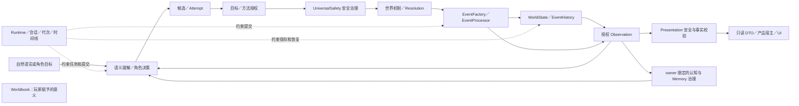

# CognitiveWorld 系统架构总纲

CognitiveWorld（CW）是以自然语言交互的持久认知多智能体世界模拟系统。系统允许玩家与自主角色提出开放式意图，但世界中究竟发生了什么，由受约束的裁定、正式事件和规范状态共同确定。它的连续性来自稳定身份、可核验的因果历史、角色各自的认知，以及与时间线绑定的恢复边界；叙事文字和模型建议均不自行生成事实。

本文是系统结构视图，不替代 [ARCHITECTURE.md](ARCHITECTURE.md)、[DATA_CONTRACTS.md](DATA_CONTRACTS.md)、[ENGINEERING_RULES.md](ENGINEERING_RULES.md)、[MEMORY_DESIGN.md](MEMORY_DESIGN.md)、[SOCIAL_CAUSAL_DESIGN.md](SOCIAL_CAUSAL_DESIGN.md) 和 [AI_BOUNDARY.md](AI_BOUNDARY.md) 的详细规范。[REPOSITORY_STATUS.md](REPOSITORY_STATUS.md) 与 [DEVELOPMENT_ROADMAP.md](DEVELOPMENT_ROADMAP.md) 仅用于辨明设计与实现的边界，不决定本文的组织顺序。下文分别标明已有的窄路径、已批准但未完整实现的设计，以及尚待确认的方向；存在契约或接口不等于全域能力已经完成。

## 核心原则与架构边界

[Core Doctrine](COGNITIVEWORLD_CORE_DOCTRINE.md) 是本总纲的概念基础，规定未来实现必须保持的不变量；本总纲继续解释子系统结构，具体权限、数据与恢复能力仍以各详细契约为准。原则要求不等于当前能力已实现，也不批准新的结果观察规则、消费证明或持久化 schema。

| 核心原则 | 在本总纲中的职责映射与边界 |
|---|---|
| [I — 世界权威独立于模型表达](COGNITIVEWORLD_CORE_DOCTRINE.md#principle-i--world-authority-is-independent-of-model-expression) | §2、§5–§7：WorldState、Resolution、EventProcessor 与 Presentation 分离；实体提及、Worldbook 和叙事不取得事实权威。 |
| [II — 角色拥有独立认知](COGNITIVEWORLD_CORE_DOCTRINE.md#principle-ii--cognitive-agents-own-distinct-cognitive-states) | §3、§9：owner 限定的 Belief、Goal、Memory 与授权 Observation 保持不同含义；按需模拟不得任意丢失重要身份与经历，保存仅覆盖已定义记录。 |
| [III — 每次行动重建推理上下文](COGNITIVEWORLD_CORE_DOCTRINE.md#principle-iii--reconstruct-the-reasoning-context-for-every-action) | §3–§4：从当前获准认知与相关证据派生 DecisionContext／模型输入，保留来源、时间和未知；上一轮模型文本不是默认记忆，也不要求每次调用模型。 |
| [IV — 模型提案，确定性机制执行权威](COGNITIVEWORLD_CORE_DOCTRINE.md#principle-iv--llms-propose-deterministic-mechanisms-enforce-authority) | §4–§6、§9–§10：语义解释不替代授权、Safety、机制检查、Resolution 或当前代次的最终提交；CPU 执行本身也不是正确性证明。 |
| [V — 认知修订须有证据与治理](COGNITIVEWORLD_CORE_DOCTRINE.md#principle-v--cognitive-revision-requires-evidence-and-governance) | §3、§5、§9：预期、实际结果、主体获准观察、必要消费证明及认知修订分开。既有门锁惩罚不是通用学习；可恢复执行反馈闭环仍不完整。 |
| [VI — 计算投入服从认知需要](COGNITIVEWORLD_CORE_DOCTRINE.md#principle-vi--computational-effort-must-follow-cognitive-need) | §6、§8：认知功能层、混合计算层级、空间三层与独立 LOD 轴分别负责不同问题；距离／角度／重要性是调度线索，不授予权限或改变事实。统一跨域协调仍属目标。 |

上述映射是原则约束，不新增模块或接口。通用反馈关联、结果消费证明扩展、空间求解与跨域预算机制仍需各自的正式设计、治理和恢复验证。

## 1. 权威关系与系统闭环

从职责与权威关系看，CW 可以概括为四类相互协作的边界：世界权威，角色认知与决策，应用与运行时协调，以及安全呈现与客户端。数据在这些边界之间流动，权威不随数据复制。WorldState（规范世界状态）是当前世界事实的权威来源；EventHistory（事件历史）记录已处理事件及其可核验证据；角色的 Belief（信念）、Goal（目标）、Memory（记忆）等由既有的 owner 限定认知 Store 管理；Presentation（可信呈现）向 UI 交付受限的只读投影。见 [ARCHITECTURE.md](ARCHITECTURE.md#current-committed-product-boundary-2026-10-22) 与 [DATA_CONTRACTS.md](DATA_CONTRACTS.md#15-data-authority-rules)。

图示为主要权威关系，独立画出的 Worldbook 不具有直达事件、认知或事实展示的通路。每次输入不必经过所有节点：只读查看、澄清、安全拒绝、未知机制及无结果反馈有各自的非事实出口。已验证的言语投递可记录“说了什么、谁听见了”，却不证明话语内容为真，也不等同于一般物理行动的 Resolution。所有会改变 WorldState 的运行时效果都必须通过正式事件提交。见 [ARCHITECTURE.md](ARCHITECTURE.md#6-event-system) 与 [SOCIAL_CAUSAL_DESIGN.md](SOCIAL_CAUSAL_DESIGN.md#route-a-persuasion--recipient-owned-cognition)。

## 2. 世界状态、身份与机制

**WorldState／World Core。** 其目的是保存当前规范事实，包括实体、地点、关系、环境状态及结构化、带版本的 WorldNorms。输入是受信任的初始世界／恢复数据，或 EventProcessor 交付的有效 WorldUpdate；输出是供因果裁定使用的权威状态读取，以及经独立授权后形成的观察和展示材料。Entity 提供稳定身份；Agent 是可参与自主决策的世界实体，Character 还具有叙事身份。这是身份与能力的关联，不要求一个运行时继承树；暂时失能不改变身份。WorldState 不保存角色的私有记忆、信念或人格，也不从描述文字推导实体已存在。初始化入口不充当运行时写入口；运行时状态变化只由 EventProcessor 在受控提交范围内应用。见 [ARCHITECTURE.md](ARCHITECTURE.md#4-world-core)。

**世界机制与规则。** 已安装的机制读取当前权威状态、Attempt 及必要的类型化证据，产生有界评估或候选效果，再由 Resolution 判断是否足以确认。环境机制、实体状态、位置和关系是不同的世界数据；当前 Entity 的稳定 ID、类型、属性／状态映射与现有类型化环境记录并未组成通用组件图。WorldNorms 描述世界中的法律、习俗和管辖规则；它们不是安全政策，也不能单独判定行动失败、定罪或触发惩罚。没有覆盖某种机制、证据不足和已核实的硬约束禁止，是不同结论。未安装的组合或自然语言上似乎可行的效果不得靠模型补成既成事实。通用实体组合、关系图及统一实体状态槽仍是拟议或设计方向，不是当前基础设施。见 [ARCHITECTURE.md](ARCHITECTURE.md#entity-composition-declarative-json-and-mechanisms-proposed-evolution-not-implemented)、[ENGINEERING_RULES.md](ENGINEERING_RULES.md#open-exploration-and-cpu-information-governance)。

**五种意义不可混用。** 世界事实是当前 WorldState 与已核验事件所支持的客观记录；角色认知是该角色持有的主观经验和判断；Worldbook 是玩家保存的理解、创作与意义；叙事解释是对获准材料的组织或假设；界面展示是面向特定接收者的受限投影。实体名称、世界设定文本、Memory 来源 ID、Worldbook 条目、模型输出或 UI 文案，均不能单凭自身获得世界事实权威。一个已存在的公共规则也不会自动成为每个角色的知识；各角色须走自己的 Observation 和认知路径。

## 3. 观察、认知、自主角色与社会因果

**Observation／感知。** Observation 把特定世界发生事实转换为某个主体获准获得的信息。其输入是处理后的 Event、明确的可观察事实、主体身份、可见性及源证据；输出是限定观察者和来源的 Observation，再经 L1 感知成为 Percept。Observation 不改变 WorldState，不等于所有角色共享的公告，也不因存在于 ObservationStore 就自动受信任。不同角色可以对同一事件得到不同观察；后续检索和决策还要复核 owner、来源、时间和当前 Runtime 绑定。见 [ARCHITECTURE.md](ARCHITECTURE.md#observation-layer)。

**Cognition／Memory。** Cognition（角色认知）管理私有的 Personality（人格倾向）、Belief、Goal、SelfModel（自我模型）、Emotion（情绪）、WorkingMemory（工作记忆）和由 MemoryStore 唯一持有的长期 Memory；各记录保持既有所有权，不在 Entity 或另一个 Store 中建立副本。输入是该 owner 实际消费的 Observation、获准的自身记录和受治理的更新提案；输出是不可变的决策快照、候选认知变更和角色自己的后续判断。L1 Perception 从可信 Observation 形成 Percept；L2 WorkingMemory 暂存当前线索；L3 长期 Memory 按角色关联与检索预算带回相关经历；L4 Belief／SelfModel 表示可与世界事实不同的理解；L5 Metacognition（元认知）可在回合内提出另一轮有界检索或复核。该过程允许目标引导注意、检索反馈改变本回合上下文，并非严格单向流水线。Emotion 与由 Goal 等导出的 Motivation（动机评估）跨层调节候选的关注和评估，但不是新的认知层或物理裁定。认知更新必须经相应的提案、验证与应用边界；Memory 另经决策授权、写入请求、源事件和当前历史复核后才能进入 MemoryStore。角色的错误信念和记忆不写回 WorldState。见 [ARCHITECTURE.md](ARCHITECTURE.md#32-cognitive-process-model)、[MEMORY_DESIGN.md](MEMORY_DESIGN.md#17-memory-authority)。

**混合认知的计算层级。** 上述 L1–L5 是认知功能层；长期架构另以确定性快速路径、结构化认知、可选的 LLM 辅助高层推理三档组织计算投入。前者负责已知事实查询与规则检查，中者处理本角色的信念、目标、计划、预期、检索和执行监测，后者为开放语义、复杂假设或社会情境提出有界候选。三档可在同一回合协作，不要求每个 NPC 行动调用模型，也不产生第二套认知状态。何时升级由不确定性、任务复杂度、重要性与因果影响共同提示；统一选档策略尚未实现。无论使用哪档，只有获准证据可进入本角色决策，模型建议仍须验证。见 [ARCHITECTURE.md](ARCHITECTURE.md#hybrid-cognition-execution-levels-architectural-direction-unified-policy-not-implemented)、[AI_BOUNDARY.md](AI_BOUNDARY.md#40-hybrid-cognition-allocation-architectural-direction)。

**AgentDecision／自主行动。** AgentTurn 从当前 owner 的 Percept、WorkingMemory、Character 关联的 Memory 及其 Belief、Goal 等构造有界 DecisionContext；检索只定位可能相关的规范记录，不赋予额外读取权，也不证明内容为真。AgentDecision 评估和选择 ActionProposal，转成 Attempt 后仍须经过 Safety、Resolution 和事件链。玩家决策从玩家输入与授权目标上下文进入，同角色决策在 Attempt 边界汇合，不能把系统级或其他角色的私有资料混入某一 NPC 的决策。Runtime 可调度角色，但调度次序和预算不指定角色的行为。见 [ARCHITECTURE.md](ARCHITECTURE.md#decision-layer)、[DATA_CONTRACTS.md](DATA_CONTRACTS.md#phase-126-autonomous-runtime-contracts)。

**按需涌现与连续性。** 文字交互世界无需持续高精度运行每个潜在 NPC。角色模板是可复用的初始结构，候选角色或叙事提及尚不是世界实例；经内容校验、受控初始化或正式安装的 CharacterInstance 才拥有稳定世界身份、其 owner 限定的认知归属及可追踪的关系。模板不能携带另一实例的 Memory、Belief、私有经历或 EventHistory。已经参与重要事件、形成关系或掌握关键信息的角色，即使离开当前交互范围，仍需保留适用的规范身份与关系、已提交历史、来源关联及其已获授权持有的认知；未观察的事件不能在再次出现时补写成其经历。再次投入计算时应从同一身份的权威状态与本角色现存认知组装上下文，而非无历史重造。剧情锚点、目标关联和可能影响可以提高关注与候选探索投入，却不命令角色采取预定行为。当前存在注册角色的有界回合、关联模板与局部预算；通用潜在 NPC 生成、动态唤醒、退活及跨范围状态恢复策略尚未正式确立。见 [ARCHITECTURE.md](ARCHITECTURE.md#cognitive-lod-approved-design-not-implemented)、[ARCHITECTURE.md](ARCHITECTURE.md#reusable-content-generation-principle-planned)、[MEMORY_DESIGN.md](MEMORY_DESIGN.md#phase-16-dynamic-character-cognition)。

**Memory 与社会传播。** EventHistory 是可核验的发生记录；Memory 是特定角色对经历的主观保留，须带来源与 owner 约束，来源 Event ID 不能给记忆内容盖真值印章。重要性判断、压缩与遗忘属于长期记忆的设计策略；当前没有自动完成这些策略的通用治理，正式写入仍需明确政策与授权。检索相关性与信心、真实性无关。言语事件可以证明说话与投递，接收者只有在自己的授权观察经 L1 消费后，才可能独立审视主张和修订既有 Belief。真话被拒绝、假话被相信、证据不足、角色间信息不对称或蓄意欺骗，均可作为世界中的持续状态；系统只应保留其来源、时间和不确定性，不能强迫一致。客观关系状态若要改变，仍须另有受支持的类型化因果规则和正式事件；单方情绪、Goal 冲突发现或言语承诺本身不完成该变化。见 [MEMORY_DESIGN.md](MEMORY_DESIGN.md#15-character-memory-vs-world-memory)、[SOCIAL_CAUSAL_DESIGN.md](SOCIAL_CAUSAL_DESIGN.md#relationship-consent-and-authority)。

**可追溯的认知反馈目标。** 预期闭环是获准感知／证据 → Belief／Goal 评估 → 意图／计划与 ActionProposal → 授权／Resolution → 正式 Event／适用时的 WorldState 变化 → 本角色在获准时观察实际结果 → 预期与结果比较 → 对具体 Memory、Belief、方法或因果假设提出受治理的更新 → 后续决策。提案中的证据与预期、实际裁定及后续观察须保持各自来源，不能用“模型认为成功”代替正式结果，也不能把未观察的结果写成角色经历。部分成功、意外后果、失败和未解决均可能促使有界复核；差异不会自动修正所有相关信念。现有锁门失败 BehaviorFeedback 仅验证一类窄适应，不等于通用学习闭环。详见 [MEMORY_DESIGN.md](MEMORY_DESIGN.md#cognitive-feedback-and-evidence-provenance-architectural-direction) 与 [SOCIAL_CAUSAL_DESIGN.md](SOCIAL_CAUSAL_DESIGN.md#social-dynamics-information-asymmetry-and-bounded-attention)。

## 4. 自然语言、语义拆解与意图理解

**语义理解的输入和输出。** 玩家自由文本进入受信任的会话与安全入口，解释器只能取得当前请求获准的角色／玩家上下文与候选目标。权威设计把理解结果概括为目标、对象、动机与方法偏好，并以 Intent（意图：想达成什么）和 Attempt（尝试：准备用什么方法）区分目的和执行。开放式 ActionProposal（行动提案）可以保留行为文字、目标、工具、方法、前置条件、条件步骤、期望效果和不确定性；有序步骤不是预先确认的结果。同一 Intent 可产生不同 Attempt，输入不能退化为“文本 → 固定动作 ID → 执行”的封闭命令表。见 [ARCHITECTURE.md](ARCHITECTURE.md#31-semantic-understanding)、[ARCHITECTURE.md](ARCHITECTURE.md#open-ended-action-semantics-approved-design-npc-proposal-support-implemented)、[DATA_CONTRACTS.md](DATA_CONTRACTS.md#4-intent-contract)。

**语义帧与真实契约的界线。** 已批准的长期设计可把一句话抽象成主体／行动谓词／对象或参数，加上时间、地点、关系、约束、前提、步骤及未知项；这只是跨语言的工程语义框架，不是现行统一中间表示，也不要求所有语言符合一种语法。当前运行时 Attempt 仍保留开放文本与目标引用；`object:{id}`、`agent:{id}` 是引用命名空间，不是实体存在、类型、可见性或权限的证明。现有窄路径支持请求内授权 Observation 所导出的目标句柄和已安装机制提供的方法候选；`agent:` 目标的一般因果裁定、开放词汇绑定及通用歧义修复尚未建立。不能因为模型识别出一个名称、写出完整语义帧或预测成功，就据此实例化对象、授予目标访问权或确认效果。见 [ARCHITECTURE.md](ARCHITECTURE.md#open-natural-language-action-representation)、[DATA_CONTRACTS.md](DATA_CONTRACTS.md#runtime-compatibility-and-future-target-namespace)、[DATA_CONTRACTS.md](DATA_CONTRACTS.md#host-bound-player-request-and-ui-boundary-current-narrow-slice)。

**歧义与缺口。** 玩家侧先从自己的授权 Observation 建立请求内候选，解释器可在其中选择，服务层还要复核句柄、方法、真实目标、会话／代次及当前状态。角色侧候选来自该 owner 的 DecisionContext，而非全局 WorldState。指代不明、必要条件缺失或目标未知时，保留多个解释、请求澄清，或在现有权限和预算允许的范围内继续取证；不能用隐藏状态或模型猜测补齐。当前分类区分行动、只读查看、不可解析、需澄清与提供者故障；澄清状态是会话／代次限定的暂态，不创建 Attempt 或 Event。语义明确但机制未安装仍可能未解决；权限拒绝、安全拒绝、已核实的因果禁止又各有不同依据。CPU 证据治理、Safety、世界机制和 Resolution 分别回答“知道什么”“能否受理”“如何评估”“实际结果为何”，语义理解只提出候选。见 [ARCHITECTURE.md](ARCHITECTURE.md#raw-input-classification-and-clarification-d331-narrow-slice)、[DATA_CONTRACTS.md](DATA_CONTRACTS.md#task-context-information-gaps-and-exploration-approved-requirements-unified-api-not-implemented)。

## 5. 行动、事件与因果历史

**意图理解和授权。** 自然语言先被解释为 Intent 或候选行动，不能直接当作命令。玩家侧需以当前授权 Observation 约束目标候选，再检查目标、方法、会话与代次；模型选择的句柄不是许可。安全治理是跨输入、Attempt、事件签发和输出的独立约束，不能被世界文档或角色目标关闭。安全拒绝只处理输入／展示，不产生世界 Event、罪责、NPC Memory 或关系后果。见 [DATA_CONTRACTS.md](DATA_CONTRACTS.md#2-core-data-flow)、[ARCHITECTURE.md](ARCHITECTURE.md#safety-conflict-and-world-law-responsibility)。

**Attempt／Resolution／EventProcessor。** Intent 是目的；Attempt 是带方法、目标和期望效果的具体尝试；模型建议和 ActionProposal 仍是候选。Resolution 读取其获准的权威证据和已安装机制，给出支持的结果、明确失败、证据不足或未解决状态，不直接写世界。EventFactory 对确认结果签发有来源和证据绑定的 Event。EventProcessor 检验并调度类型化处理器，在 Runtime 提交约束内把有效更新交给 WorldState，并把成功处理的 Event 及处理证据纳入 EventHistory。处理器不重新决定结果；候选树、叙事生成器、NPC 或 UI 均不能绕行这条链。见 [ARCHITECTURE.md](ARCHITECTURE.md#5-resolution-system)、[ARCHITECTURE.md](ARCHITECTURE.md#event-application)。

**因果约束。** 世界更新须能追到正式事件、其所依据的 Attempt／裁定及被核验的状态证据。CausalGraph 的链接记录显式提供的事件间关系，不从事件先后或文字相似性自动推断因果。当前值的来源、事件处理证据和 EventHistory 各有不同证明范围；某个状态快照不证明任意过去区间里没有变化。失败、未解决或仅预期的后果不能被叙事、记忆压缩或后续步骤当作已发生。已提交事件可以影响之后的状态与观察，角色只有经自己的授权信息路径才能据此调整行为。见 [DATA_CONTRACTS.md](DATA_CONTRACTS.md#12-causal-link-contract)、[ARCHITECTURE.md](ARCHITECTURE.md#persistence)。

## 6. 物理机制、世界约束与因果裁定

**现有机制的位置。** 物理评估属于世界机制向 Resolution 提供证据与候选效果的范围，不是第二个世界写入器。当前窄域以 Attempt 绑定的目标、角色位置／能力、工具身份和类型化门／通道状态组装临时的 `CausalWorldContext`，处理已安装的门操作与已知通道移动；它不复制整个 WorldState，也不宣称具有通用力学或所有物体的交互规则。角色的主观 Memory 不充当物理证据，NPC 对环境的了解须另经授权 Observation；系统为裁定读取的客观状态不因此自动成为 NPC 知识。缺目标、状态、能力、时间或机制证据时，保留未解决。见 [ARCHITECTURE.md](ARCHITECTURE.md#stable-interaction-references-and-dynamic-minimum-interaction-context)、[REPOSITORY_STATUS.md](REPOSITORY_STATUS.md#hybrid-physical-engine-and-adaptive-lod--architecture-approved-not-implemented)。

**可组合机制的长期方向。** 已安装的类型化状态、属性、能力、前置条件、空间关系与状态转换可共同约束行动效果，避免为每种自然语言说法设一条特例规则。开门与穿过通道仍是不同机制：门打开不证明有可通行目的地。通用机制组合、开放对象规则发现与刚体求解都尚未实现；任何新组合只有在证据、适用规则与正式裁定支持时才可成为世界变化。见 [ARCHITECTURE.md](ARCHITECTURE.md#hybrid-physical-engine-and-independent-lod-axes-approved-design-not-implemented)。

**已批准但未完整实现的混合物理设计。** 设计将离散类型化状态规则、有适用范围的简化连续近似，以及影响关键 Event 时更严格的确定性接触／约束检查组合起来。结构、材料、形状、质量类阻力、摩擦、弹性、强度和环境条件是受支持的接收方规则可能读取的类型化输入，不是当前 Entity 已具备的通用参数全集。规范世界坐标与观察者局部投影须分离；力类尝试如要受理，需有量值、方向／坐标系、作用点或区域、时长／冲量及单位等可核验含义。具体求解器、材料响应和多体传播尚无通用实现；未知组合不能由语言模型直接确认。通用组件组合与独立部件关系仍是拟议表示方案，不能据此断言 ECS 已确立。见 [ARCHITECTURE.md](ARCHITECTURE.md#hybrid-physical-engine-and-independent-lod-axes-approved-design-not-implemented)、[ARCHITECTURE.md](ARCHITECTURE.md#entity-composition-declarative-json-and-mechanisms-proposed-evolution-not-implemented)。

**物理评估与提交。** 已批准的精度分层允许粗检查先找潜在作用对象，再对可能改变重要结果的接触、约束或阈值升级核查；低高精度结果相冲突时，低精度判断只能作为建议。物理轴可选择模型、频率、步长和容差，必须把评估限定于同一 Attempt、可信 tick、状态读取、规则版本及不确定性。Resolution 独立核实适用性、证据与硬约束，确认后才由 EventFactory／EventProcessor 将类型化效果和状态来源纳入世界历史；过期状态要重评或保持未解决。预算不足不能以较便宜的近似结果替代正式判断。存档与分叉须验证这些正式事件及状态来源，不能把未提交的求解候选当作可恢复历史。该流程是已批准的机制边界，不表示通用物理精度梯级和升级协调器已运行。见 [ENGINEERING_RULES.md](ENGINEERING_RULES.md#hybrid-physical-engine-and-independent-lod-axes-approved-design-not-implemented)、[DATA_CONTRACTS.md](DATA_CONTRACTS.md#task-context-information-gaps-and-exploration-approved-requirements-unified-api-not-implemented)。

### 空间权威、主体投影与自适应调度

这三层是对已批准空间与独立 LOD 边界的职责视图，**不是当前已实现的通用空间服务或统一调度器**。规范空间世界在 WorldState 的权威坐标系中维持实体的稳定身份、绝对位置与朝向；既有设计的初始坐标框架为可配置的三维笛卡尔系。空间关系、场景连通性及适用的物理约束须有相应的权威状态和类型化机制依据；叙事描述不能自行建立可通行拓扑。切换观察者或行动主体本身不移动实体。移动等空间更新仍经授权、Resolution、正式 Event 与 EventProcessor 提交。当前门与已知通道路径主要使用地点身份及类型化状态，尚无通用三维位置／朝向原语。见 [ARCHITECTURE.md](ARCHITECTURE.md#hybrid-physical-engine-and-independent-lod-axes-approved-design-not-implemented)、[ARCHITECTURE.md](ARCHITECTURE.md#worldstate-authority)。

主体中心的空间投影是对同一规范世界快照的派生查询，不拥有另一套位置真值。以当前查询或行动主体 $a$ 为原点、目标实体为 $e$；在选定的水平面上，取两者规范位置的平面分量 $\mathbf p_a=(x_a,y_a)$、$\mathbf p_e=(x_e,y_e)$，以主体规范朝向在该平面上的航向角 $\phi_a$ 为参考，则

$$
r_{a,e}=\lVert\mathbf p_e-\mathbf p_a\rVert,
\qquad
\theta_{a,e}=\operatorname{wrap}\!\left(\operatorname{atan2}(y_e-y_a,x_e-x_a)-\phi_a\right).
$$

这里的 `wrap` 把角度规范到一致区间，例如 $[-\pi,\pi)$。$r_{a,e}$ 是**平面**相对距离，$\theta_{a,e}$ 是相对方位；投影必须使用同一世界快照／tick，并遵守规范坐标系声明的轴向、手性、单位和版本。高度或仰角在有适用机制时另行处理，不能用平面距离代替完整三维约束。改变主体只重算原点与朝向下的投影，不改规范坐标，也不克隆世界或为每个主体维持独立世界。位置／朝向未知或过期时，相关投影应保持未知并按现有证据边界处理。相对距离与方位可供方向关系、空间相关性和感知计算使用，但投影自身不是授权 Observation；视野只是视觉通道的条件，听觉与角色已获知的记忆各走自己的信息路径，视野外也不等于世界不可达或角色必然无知。

自适应调度层读取上述派生关系及权威因果关联，决定**请求多少计算精度**，不裁定事实。其概念接口可写为 $L(a,e)=F(r_{a,e},\theta_{a,e},I_e,C_e,\ldots)$：$I_e$ 表示实体／事件重要性，$C_e$ 表示因果耦合或下游影响；角度与感知相关性、当前认知／模拟需求及可用预算也参与判断。此式不规定权重、阈值或数值保证。调度策略可分别请求认知、感知或物理轴提高精度，却不能越过信息权限、物理约束、Resolution 或正式事件边界。远处甚至视野外的高影响事件仍可能需要细致模拟；近处对象也不会仅因距离而自动获得全部精度。降低细度可以减少计算，但不能抹去稳定身份、已提交历史及后续必须履行的因果约束；证据或预算不足时保持未解决。已批准设计允许独立 LOD 轴及共享预算的方向，跨域统一调度仍未实现。见 [ARCHITECTURE.md](ARCHITECTURE.md#simulation-lod)、[ARCHITECTURE.md](ARCHITECTURE.md#hybrid-physical-engine-and-independent-lod-axes-approved-design-not-implemented)。

## 7. 世界书、叙事组织与可信呈现

**Worldbook（世界书）。** 其正式定义是面向玩家的情感连接和意义收藏层，可保存世界传说、玩家笔记、档案、收藏与有意义的记录。它属于玩家如何理解、创作和纪念世界的外部视角，不是 WorldState、Entity 或角色 Memory；也不直接驱动世界运行。Worldbook 本身不是 Prompt 层。玩家写下一段补充设定、对事件的解释或长期备注，说明玩家表达了什么，不证明对应实体已安装、事件已发生或 NPC 已获知。若用户希望让其中某项描述产生世界效果，仍需将其作为受审查的内容／行动候选，经过适用的身份、授权、机制和正式事件路径。世界书与规范事实矛盾时，应保留“玩家描述或待核实主张”与“已核验事实”的不同来源，不能让文字覆盖状态。见 [ARCHITECTURE.md](ARCHITECTURE.md#worldbook-layer)。

现有权威文档尚未规定 Worldbook 条目的正式数据模式、写入权限、检索算法、提示构建入口、与 NPC 认知的信息传播路径，或存档／时间线的继承隔离契约；仓库也未出现独立的 Worldbook 实现。当前架构尚未定义其内容自动注入模型上下文的正式契约；任何此类集成都必须明确接收者、用途、信息权限及与规范世界事实的边界。因而本文不声称条目会自动进入 Prompt、Narrative、Observation 或 Memory。即使 NPC 读到了文本，其所听／所读、理解、相信和客观真实性仍是不同事情。世界书的可能持久化不能直接套用已定义的 Memory 或 WorldState 快照生命周期。这些连接属于待确认的接口边界，而不是本总纲新设的数据流。

**叙事组织。** Narrative Layer／Narrative Pressure（叙事层／叙事压力）是发现冲突、机会、可延展线索与值得关注候选的设计范围；已有 `ConflictOpportunityScheduler` 仅有界地提供角色本地目标张力、已观察机会及最小跨角色目标资源比较。Event Tree 的懒展开用于候选诊断，不是另一个已经发生的时间线；冲突发现不证明实际争斗、资源匮乏或另一角色已知情。剧情锚点和有意义的支线可以提高相关角色、事件和信息的探索价值，不能决定某个 NPC 必须合作、敌对或按剧本行动。具体可交互的人、物、线索或变化若被当成世界元素呈现，须有相应权威身份／状态或正式安装与事件依据。见 [ARCHITECTURE.md](ARCHITECTURE.md#8-narrative-pressure-layer)、[ARCHITECTURE.md](ARCHITECTURE.md#narrative-causal-relevance-planned)、[SOCIAL_CAUSAL_DESIGN.md](SOCIAL_CAUSAL_DESIGN.md#social-dynamics-information-asymmetry-and-bounded-attention)。

长期叙事涌现来自不同角色的信念／目标／计划、环境和物理机制、社会信息传播、正式事件后果及有界探索之间的相互作用；叙事目标只影响候选关注与计算投入，不拥有行动或事实权威。《灰域之外》（*Gray Domain Beyond*）现以复用门与通道机制的默认世界预览提供，保留 `rain-harbor` 内部身份以兼容旧存档；其序章属于经安全检查的设定展示，不写入角色经历或世界事实。天意、五界、灰域、腐化与竞争锚点等主题若要产生效果，仍须另行定义受审查的世界配置、类型化机制和因果约束。这些主题机制尚未实现，也不能使 Core 固化为只支持这一设定；见 [ARCHITECTURE.md](ARCHITECTURE.md#gray-domain-beyond-world-content-authored-preview-mechanisms-not-implemented)。

玩家可见内容沿“已验证事实／Event → 接收者获准的 Observation → 受限事实投影 → Presentation 校验 → 展示 DTO／Gateway”流动。Presentation 的输入须保持接收者、来源与会话绑定；它既不能读取并泄露私有认知、Emotion 数值、决策轨迹、Prompt 或调试对象，也不能用安全化措辞抹掉确认的后果，或暗示未确认的结果。只读查看、澄清、玩家输入回显和未验证探索建议须保留各自的非事件语义。文本是输出，不回流成 Resolution 或 WorldState 的事实输入。现有受信任展示路径覆盖有限事实类型，不能由其存在推断通用叙事授权已完成。见 [ARCHITECTURE.md](ARCHITECTURE.md#trusted-player-presentation-and-chat-output-phase-120d-narrow-slice)、[ENGINEERING_RULES.md](ENGINEERING_RULES.md#phase-125c-p0-safety-conflict-and-worldnorms-rules)。

## 8. 有限预算下的自适应模拟

LOD（模拟细度分配）跨越空间模拟、角色推理、感知信息与因果评估，不是单个模块的性能开关。局部对象可获得较细处理，区域与全局过程可摘要或延后；Event Tree 只展开与当前问题相关的候选。玩家交互、重要角色、目标、剧情锚点、已观察机会和潜在因果后果解释**为何值得关注**；任务的信息需求、权限与证据充分性决定**可用什么材料**；预算分配与各 LOD 轴决定**何处、何时、用多细的计算**；Resolution 决定**能否确认效果**。这些是互相提供信号的职责，而非统一的剧情分数或裁定模块。现有 Agent／Event 调度、owner 限定检索轮次与结果上限、候选树和模型调用限额只构成局部预算；跨任务总预算与通用三轴协调尚未实现。见 [ARCHITECTURE.md](ARCHITECTURE.md#world-dynamics-task-information-and-bounded-exploration)、[ARCHITECTURE.md](ARCHITECTURE.md#10-simulation-strategy)、[REPOSITORY_STATUS.md](REPOSITORY_STATUS.md#world-dynamics-and-task-information-source-checked-inventory-2026-10-22)。

已批准的 LOD 设计将认知、感知和物理计算精度分开：认知轴调整某角色的推理投入，感知轴调整已授权信息的生成／细度，物理轴调整有界机制评估的精度。它们可以共享预算约束，却各自保有输入、升级理由与结果边界。精度降低不授予隐藏信息、不改写 Belief，也不删除正式事件、重要身份关联和必须维持的因果后果；当低精度无法可靠判断高影响效果或硬约束时，应局部升级核查，预算仍不足则保持未解决。距离只是选择线索之一，相关性、状态约束敏感度、不确定性与后果严重度同样影响投入。见 [ARCHITECTURE.md](ARCHITECTURE.md#hybrid-physical-engine-and-independent-lod-axes-approved-design-not-implemented)、[ARCHITECTURE.md](ARCHITECTURE.md#cognitive-lod-approved-design-not-implemented)。

在已批准三轴之上，统一自适应预算协调仍是**未来方案**：它可综合空间和感知相关性、认知需求、社会因果复核、Memory 检索／更新、物理机制精度及 Event Tree 展开，并考虑不确定性、重要性、因果耦合、下游后果与成本。协调只分配工作和请求局部升级，不合并各域的授权、所有权或裁定；远处重要事件仍可获较细检查。当前没有跨域资源账本、统一冲突算法或生产协调器，不能把该方向写成已运行的自动策略。见 [ARCHITECTURE.md](ARCHITECTURE.md#world-dynamics-task-information-and-bounded-exploration)。

**待确认的跨域精度策略。** 将状态冲突普遍作为精度升级触发器，并沿角色、事件、信息来源、关系和世界机制的关联局部扩展，是与现有证据缺口、Goal 冲突候选、LOD 升级及有界探索相容的方向。例如，Belief 与独立证据不符、记忆表述与已核验事件不符、Goal 与候选行为张力、物理候选效果与当前状态冲突，分别可能需要不同责任域复核；并非一个自动纠错队列。权威文档尚未给出统一冲突类型、传播规则、资源账本或生产协调器。冲突分析只标记需要复核的条件，信息治理核定可访问证据，预算策略决定是否扩展，认知治理判断是否修订主观状态，机制与 Resolution 裁定实际效果。升级精度也不必消除主观矛盾：可信的不同观察、错误信念、欺骗与未知状态可以并存。因果影响越大，对证据、规则、状态来源及提交时效的要求越严格；预算剪枝、资料缺失、机制未覆盖和已核实的不可能须保留不同结论。按需深化或降低某 NPC／对象的计算投入时，必须回到相同权威身份、规范记录与事件历史，不建立影子世界或重置经历。见 [DATA_CONTRACTS.md](DATA_CONTRACTS.md#task-context-information-gaps-and-exploration-approved-requirements-unified-api-not-implemented)、[SOCIAL_CAUSAL_DESIGN.md](SOCIAL_CAUSAL_DESIGN.md#social-dynamics-information-asymmetry-and-bounded-attention)。

## 9. 运行时、并发、持久化与时间线

**Runtime／应用协调。** SimulationRuntime 管理模拟时钟、既有调度器、角色回合和事件分发，不持有第二套世界或认知规则。主机／应用服务管理玩家会话、请求身份、背景解释任务、候选与授权检查；耗时模型工作是可取消或过期的建议计算，不占有最终提交许可。RuntimeWriteFence 将原始 session、restore generation 与写入 permit 绑定到工作，并在最终提交时核验；代次推进、取消和提交在同一边界排序。晚到结果不能借新 permit 写入旧世界。玩家任务的执行状态与 Presentation 投递状态独立；已提交到达结果的投递重试复核原行动 Event 的完成状态及当前展示授权，不重新解释输入、运行移动 Resolution 或重复提交移动 Event。若目的地的类型化机制观察尚缺，重试可在原 Runtime 许可和 EventProcessor 边界内另行签发 `environment_state_observed` 系统 Event；只有经授权的 Observation 才能进入候选与 Presentation。见 [ARCHITECTURE.md](ARCHITECTURE.md#runtime-write-fencing-narrow-in-process-foundation)、[ARCHITECTURE.md](ARCHITECTURE.md#framework-neutral-core-and-asynchronous-host-boundary-approved-constraint-implementation-partial)。

**保存、恢复、分叉。** Timeline 是历史分支，save slot 是指向可恢复检查点的引用，live session 是当前 Runtime；三者不互相代替。规范快照、认知快照、EventHistory、状态槽来源及签名 Bundle／祖先关系需要共同验证，才能在隔离环境重建并发布活动 Runtime。恢复必须保留原时间线身份、已确认后果、owner 归属和已核验来源；分叉继承不可变祖先，子分支的事件、认知修订和状态变化与父／兄弟分支隔离。发布新 Runtime 后使用新的会话／代次，旧任务、暂存 Observation、L1 收据、候选树和界面投递状态不会自动成为恢复的世界事实。初始化／恢复与运行时 Event 写入是不同入口；签名和进程内防误用也不等于任意同进程代码或所有崩溃情形下的隔离保证。见 [ARCHITECTURE.md](ARCHITECTURE.md#timeline-save-slots-and-live-sessions-lifecycle-contract-backend-partial)、[ARCHITECTURE.md](ARCHITECTURE.md#timeline-aware-eventhistory-and-runtime-recovery-boundary)、[DATA_CONTRACTS.md](DATA_CONTRACTS.md#outer-snapshot-and-verification-boundaries)。

WorldState、EventHistory 与受管的角色认知各有已定义的快照／来源校验范围；Worldbook 尚无对应的正式持久化、恢复或分叉契约。因此恢复一个时间线不能推定玩家备注已按同一规则恢复或继承，也不能从存档中的世界事实反向构造 Worldbook 条目。

## 10. 产品宿主与界面边界

CW Core 拥有世界真相、角色认知、因果裁定、正式事件、安全、WorldNorms 及存档／时间线权威；产品网关和宿主负责装配已验证世界、配置 Runtime 与策略、调度异步任务及把受限结果交给客户端。桌面 UI 负责交互、导航和展开状态，通过稳定的只读 DTO 消费展示，不能导入或修改 WorldState、EventHistory、认知 Store 或存档内部对象。Core 与 Qt 解耦；宿主私有的装配能力不进入客户端 DTO。公共 WorldNorms 投影只暴露准许公开的规则，不把隐藏规则或规则知识自动写给玩家角色和 NPC。详见 [ARCHITECTURE.md](ARCHITECTURE.md#unified-cwcwui-product-boundary)、[DATA_CONTRACTS.md](DATA_CONTRACTS.md#client-dto-and-asynchronous-operation-contracts-approved-constraint-implementation-partial)。

桌面的序章与初始授权事实按队列动画展示，但保持各自来源；滚动跟随只影响阅读位置。管理操作须经独立确认：内置包隐藏只写本机界面偏好，运行实例丢弃通过会话关闭和写入栅栏且保留存档，手动存档删除通过 SaveManager 的签名目录与依赖保留；通用持久实例级联删除尚无正式目录支持。UI 将自由文本交给异步应用边界，并分别接收已授权事实、澄清、展示用叙述、进度和错误的有限 DTO；提交受理不代表行动成功。世界档案和导航属于客户端交互，但当前档案／状态页面不构成通用 EventHistory 浏览器，也不能由界面条目倒推角色已知内容。Worldbook 的正式编辑界面与其 Core 数据契约尚未确立，不能因 UI 有档案入口便假定已连接世界书。领域层回答世界发生了什么，应用层回答当前请求能访问和提交什么，Presentation 回答特定接收者可以看到什么；UI 展示的句子既不能产生事实，也不能自动启动角色认知生命周期。见 [DATA_CONTRACTS.md](DATA_CONTRACTS.md#current-anchor-desktop-host-contract)、[ARCHITECTURE.md](ARCHITECTURE.md#unified-cwcwui-product-boundary)。

Contact: ankorgine@outlook.com
