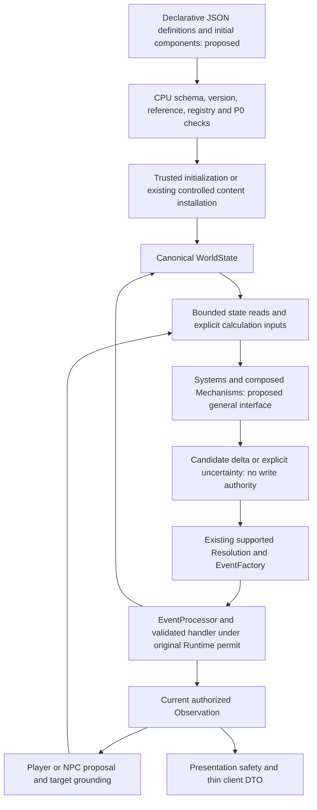

# CognitiveWorld — Canonical World and Declarative Content

> **Status: approved Phase 3B/3C excerpts migrated; excluded scope remains pending.**
> This is staged documentation migration, not new implementation or test evidence. Only explicitly marked source ranges have been copied.

The original [ARCHITECTURE.md](../ARCHITECTURE.md) remains byte-identical. Existing data, meta-contract and specialized definitions retain their frozen owners. Historical, held, reference-only and old-entry material is not implicitly migrated; source-stage descriptions remain qualified.

## Purpose

Canonical world and declarative content.

## Authority and scope

**Frozen authority level:** Domain architecture; exact records remain DATA_CONTRACTS.

**Assigned responsibility:** Identity, state, topology/relations, content preparation/installation and unresolved general materialization.

Only marked Phase 3B/3C excerpts have migrated. Detailed data contracts, meta-contracts and specialized normative definitions retain their approved owners.

## Concepts assigned by the frozen charter

- **A03 — WorldState current fact and identity authority**: Approved source excerpts are migrated only where marked; remaining scope and exact canonical contracts stay with their frozen owners.
- **A24 — World generation, content installation and materialization roles**: Approved source excerpts are migrated only where marked; remaining scope and exact canonical contracts stay with their frozen owners.
- **A28 — Canonical spatial position/topology and range domains**: Approved source excerpts are migrated only where marked; remaining scope and exact canonical contracts stay with their frozen owners.

## Out of scope

- Observer-owned perception, private cognition and player-facing interpretation.
- Adjudication, Event issuance and final world-effect submission.
- Detailed schema/signature contracts or a new general materialization protocol.

## Migrated excerpts and pending section outline

Marked Phase 3B and Phase 3C sections contain only approved source excerpts. All other ranges remain pending. Original stage/status labels are not new capability or test claims.

### ID 14 — Entity composition, declarative JSON and mechanisms (proposed evolution; not implemented)

<a id="arch-source-14"></a>

<!-- phase3c-begin:C-14-169-179 -->

<a id="arch-source-14-part-1"></a>

**Phase 3C source excerpt:** ID 14, lines 169–179 from [ARCHITECTURE.md](../ARCHITECTURE.md). Direct body only; child sections and excluded lines are not included.

**Source classification:** PLANNED. Original stage/plan/uncertainty limits are retained; this copy is not new runtime functionality or a new test result.

<!-- phase3c-source:C-14-169-179:169-179 -->

ECS is a **candidate representation model to validate**, not a description of the current engine or an instruction to replace Runtime. This direction refines the existing Entity-state/anti-enumeration design below. The four responsibility groups above stay unchanged: composition belongs within world modeling; Systems and Mechanisms calculate candidates; Resolution confirms supported outcomes; EventProcessor is the controlled commit boundary. No ECS Store, alternative world writer, new Runtime, or private-cognition copy is authorized. The proposed contracts are in [DATA_CONTRACTS.md](../DATA_CONTRACTS.md#proposed-entity-component-and-relation-contracts-not-a-runtime-api); staged acceptance is owned by `POST-MVP-07` in [DEVELOPMENT_ROADMAP.md](../DEVELOPMENT_ROADMAP.md).

| Concept | Proposed responsibility | Existing foundation and limit |
|---|---|---|
| Entity | Stable world identity, independent of name, temporary condition and capability | `core/entity.py` has `id`, `type`, attributes/state and explicit capability/safety fields. It is not a generic component container. |
| Component | Versioned, typed data describing state, properties, capability or relation endpoints under an explicit authority | Current Entity mappings and typed `DoorState`/`PassageState` are narrow records, not a general component schema/registry. Private Memory, Belief, Goal, Emotion and SelfModel remain in their canonical owner Stores. |
| System | Select eligible component inputs and compute bounded assessments or candidate deltas | Existing causal policies and `InteractionStateAggregator` are reusable seams. Their access to live state, clock, providers and orchestration does not establish functional purity or an ECS scheduler. |
| Mechanism | Replaceable, composable interaction calculation with declared inputs/outputs, applicability, constraints and version | Current `MechanismTemplate` and causal adapters support installed door/passage semantics; the template name does not imply a general mechanism framework. |
| Resolution / EventProcessor | Independently validate candidates, confirm supported effects, and apply authorized updates | Reuse Resolution confirmation, EventFactory, typed handlers, EventHistory and RuntimeWriteFence; a System result or JSON field is not confirmation. |


<!-- phase3c-end:C-14-169-179 -->


### ID 15 — Proposed loading and interaction flow

<a id="arch-source-15"></a>

<!-- phase3c-begin:C-15-181-202 -->

<a id="arch-source-15-part-1"></a>

**Phase 3C source excerpt:** ID 15, lines 181–202 from [ARCHITECTURE.md](../ARCHITECTURE.md). Direct body only; child sections and excluded lines are not included.

**Source classification:** PLANNED. Original stage/plan/uncertainty limits are retained; this copy is not new runtime functionality or a new test result.

<!-- phase3c-source:C-15-181-202:181-202 -->



The diagram overlays proposed representation/calculation stages on existing authority crossings; it is not an implemented ECS pipeline. Initial content is not a historical Event. Before Runtime starts, only the trusted initialization path may install validated initial data. Later creation or assembly changes require the applicable controlled content-installation or Resolution Event path. Editing JSON on disk never patches an active WorldState, changes an existing save, or proves that an Event occurred. Current `WorldPackageCatalog → parse_generation_proposal → ContentValidator/ContentRegistry → ContentInstantiator` can be reused for its supported scope; a general component declaration needs its own reviewed schema and explicit adapter into those authorities.

JSON may describe identities/display names, initial components, references, composition and schema versions. It must remain data: no executable expressions, Python import/class selectors, automatic plugin installation or authorization fields supplied by content. Host-installed registries define understood component semantics and permitted mechanisms; JSON cannot register behavior. If existing components/mechanisms suffice, a new box-like object should be a new data composition, not a required Python subclass. A truly new behavior needs a reviewed component/mechanism contract. The concrete declaration shape, registry API and migration format remain unimplemented and unfrozen.


<!-- phase3c-end:C-15-181-202 -->


### ID 17 — Composite identity and independent relations

<a id="arch-source-17"></a>

<!-- phase3c-begin:C-17-210-216 -->

<a id="arch-source-17-part-1"></a>

**Phase 3C source excerpt:** ID 17, lines 210–216 from [ARCHITECTURE.md](../ARCHITECTURE.md). Direct body only; child sections and excluded lines are not included.

**Source classification:** PLANNED. Original stage/plan/uncertainty limits are retained; this copy is not new runtime functionality or a new test result.

<!-- phase3c-source:C-17-210-216:210-216 -->

A composite may reference independently identified parts. A door panel, handle, lock, hinge and frame are design examples, not an installed simulation. A part can be targeted independently only after current Observation/target authorization, existence, relevant state and Runtime generation are rechecked. Knowing a parent does not authorize every hidden child; composition traversal is not a knowledge grant. The parent's behavior must not unconditionally determine all part outcomes.

Keep these relation meanings separate: structural parent/part hierarchy; assembly/attachment; motion or force transmission; physical constraint; spatial location/containment; ownership; and organization membership/employment/business links. A structural hierarchy organizes parts and must enforce its own cycle/cardinality rules. Mechanical or organizational graphs may have different valid topology; do not impose one tree or one universal acyclicity rule on every relation. Cross-hierarchy links use explicit typed endpoint references and domain invariants, not display names or nested JSON paths as identity.

Detaching a handle would change its validated attachment relation and any explicitly affected dependencies through formal effects. The part keeps its identity; unrelated ownership, history and other relations remain intact unless their separate contracts justify a change. Detachment alone does not imply a new location, possession, destruction, loss of visibility, or permission. Relation creation/removal, dangling-reference handling and multi-record consistency need acceptance before that domain is enabled. This is not evidence that current `Relationship(source, target, attributes)` implements these transitions.


<!-- phase3c-end:C-17-210-216 -->


### ID 18 — Polymorphic mechanisms and unknown combinations

<a id="arch-source-18"></a>

<!-- phase3c-begin:C-18-218-222 -->

<a id="arch-source-18-part-1"></a>

**Phase 3C source excerpt:** ID 18, lines 218–222 from [ARCHITECTURE.md](../ARCHITECTURE.md). Direct body only; child sections and excluded lines are not included.

**Source classification:** PLANNED. Original stage/plan/uncertainty limits are retained; this copy is not new runtime functionality or a new test result.

<!-- phase3c-source:C-18-218-222:218-222 -->

A common interaction request can yield different candidate responses according to components, current state, typed relations, actor capabilities/resources, mechanism applicability and causal/physical constraints. For example, a proposed force interaction may be assessed differently for a door, stone or machine; this does not install a general force/material solver. Dispatch should select registered contracts by applicability, not accumulate branches for particular names/worlds. Mechanisms may specialize a real domain while sharing generic composition; neither arbitrary dynamic execution nor a closed catalogue of every object is required.

LLMs may propose unfamiliar entities, organizations, component combinations or relations. CPU review must check schema/version, identity collisions, endpoint integrity, registered component meaning, applicability, evidence and budgets. Unknown schemas cannot execute or be installed; unknown mechanisms cannot confirm effects. A bounded completion/evaluation/alternative query may retain the candidate outside canonical state under `POST-MVP-02`; if no supported validation becomes available, stop unresolved. Lack of an installed model alone is not proof of impossibility, while verified hard constraints, missing authority and P0 refusals remain binding. No model output auto-installs code, grants access or creates a fact.


<!-- phase3c-end:C-18-218-222 -->


### ID 19 — Compatibility and implementation gate

<a id="arch-source-19"></a>

<!-- phase3c-begin:C-19-224-228 -->

<a id="arch-source-19-part-1"></a>

**Phase 3C source excerpt:** ID 19, lines 224–228 from [ARCHITECTURE.md](../ARCHITECTURE.md). Direct body only; child sections and excluded lines are not included.

**Source classification:** MIXED. Original stage/plan/uncertainty limits are retained; this copy is not new runtime functionality or a new test result.

<!-- phase3c-source:C-19-224-228:224-228 -->

Preserve existing stable references and canonical authorities during any future incremental adapter work. A proposed component representation is not currently accepted by `PersistedValueCodec`, WorldState, Bundle or typed handlers. New persistent records require explicit symmetric encoding/decoding, version/field allowlists, signature coverage and reviewed compatibility; unknown types/versions fail closed. General signed component/relation persistence is not supplied by the existing codec registration mechanism alone.

Reuse verified EventHistory lineage, Bundle validation, isolated assembly, RestoreCoordinator for active replacement and ColdRuntimeFactory/ColdRuntimePublisher for verified original-Timeline cold publication. Keep resume, fork and new-world semantics distinct; do not fabricate parent history or re-sign unknown historical data. Inherited identities/source Timelines remain intact, branch-local updates stay isolated, and outstanding tasks retain their original session/generation/permit. General graph restoration, registry dependency reconstruction and component migrations still need tests. Observation and Presentation require reviewed projections for each newly supported fact family; never dump components/relations into player DTOs. This direction starts no D4 work and does not close D3.2.4 ancestor debt. Current MVP acceptance remains the real interaction, read-only feedback, visible desktop and save/restart/restore flow, without a full ECS prerequisite.


<!-- phase3c-end:C-19-224-228 -->


### ID 26 — World Layer

<a id="arch-source-26"></a>

**Phase 3B migration:** selected direct-body ranges only. Source: [ARCHITECTURE.md](../ARCHITECTURE.md), ID 26, lines 315–323, 325–335. Child sections and deferred lines are not included.

#### Migrated excerpt — source lines 315–323

<!-- phase3b-source:26:315-323 -->

The World Layer provides the foundation for world records:

- Entity;
- Relationship;
- Event;
- WorldState;
- CausalGraph.


#### Migrated excerpt — source lines 325–335

<!-- phase3b-source:26:325-335 -->

Agent/Character autonomy is compatible with this state-centered model. An Agent is an autonomous decision subject because `AgentDecision` reasons from that owner's available Observations, Goals, and authorized cognition, not because an Entity subtype contains a prewritten behavior script. Personality, Memory, Belief, Goal, Emotion, and SelfModel remain in their existing authoritative owner-scoped Stores and cognition boundaries; treating them conceptually as subject state does not authorize a duplicate Entity field or parallel Store.

It does not contain:

- AI logic;
- personality systems;
- character behavior decisions;
- story generation;
- specific world settings.

<!-- phase3c-begin:C-26-324-324 -->

<a id="arch-source-26-part-1"></a>

**Phase 3C source excerpt:** ID 26, lines 324–324 from [ARCHITECTURE.md](../ARCHITECTURE.md). Direct body only; child sections and excluded lines are not included.

**Source classification:** MIXED. Original stage/plan/uncertainty limits are retained; this copy is not new runtime functionality or a new test result.

<!-- phase3c-source:C-26-324-324:324-324 -->
The World Layer describes what exists in the world, its relationships and state, and recorded causal links. As a future modeling direction, an Entity is best understood as a stable identity with a set of permission-bounded state slots, rather than as a behavior-rich object whose type dictates what it does. Categories and interfaces may define which slots exist, their initialization, and permitted readers/writers; they do not prescribe runtime actions. This direction does not erase the current Entity model or merge private cognition into WorldState.

<!-- phase3c-end:C-26-324-324 -->


### ID 54 — 4. World Core

<a id="arch-source-54"></a>

**Phase 3B migration:** direct body only. Source: [ARCHITECTURE.md](../ARCHITECTURE.md), ID 54, lines 684–690. Child sections and deferred lines are not included.

#### Migrated excerpt — source lines 684–690

<!-- phase3b-source:54:684-690 -->

World Core maintains reality. It contains:

- World State;
- Entity Graph;
- Causal Graph.

### ID 55 — 4.1 World State

<a id="arch-source-55"></a>

**Phase 3B migration:** direct body only. Source: [ARCHITECTURE.md](../ARCHITECTURE.md), ID 55, lines 692–700. Child sections and deferred lines are not included.

#### Migrated excerpt — source lines 692–700

<!-- phase3b-source:55:692-700 -->

Current world status, including:

- entities;
- locations;
- relationships;
- facts;
- environment.

### ID 56 — WorldState Authority

<a id="arch-source-56"></a>

**Phase 3B migration:** direct body only. Source: [ARCHITECTURE.md](../ARCHITECTURE.md), ID 56, lines 702–704. Child sections and deferred lines are not included.

#### Migrated excerpt — source lines 702–704

<!-- phase3b-source:56:702-704 -->

WorldState is the authoritative source for the current world state.

### ID 57 — Entity identity continuity and epistemic disagreement (approved architectural principle)

<a id="arch-source-57"></a>

**Phase 3B migration:** direct body only. Source: [ARCHITECTURE.md](../ARCHITECTURE.md), ID 57, lines 706–721. Child sections and deferred lines are not included.

#### Migrated excerpt — source lines 706–721

<!-- phase3b-source:57:706-721 -->

An entity's actual identity is determined by the authoritative world model and valid evidence, independently of what a player currently observes, a UI target reference or narrative wording. Within supported world state and mechanisms, preserve identity and state continuity: changing LOD, leaving sight/the current scene, or reappearing must not itself reconstruct or change identity. Do not merge or split entities merely to simplify target tracking, UI display or plot continuity. Legitimate identity/state changes still require their applicable world mechanisms and authority; this principle adds no new transition or persistence guarantee.

Keep **authoritative entity identity**, **the observation target a player/NPC is currently tracking**, and **an evidence-based identity judgment** distinct. Reusing one observation target establishes interaction continuity only; it is not independent proof of who or what that target really is. More detailed observation may reveal identity clues, but a low-fidelity hypothesis must not silently become a confirmed fact. This principle does not require a separate target tracker or change the current canonical reference mapping.

Players and NPCs can misidentify an object through incomplete evidence, observational error or mistaken inference; NPCs can deliberately deceive. CPU validation maintains only what authoritative state and valid evidence establish. Where an identity association is unsupported, retain unknown/unresolved rather than selecting an explanation, writing the player's interpretation into world truth, or revealing hidden truth to ensure the player understands correctly. This adds no implemented general misidentification, disguise or deception simulator.

| Layer | Meaning and authority |
|---|---|
| World facts | State confirmed by the authoritative world model under applicable contracts |
| Observation results | Limited evidence received through that subject's authorized observation path |
| Character cognition | The NPC's owner-scoped judgments from its own information, experience and reasoning |
| Player understanding | The player's interpretation of narrative, interactions and clues; not authoritative world state |

These layers may disagree. Differences can shape later judgments, relationships, chosen actions and formal Events, providing real narrative causality through supported mechanisms. An Observation is not promoted to world truth by being received; an NPC Belief is not objective truth; player understanding is not WorldState. Cognition, relationship and world changes retain their separate evidence/governance, Resolution and EventProcessor boundaries where applicable. LOD and [hybrid Lazy World Expansion](../ARCHITECTURE.md#hybrid-lazy-world-expansion-selected-direction-acceptance-boundary-unresolved) must preserve accepted identities and commitments without granting knowledge or fabricating missing historical identity evidence. Neither this principle nor a narrative cue installs a new identity manager, schema or automatic cognitive revision.

### ID 58 — World Initialization

<a id="arch-source-58"></a>

**Phase 3B migration:** direct body only. Source: [ARCHITECTURE.md](../ARCHITECTURE.md), ID 58, lines 723–733. Child sections and deferred lines are not included.

#### Migrated excerpt — source lines 723–733

<!-- phase3b-source:58:723-733 -->

WorldState may be populated through an initialization or restoration flow using:

- Scenario Loader;
- Save Loader;
- Initial World Builder.

These flows create an initial world state or restore an existing state. They are not runtime world changes.

WorldState `load_*` methods are reserved for trusted initialization and restoration. Starting `SimulationRuntime` or beginning the first EventProcessor processing attempt closes these methods before any handler runs. Event is the only source of runtime world changes; those changes must enter through the Event Pipeline and be applied through `WorldState.apply_event`.


#### Initialization flow — unique diagram from ID 76

<!-- phase3b-source:76:1035-1039 -->
```text
Scenario / Save
  ↓
Initial World State
```

### ID 60 — 4.2 Entity Graph

<a id="arch-source-60"></a>

<!-- phase3c-begin:C-60-749-751 -->

<a id="arch-source-60-part-1"></a>

**Phase 3C source excerpt:** ID 60, lines 749–751 from [ARCHITECTURE.md](../ARCHITECTURE.md). Direct body only; child sections and excluded lines are not included.

**Source classification:** APPROVED_PRINCIPLE. Original stage/plan/uncertainty limits are retained; this copy is not new runtime functionality or a new test result.

<!-- phase3c-source:C-60-749-751:749-751 -->

Represents what exists, including characters, objects, and places.


<!-- phase3c-end:C-60-749-751 -->


### ID 61 — 4.3 Causal Graph

<a id="arch-source-61"></a>

<!-- phase3c-begin:C-61-753-767 -->

<a id="arch-source-61-part-1"></a>

**Phase 3C source excerpt:** ID 61, lines 753–767 from [ARCHITECTURE.md](../ARCHITECTURE.md). Direct body only; child sections and excluded lines are not included.

**Source classification:** APPROVED_PRINCIPLE. Original stage/plan/uncertainty limits are retained; this copy is not new runtime functionality or a new test result.

<!-- phase3c-source:C-61-753-767:753-767 -->

Represents why something happened.

Example:

```text
Player helped NPC
  ↓
NPC trust increased
  ↓
NPC may help player later
```

Causality is essential for long-term consistency.


<!-- phase3c-end:C-61-753-767 -->


### ID 62 — Character and Agent Model

<a id="arch-source-62"></a>

<!-- phase3c-begin:C-62-769-771 -->

<a id="arch-source-62-part-1"></a>

**Phase 3C source excerpt:** ID 62, lines 769–771 from [ARCHITECTURE.md](../ARCHITECTURE.md). Direct body only; child sections and excluded lines are not included.

**Source classification:** APPROVED_PRINCIPLE. Original stage/plan/uncertainty limits are retained; this copy is not new runtime functionality or a new test result.

<!-- phase3c-source:C-62-769-771:769-771 -->

Entity represents an existence in the world. Not every Entity has cognition, goals, or decision capability.


<!-- phase3c-end:C-62-769-771 -->


### ID 63 — Agent Model

<a id="arch-source-63"></a>

<!-- phase3c-begin:C-63-773-779 -->

<a id="arch-source-63-part-1"></a>

**Phase 3C source excerpt:** ID 63, lines 773–779 from [ARCHITECTURE.md](../ARCHITECTURE.md). Direct body only; child sections and excluded lines are not included.

**Source classification:** APPROVED_PRINCIPLE. Original stage/plan/uncertainty limits are retained; this copy is not new runtime functionality or a new test result.

<!-- phase3c-source:C-63-773-779:773-779 -->

An Agent is an Entity with autonomous behavior capability. An Agent may have:

- Cognition Layer;
- Goals;
- Decision Capability.


<!-- phase3c-end:C-63-773-779 -->


### ID 64 — Character Model

<a id="arch-source-64"></a>

<!-- phase3c-begin:C-64-781-807 -->

<a id="arch-source-64-part-1"></a>

**Phase 3C source excerpt:** ID 64, lines 781–807 from [ARCHITECTURE.md](../ARCHITECTURE.md). Direct body only; child sections and excluded lines are not included.

**Source classification:** APPROVED_PRINCIPLE. Original stage/plan/uncertainty limits are retained; this copy is not new runtime functionality or a new test result.

<!-- phase3c-source:C-64-781-807:781-807 -->

A Character is an Agent with a narrative identity. A Character may have:

- Personality;
- Memory;
- Belief;
- Emotion;
- Goals.

These terms describe identity and capability associations, not a required runtime inheritance chain or state transition: an Entity has world identity; an Agent is an Entity registered for autonomous cognition/decision; a Character is an Agent with narrative identity. Becoming unconscious, dying, or being otherwise unable to act does not remove an Agent's identity or turn it into another entity category.

Cognition does not belong to Entity as a general world record. It belongs to Agents or Characters with cognitive capability.

Agents and Characters cannot directly modify WorldState. All changes must follow:

```text
Intent
  ↓
Attempt
  ↓
Resolution
  ↓
Event
  ↓
WorldState
```


<!-- phase3c-end:C-64-781-807 -->


### ID 76 — World Initialization

<a id="arch-source-76"></a>

**Phase 3B migration:** direct body only. Source: [ARCHITECTURE.md](../ARCHITECTURE.md), ID 76, lines 1028–1042. Child sections and deferred lines are not included.

Initialization is consolidated under [ID 58](#arch-source-58). Source IDs **58** (lines 723–733) and **76** (lines 1028–1042) remain separately traceable; the repeated loader list and non-runtime distinction are maintained once. The unique ID 76 diagram is retained in that same section.

### ID 77 — Scenario Layer

<a id="arch-source-77"></a>

<!-- phase3c-begin:C-77-1044-1064 -->

<a id="arch-source-77-part-1"></a>

**Phase 3C source excerpt:** ID 77, lines 1044–1064 from [ARCHITECTURE.md](../ARCHITECTURE.md). Direct body only; child sections and excluded lines are not included.

**Source classification:** APPROVED_PRINCIPLE. Original stage/plan/uncertainty limits are retained; this copy is not new runtime functionality or a new test result.

<!-- phase3c-source:C-77-1044-1064:1044-1064 -->

The Scenario Layer defines world initialization templates, including:

- world templates;
- initial world state;
- initial character templates;
- initial relationship configuration;
- configuration validation.

```text
Scenario
  ↓
Scenario Loader
  ↓
World Bootstrap
  ↓
Initial World State
```

Scenario is not runtime WorldState and does not directly modify WorldState. It only describes and creates the initial state. Scenario describes how a world begins; WorldState describes its current true state.


<!-- phase3c-end:C-77-1044-1064 -->


### ID 118 — 11. World Creation

<a id="arch-source-118"></a>

<!-- phase3c-begin:C-118-1728-1752 -->

<a id="arch-source-118-part-1"></a>

**Phase 3C source excerpt:** ID 118, lines 1728–1752 from [ARCHITECTURE.md](../ARCHITECTURE.md). Direct body only; child sections and excluded lines are not included.

**Source classification:** MIXED. Original stage/plan/uncertainty limits are retained; this copy is not new runtime functionality or a new test result.

<!-- phase3c-source:C-118-1728-1752:1728-1752 -->

World creation uses the same semantic architecture.

Input example:

```text
"I want a mystery survival world."
```

Processing:

```text
Description
  ↓
Semantic Understanding
  ↓
World Seed
  ↓
Initial World State
  ↓
Lazy Expansion
```

The system does not generate the entire world immediately.


<!-- phase3c-end:C-118-1728-1752 -->


### ID 119 — Hybrid Lazy World Expansion (selected direction; acceptance boundary unresolved)

<a id="arch-source-119"></a>

<!-- phase3c-begin:C-119-1754-1758 -->

<a id="arch-source-119-part-1"></a>

**Phase 3C source excerpt:** ID 119, lines 1754–1758 from [ARCHITECTURE.md](../ARCHITECTURE.md). Direct body only; child sections and excluded lines are not included.

**Source classification:** APPROVED_PRINCIPLE. Original stage/plan/uncertainty limits are retained; this copy is not new runtime functionality or a new test result.

<!-- phase3c-source:C-119-1754-1758:1754-1758 -->

**Maintainer-selected design direction, not a general production implementation:** first generate the minimum runnable structure needed for the current action, then add detail as perception, interaction and exploration require it. Special scenarios may instead be generated completely at once. Existing bounded content validation/installation remains limited to its declared scope; this direction does not freeze new APIs, schemas or admission permissions.

World expansion determines what structure needs generation or materialization. LOD determines computation and precision for current work. Event Tree explores budgeted candidate alternatives, not formal world evolution; the present tree does not simulate future world outcomes. See the [existing candidate slice](../DATA_CONTRACTS.md#13-event-tree-contract-candidate-exploration-slice). These responsibilities must not collapse into one level.


<!-- phase3c-end:C-119-1754-1758 -->


### ID 120 — Commitment and materialization are independent

<a id="arch-source-120"></a>

<!-- phase3c-begin:C-120-1760-1773 -->

<a id="arch-source-120-part-1"></a>

**Phase 3C source excerpt:** ID 120, lines 1760–1773 from [ARCHITECTURE.md](../ARCHITECTURE.md). Direct body only; child sections and excluded lines are not included.

**Source classification:** APPROVED_PRINCIPLE. Original stage/plan/uncertainty limits are retained; this copy is not new runtime functionality or a new test result.

<!-- phase3c-source:C-120-1760-1773:1760-1773 -->

| Concept | Meaning and authority |
|---|---|
| Candidate | Temporary model-proposed structure, not accepted world truth |
| Derived Artifact | Recomputable cache, path-search result or other non-authoritative calculation from valid inputs |
| World Commitment | Accepted fact or structural relation constraining future simulation |
| Materialized Structure | Structure concrete enough to support the applicable current simulation work |

These are conceptual distinctions, not new record types, a Store or a lifecycle state machine. An area may be committed to exist before its interior is materialized. A computed artifact may be materialized for one calculation without becoming a permanent fact. Do not classify lifetime solely by whether a detail currently affects causality: decoration may later affect occlusion, fire, evidence or NPC choices. Examine actual use, dependencies and downstream consequences.

Keep initial acceptance of undetermined structure, materialization under existing commitments, and formal changes to accepted structure separate. Ordinary regeneration must not silently overwrite accepted structure. Subsequent changes require legitimate world-change authority and traceability. **Whether initial structure acceptance uses EventProcessor or another mechanism compatible with existing authority is unresolved**; neither the term commitment nor a generated object grants a write path.

LLMs propose within existing commitments and permitted scope. Deterministic validation must check consistency, connections, constraints and supported mechanisms before acceptance. Accepted structure may enter the formal world only under its applicable authority; normal actions still use Decision/Resolution/EventProcessor. Structure acceptance proves neither action success nor authorized Observation. Exhausted budget, generation failure and unavailable historical inputs mean unresolved/incomplete, not nonexistent structure or a guessed collision/physical outcome.


<!-- phase3c-end:C-120-1760-1773 -->


### ID 121 — Topology and local geometry

<a id="arch-source-121"></a>

<!-- phase3c-begin:C-121-1775-1779 -->

<a id="arch-source-121-part-1"></a>

**Phase 3C source excerpt:** ID 121, lines 1775–1779 from [ARCHITECTURE.md](../ARCHITECTURE.md). Direct body only; child sections and excluded lines are not included.

**Source classification:** APPROVED_PRINCIPLE. Original stage/plan/uncertainty limits are retained; this copy is not new runtime functionality or a new test result.

<!-- phase3c-source:C-121-1775-1779:1775-1779 -->

A graph-based expansion direction can describe places/regions, typed connections, containment, doors, portals and rule-permitted non-Euclidean transitions. Local geometry and physical mechanisms are added where applicable. A connection alone establishes neither visibility, audibility, known Euclidean distance nor collision feasibility. Non-Euclidean spaces may use internally consistent local spatial models and explicit transitions, without requiring a single global Euclidean embedding.

The Cartesian-3D direction in the physical section describes the applicable canonical geometric model and its observer projections; it does not require arbitrary Lazy World topology to have one global embedding. Cross-space geometric queries require explicit supported transforms/rules; unknown or inapplicable distance stays unknown. This qualification adds no coordinate service, portal solver or new transition authority.


<!-- phase3c-end:C-121-1775-1779 -->


### ID 122 — Seed, identity and Timeline continuity

<a id="arch-source-122"></a>

<!-- phase3c-begin:C-122-1781-1787 -->

<a id="arch-source-122-part-1"></a>

**Phase 3C source excerpt:** ID 122, lines 1781–1787 from [ARCHITECTURE.md](../ARCHITECTURE.md). Direct body only; child sections and excluded lines are not included.

**Source classification:** APPROVED_PRINCIPLE. Original stage/plan/uncertainty limits are retained; this copy is not new runtime functionality or a new test result.

<!-- phase3c-source:C-122-1781-1787:1781-1787 -->

Retain World Seed as an expansion direction, not a promise of deterministic LLM output. A random seed alone cannot reproduce or authenticate accepted content. Accepted structures need suitable stable identities, sources, constraint bases and Timeline lineage through the applicable reviewed contracts.

Accepted ancestor structures remain subject to existing verified inheritance rules. Children may legitimately diverge only in content not already determined by inherited commitments, or through separately authorized changes to existing structure. Restore must not regenerate accepted structure as disposable cache; repeated materialization must not replay committed effects. Model upgrades must not silently change accepted historical meanings. These requirements do not implement general graph persistence, dynamic loading or module lifecycle.

The next design question is **potential-world determination and structure acceptance boundaries**: distinguish (1) existence determined, details unknown; (2) partly undetermined content constrained by prior commitments; and (3) existence itself undetermined. Decide what may be generated, what must already be fixed, and what makes a possibility a fact on a specific Timeline. Acceptance authority, supported persistence and materialization compatibility remain open; no journal, schema or universal retry policy is added. See [contract limits](../DATA_CONTRACTS.md#lazy-expansion-commitment-and-recovery-boundaries-design-only).


<!-- phase3c-end:C-122-1781-1787 -->


### ID 132 — Structured WorldNorms and public projection

<a id="arch-source-132"></a>

<!-- phase3c-begin:C-132-1924-1930 -->

<a id="arch-source-132-part-1"></a>

**Phase 3C source excerpt:** ID 132, lines 1924–1930 from [ARCHITECTURE.md](../ARCHITECTURE.md). Direct body only; child sections and excluded lines are not included.

**Source classification:** IMPLEMENTED. Original stage/plan/uncertainty limits are retained; this copy is not new runtime functionality or a new test result.

<!-- phase3c-source:C-132-1924-1930:1924-1930 -->

`WorldNorms` is an immutable snapshot installed in the existing `WorldState`, not a parallel Store. It requires explicit governance status, lawmaking authority where formal law exists, jurisdiction identifiers, responsibility/process, enforcement/governance bodies, law-versus-morality distinction, a version history, and a concise player notice. Legal and social rules are separate. A rule has stable ID, human display fields, applicable jurisdictions, active/repealed/suspended/draft status, visibility, nested entries, open conduct scope, and normative force (`prohibit`, `require`, `permit`, `regulate`, or customary expectation). These are rule modalities, not a closed action enum. A no-formal-law world is represented explicitly and may not carry formal legal rules.

`WorldNormsGenerationPipeline` accepts a strict structured configuration or a bounded seed through the existing OpenAI-compatible transport. It applies schema and consistency checks plus universal safety review; model-created norms remain drafts until they pass this pipeline. `applicable_norm_rules()` is an objective version/tick/jurisdiction query only. It does not determine guilt, consequences, or an NPC's knowledge. Rule changes append a version through `world_norms_updated` system Events in EventProcessor, with stale-version and clock-tick checks. Prior versions remain queryable. This does not yet install a general legal interpreter, enforcement simulator, or automatic Observation of published/hidden law.

`project_public_norms()` emits a closed immutable read-only DTO: world notice, governance summary, version ID, public active legal rules, public active social norms, display details, applicable region IDs/names, normative force, children, and content hints. Hidden rules are omitted recursively. Projection safety validation happens before the UI receives it. CWUI controls accordion state; no UI state enters WorldState. Public law text does not imply all NPCs know it; character knowledge still requires authorized Observation and Cognition. The existing CWUI `public_rules` string tuple has not been migrated to this DTO.


<!-- phase3c-end:C-132-1924-1930 -->


### ID 142 — Reusable Content Generation Principle (planned)

<a id="arch-source-142"></a>

<!-- phase3c-begin:C-142-2136-2148 -->

<a id="arch-source-142-part-1"></a>

**Phase 3C source excerpt:** ID 142, lines 2136–2148 from [ARCHITECTURE.md](../ARCHITECTURE.md). Direct body only; child sections and excluded lines are not included.

**Source classification:** PLANNED. Original stage/plan/uncertainty limits are retained; this copy is not new runtime functionality or a new test result.

<!-- phase3c-source:C-142-2136-2148:2136-2148 -->

CW should proactively propose scenes, characters, locations, interactable
objects, Event seeds, meaningful conflicts, side-branch candidates, and
explorable scenario instances rather than waiting indefinitely for input or
filling time with low-value content. Reusable scene/character/location/
interaction/Event/conflict/scenario templates are abstract structures, not
world instances. A concrete instance receives its own identity and passes
world-rule validation plus trusted initialization or Event submission before
becoming authoritative. Template reuse must not copy another world
instance's private Memory, Event history, or hidden information. Generated
prose alone never makes an instance a fact. This is future generation
architecture, not a new generation engine in this phase.


<!-- phase3c-end:C-142-2136-2148 -->


### ID 144 — Dungeon / Scenario Instance and 1.0 boundary (planned)

<a id="arch-source-144"></a>

<!-- phase3c-begin:C-144-2192-2204 -->

<a id="arch-source-144-part-1"></a>

**Phase 3C source excerpt:** ID 144, lines 2192–2204 from [ARCHITECTURE.md](../ARCHITECTURE.md). Direct body only; child sections and excluded lines are not included.

**Source classification:** PLANNED. Original stage/plan/uncertainty limits are retained; this copy is not new runtime functionality or a new test result.

<!-- phase3c-source:C-144-2192-2204:2192-2204 -->

A Dungeon or Scenario Instance is a future local-world content module with a
distinct instance ID and persistent state; templates can be reused, instances
cannot be conflated. The 1.0 goal is to generate or compose explorable scenes,
NPCs, and meaningful interactions; allow open-ended player actions; provide
verifiable environment mechanisms; preserve world continuity; and retain
confirmed Events and state changes when the player re-enters. Pausing
background simulation must not reset the instance. Version 1.0 does not
require departed instances to keep simulating, every NPC to deliberate in the
background, every area to evolve in real time, or a general physics engine.
Do not force NPCs to complete prewritten plot actions. No Dungeon/Scenario
engine is implemented by this phase.


<!-- phase3c-end:C-144-2192-2204 -->


### ID 146 — Phase 13 — Reusable World Content Foundation

<a id="arch-source-146"></a>

<!-- phase3c-begin:C-146-2216-2226 -->

<a id="arch-source-146-part-1"></a>

**Phase 3C source excerpt:** ID 146, lines 2216–2226 from [ARCHITECTURE.md](../ARCHITECTURE.md). Direct body only; child sections and excluded lines are not included.

**Source classification:** MIXED. Original stage/plan/uncertainty limits are retained; this copy is not new runtime functionality or a new test result.

<!-- phase3c-source:C-146-2216-2226:2216-2226 -->

The reusable-content authority chain is `ContentGenerator → GenerationProposal → ContentValidator → ContentRegistry → Template → ContentInstantiator → existing WorldState/CognitionContainer/AgentRegistry`. Generation is only a proposal. The registry contains validated immutable definitions, not a second runtime world or cognition store. The installer uses the existing trusted **pre-runtime initialization** boundary; after initialization closes, any world change still needs Decision/Resolution, EventFactory and EventProcessor. Templates contain no runtime Memory, Emotion, Relationship, injury, Event history, or per-instance Goal state. Every instance receives namespaced identities; confirmed changes remain in the canonical world and cognition stores and never flow back into its template.

`CharacterTemplate` supplies reusable initial goals and capabilities; `LocationTemplate` supplies reusable locations and typed environment mechanisms; `ScenarioTemplate` composes local references, entry and exit locations, participants, and optional `EventSeed` hooks. These environment mechanism types describe currently installed causal adapters (door and passage), **not** an exhaustive action taxonomy. Agents still choose from owner-scoped Percept, Goal, cognition and observed Affordance; scenario or character IDs never prescribe an action sequence. A scenario is an explorable local content structure, not a script. The current foundation instantiates only before runtime processing; a future runtime scenario-admission flow must use validated trusted events and preserve instance state on re-entry. No persistent scenario archive, dynamic dungeon evolution, or general content-to-world event converter exists yet.

`EventSeed` records a predicate/value trigger, potential effects, participants, importance, constraints and follow-up hooks. It is neither a trusted Event nor a source of world facts. A seed can become an owner-local `SeedOpportunity` only after the matching fact is backed by EventProcessor evidence in EventHistory **and** that owner has a trusted Observation. The opportunity itself neither selects an Agent action nor writes the world; any actual attempt and consequence still use the existing AgentDecision → Resolution → EventFactory → EventProcessor path. No generic seed scheduler or automatic follow-up event generation is implemented.

Narrative Causal Relevance is enforced at content registration through typed references to actual characters, mechanisms and seed hooks. The Meaningful Side-Branch Policy rejects an emphasized side branch with no linked character goal, interactable mechanism or effective seed. Ordinary quiet locations remain allowed. This structural check prevents empty branches; it does not prove literary quality or long-term narrative impact. P0 safety is applied to descriptions, initial goals, and seed effect/constraint text; actual player-facing prose still requires the separate Presentation boundary.

Scenario 1.0 remains “generate/compose, enter, run, reuse” without mandatory background evolution. Phase 13 establishes reusable templates, isolated identities, entry/exit references and a working environment/Agent decision slice. Runtime entry, exit gating beyond location references, durable save/restore of scenario instances, arbitrary generated mechanism adapters and LLM content generation remain future work.


<!-- phase3c-end:C-146-2216-2226 -->


### ID 147 — Phase 14 — LLM Content Generation Adapter

<a id="arch-source-147"></a>

<!-- phase3c-begin:C-147-2228-2236 -->

<a id="arch-source-147-part-1"></a>

**Phase 3C source excerpt:** ID 147, lines 2228–2236 from [ARCHITECTURE.md](../ARCHITECTURE.md). Direct body only; child sections and excluded lines are not included.

**Source classification:** IMPLEMENTED. Original stage/plan/uncertainty limits are retained; this copy is not new runtime functionality or a new test result.

<!-- phase3c-source:C-147-2228-2236:2228-2236 -->

The Phase 13 content authority chain now has a callable LLM proposal adapter: `ContentGenerationRequest → LLMContentGenerator → GenerationProposal → ContentValidator → ContentRegistry → Template → ContentInstantiator → independent Instance`. The adapter reuses the existing bounded OpenAI-compatible structured-completion transport; a different provider can implement the same small method. No provider is required for deterministic world execution. Missing/failed providers and exhausted model budgets produce an explicit error, never a fixed fallback story.

Model output is an untrusted JSON proposal. The adapter checks schema version and content type, exact field sets, identifier syntax, primitive types, duplicate fields, size/depth/node/container limits, and then constructs the existing Phase 13 immutable templates. `ContentValidator` independently checks references, side-branch continuation value and P0 safety before registration. A malformed or rejected proposal leaves the registry and world unchanged. The generated schema has no WorldState, Event, Resolution, Observation, Cognition, Memory, safety-profile, WorldNorms or runtime-instance fields. Descriptive possible effects and trigger hooks never confirm outcomes.

Generated templates can be instantiated multiple times with distinct identities. Initial goals and mechanisms enter canonical initialization only via `ContentInstantiator`; later decisions remain driven by each owner's authorized Percepts and cognition, and every confirmed change still requires Resolution/EventFactory/EventProcessor. Neither template IDs nor content order select behavior. The current parser supports only the installed door and passage environment mechanism adapters; these are causal implementation limits, not a fixed action vocabulary.

WorldNorms remain a separate structured authority. Phase 14 does not generate or accept world law prose as executable norms. Likewise, generated Scenario entry/exit references are definitions rather than automatic admission or scripted events. Runtime Scenario admission, seed scheduling, dynamic dungeon evolution, full narrative planning and live-model effectiveness evaluation remain separate work.


<!-- phase3c-end:C-147-2228-2236 -->


### ID 148 — Phase 15 — Scenario Runtime Lifecycle

<a id="arch-source-148"></a>

<!-- phase3c-begin:C-148-2238-2246 -->

<a id="arch-source-148-part-1"></a>

**Phase 3C source excerpt:** ID 148, lines 2238–2246 from [ARCHITECTURE.md](../ARCHITECTURE.md). Direct body only; child sections and excluded lines are not included.

**Source classification:** MIXED. Original stage/plan/uncertainty limits are retained; this copy is not new runtime functionality or a new test result.

<!-- phase3c-source:C-148-2238-2246:2238-2246 -->

Phase 15 adds a bounded runtime for **already validated and pre-runtime installed** Scenario instances. Each immutable `ScenarioInstance` remains an identity receipt; its lifecycle is a typed `ScenarioRuntimeState` in the existing `WorldState.facts`, initialized as `AVAILABLE` by `ContentInstantiator`. A trusted clock can stamp creation; absent a clock, creation time remains unknown rather than fabricated. Reusing one template produces independent instance identities and state. No second scenario world, EventHistory or cognition store is introduced.

The lifecycle is `AVAILABLE → ENTERING → ACTIVE → EXITING → COMPLETED`, with `ACTIVE → ABORTED` for a bounded abort. `ScenarioEntryProposal` and `ScenarioExitProposal` bind the actor, instance and expected revision. The runtime coordinator checks canonical actor registration/location and the applicable entry or exit condition. It then submits controlled system transition Events to `EventProcessor`; the registered handler verifies its in-process authorization, current clock, state revision, actor and transition, and returns a `WorldUpdate`. `WorldState` is changed only by the existing processor. Scenario entry does not teleport an actor; movement and all other objective effects still require their own Resolution. A transition may fail after an earlier one committed; the existing EventHistory recovery semantics apply, with no claim of multi-event atomicity or crash durability. In-process authorization prevents normal application misuse, not hostile code in the same Python process.

Activation exposes only installed typed door/passage entry mechanisms by the existing `environment_state_observed` system Event and shared VisibilityPolicy. The mechanism snapshot is bound to the activation state; if it changes before publication, the delayed publication fails rather than presenting the later state as the entry state. This does not make every Scenario description or EventSeed visible. `ScenarioSeedScheduler` matches only owner-authorized, processor-evidenced Observations while the instance is active, and schedules that Agent's next turn with a bounded, stable order. A Seed is an attention hook: it neither creates an Event nor selects an ActionProposal. Different goals, perception, capabilities and current world conditions continue through Perception → Decision → Attempt → Resolution → Event → Observation. Unsupported methods remain unresolved.

Meaningful Side-Branch validation still occurs at registration; the lifecycle additionally rejects activation when none of an emphasized branch's linked character, installed mechanism or effective seed remains available. This is a structural continuation check, not guaranteed story quality or a forced reward. Normal conflict remains available to Decision/Resolution; Scenario neither imposes peace nor confirms an unsupported conflict result. CWUI consumes future approved projections and must not copy lifecycle authority or receive private cognition. Phase 15 does not add runtime creation of arbitrary new locations/characters, generalized seed causality, durable save/restore, full narrative planning, or unbounded Dungeon evolution.


<!-- phase3c-end:C-148-2238-2246 -->


### ID 149 — Phase 16 — Runtime Content Installation

<a id="arch-source-149"></a>

<!-- phase3c-begin:C-149-2248-2256 -->

<a id="arch-source-149-part-1"></a>

**Phase 3C source excerpt:** ID 149, lines 2248–2256 from [ARCHITECTURE.md](../ARCHITECTURE.md). Direct body only; child sections and excluded lines are not included.

**Source classification:** IMPLEMENTED. Original stage/plan/uncertainty limits are retained; this copy is not new runtime functionality or a new test result.

<!-- phase3c-source:C-149-2248-2256:2248-2256 -->

Phase 16 extends the existing Phase 13–15 chain for **new content while a world is running**: `ContentGenerator/LLM → GenerationProposal → ContentValidator → prepared ContentInstantiator plan → authorized System Event → EventProcessor → canonical WorldState → owner-scoped cognition/AgentRegistry → ready ScenarioInstance`. The same `ContentRegistry`, template models, instance receipts, P0 governance and lifecycle are reused. A generated template is a reusable definition; only an explicit installation request can create an instance. The generator receives no WorldState, EventFactory, installation permit, ResolutionDecision or cognition write access. `source_id` is a bounded audit label, not authentication; the installation record stores a proposal digest instead of raw provider output.

Preparation checks template references, safety, IDs, collisions, actor cognition ownership, environment adapters and source shape without mutation. An installation Event with a private in-process preparation binding asks the existing EventProcessor for one `WorldContentBatch` update. `WorldState.apply_event` checks typed records and all collisions before updating its existing entity, location, environment and fact collections. This is one in-memory world commit, not a second store. The world installation record is first `world_installed`; only after existing cognition Stores and the template registry are populated does a second controlled Event add the `AVAILABLE` Scenario lifecycle state and mark the record `ready`. Runtime Agents are registered at the end under the existing fence-then-registry lock order, holding membership through ready dispatch so another thread using AgentRegistry cannot enumerate the pre-ready batch. Cleanup is limited to registration slots proven absent before this request and still matching its Agents, and only when the exact ready Event is uncommitted and the world record remains pending. A committed ready Event followed by Observation-delivery failure retains Agents, cognition and AVAILABLE state, propagates the error and preserves observations_pending; no world rollback or automatic retry occurs. A failed generator or validator never reaches the first commit. Duplicate template and instance IDs are rejected.

The standard Scenario codec explicitly admits the existing ContentInstallationRecord and WorldContentBatch records with field validation and symmetric decoding. Signed completed-installation checkpoint/restore preserves the exact records and inherited Event attestations; no existing signature purpose, payload fields or snapshot version changes. Template definitions remain host-provided, and this does not reconstruct arbitrary generated registries or lifecycle instance indexes. The two Events and the separate cognition/registry changes are **not a globally atomic or crash-durable transaction**. Failure after the first world commit leaves an explicit `world_installed` record requiring operator-directed recovery; the installation Event must not be replayed to repair it. The current synchronous runtime path is tested; concurrent hosts, durable recovery and live content migration need separate work. `ScenarioLifecycle` still requires an installed ready state before entry. Entry observation uses existing typed mechanisms and VisibilityPolicy; `EventSeed` remains an observation-gated attention hook, never an automatic Event. A new NPC still runs through owner-scoped Perception/Cognition/Decision → Attempt → Resolution → EventFactory/EventProcessor. Door and passage remain the only demonstrated deterministic causal domains; ordinary fictional conflict is permitted and unsupported methods remain unresolved.

Narrative Causal Relevance and Meaningful Side-Branch remain registration and activation constraints for emphasized content, without turning ordinary atmosphere into mandatory Events or forcing a reward. The Phase 16 installer remains the only runtime content installation authority. Its multi-authority failure semantics are unchanged: after the first world batch, a provisioning failure leaves an explicit `world_installed` record for operator-directed recovery; there is no cross-process atomic transaction or automatic replay.


<!-- phase3c-end:C-149-2248-2256 -->


### ID 150 — Proactive World Expansion (runtime-connected minimum slice)

<a id="arch-source-150"></a>

<!-- phase3c-begin:C-150-2258-2268 -->

<a id="arch-source-150-part-1"></a>

**Phase 3C source excerpt:** ID 150, lines 2258–2268 from [ARCHITECTURE.md](../ARCHITECTURE.md). Direct body only; child sections and excluded lines are not included.

**Source classification:** IMPLEMENTED. Original stage/plan/uncertainty limits are retained; this copy is not new runtime functionality or a new test result.

<!-- phase3c-source:C-150-2258-2268:2258-2268 -->

`SimulationRuntime` can now host an explicitly composed `ProactiveContentExpansion`. It receives only the current-tick `ConflictOpportunityCandidate` objects that the same Runtime's owner-scoped scheduler issued, and only after the Agent's produced Event completed EventProcessor dispatch. A finding remains a sourced attention hypothesis, not an objective world conflict or a claim that new content is required. The injected `ContentNeedPolicy` may return no request; the runtime has no unconditional generation step and no default external model. A host that enables expansion supplies both this policy and a factory for the existing `ContentGenerator` abstraction.

For an accepted need, the host policy creates the existing bounded `ContentGenerationRequest`; the generator returns the existing `GenerationProposal`. The existing shared P0 `ContentValidator`, `ContentRegistry`, `ContentInstantiator` and `RuntimeContentInstaller` remain authoritative. One selected ScenarioTemplate is installed per Runtime tick, using a stable ID derived from world and scheduler finding. New instances are registered with the already bound `ScenarioLifecycle` after the installer's ready commit. Existing exact template definitions can be reused for a distinct need; identity collisions with different definitions are rejected. An already-ready instance is not regenerated; a `world_installed` pending instance is reported as `recovery_required` and is never replayed.

The installation record retains the scheduler finding and its typed source references as audit links; these do not authenticate the finding or prove the generated content is semantically relevant. The expander checks object identity against the same Runtime scheduler's current owner/tick result, so a reconstructed candidate DTO cannot trigger installation through this path. No full private CognitionContext or WorldState is passed to the generator by this integration. The host's `ContentNeedPolicy` controls what enters a generation brief; an external Provider must remain explicitly configured under the host's separate data-scope approval. Tests use a local static proposal generator and do not send data externally.

Installed Characters and locations enter the existing WorldState, owner cognition, AgentRegistry and Scenario lifecycle. Scenario entry remains subject to the existing lifecycle proposal and location checks; entry mechanism facts reach Agents only via EventProcessor, VisibilityPolicy and their L1 path. `SimulationRuntime` does not force a newly installed NPC to act in the current tick. The autonomous runner discovers registered Agents on a later round. The current ContentInstantiator still provisions the existing Personality/SelfModel/Goal set for each generated Character; tiered lightweight NPC cognition is not part of this slice.

This is an opt-in Runtime content-admission path, not a global world-needs detector or a live LLM creative system. Current scheduler signals remain owner-local Goal tension or observed candidate/Affordance opportunities. Cross-Agent conflict/relationship discovery, a need-quality policy with live-world-wide context, automatic model service configuration, long-term content lifecycle persistence, and durable recovery remain unimplemented. Phase 16's door/passage adapter limits, ordinary Agent autonomy and EventSeed non-authority are unchanged.


<!-- phase3c-end:C-150-2258-2268 -->


### ID 152 — Entity State as canonical, typed world state

<a id="arch-source-152"></a>

<!-- phase3c-begin:C-152-2274-2278 -->

<a id="arch-source-152-part-1"></a>

**Phase 3C source excerpt:** ID 152, lines 2274–2278 from [ARCHITECTURE.md](../ARCHITECTURE.md). Direct body only; child sections and excluded lines are not included.

**Source classification:** APPROVED_PRINCIPLE. Original stage/plan/uncertainty limits are retained; this copy is not new runtime functionality or a new test result.

<!-- phase3c-source:C-152-2274-2278:2274-2278 -->

Future world state should represent entities through their canonical identity and typed, currently confirmed state, with state changes committed only through the established `Resolution → EventFactory → EventProcessor → WorldState` path. Entity state is not a second mutable character or object store. Reusable templates and Scenario instances from Phases 13–16 may define initial structure and compose existing canonical entities, but runtime state belongs to the world instance and must not flow backward into templates or leak between instances.

State descriptions should distinguish confirmed values from unknown or unavailable values. A missing attribute is not evidence that a capability, condition, resource, or effect exists. Proposals and model interpretations may refer to candidate state changes, but only a Resolution-authorized effect applied by EventProcessor can make such a change factual. Stable identity and runtime state are separate: unconsciousness, injury, restraint, death, or another temporary/terminal condition changes relevant state, not the entity's base identity or namespace. An Agent does not become an Object when unconscious, dead, restrained, or otherwise temporarily unable to act. Death may be represented as a terminal state; consciousness and mobility may be represented by domain-appropriate state. This principle does not define an exhaustive state enum.


<!-- phase3c-end:C-152-2274-2278 -->


### ID 153 — State Anti-Enumeration

<a id="arch-source-153"></a>

<!-- phase3c-begin:C-153-2280-2282 -->

<a id="arch-source-153-part-1"></a>

**Phase 3C source excerpt:** ID 153, lines 2280–2282 from [ARCHITECTURE.md](../ARCHITECTURE.md). Direct body only; child sections and excluded lines are not included.

**Source classification:** APPROVED_PRINCIPLE. Original stage/plan/uncertainty limits are retained; this copy is not new runtime functionality or a new test result.

<!-- phase3c-source:C-153-2280-2282:2280-2282 -->

Future state modeling must not grow by adding a dedicated Entity field for every observed temporary condition. Prefer expressing a runtime change through its **effect, source, and interaction** within an authorized state domain. Stable identity and type remain separate from runtime state; type describes stable identity and eligible initial state slots/capabilities, not every state the Entity might ever enter. Runtime behavior reads and proposes changes only within explicit permissions. A condition such as unconsciousness, fatigue, injury, or restraint does not change Entity type and is not, by itself, a reason to add a one-off field or subtype. A stable domain concept may have a typed field when its semantics and authority warrant one; transient, combined, or causally derived conditions should not be mechanically enumerated. Physical and cognitive/physiological domains retain separate access scopes and the shared trusted fact-commit path. If available evidence cannot establish a state or transition, preserve unknown/unresolved rather than infer it.


<!-- phase3c-end:C-153-2280-2282 -->


### ID 158 — Temporary conditions and derived state

<a id="arch-source-158"></a>

<!-- phase3c-begin:C-158-2335-2337 -->

<a id="arch-source-158-part-1"></a>

**Phase 3C source excerpt:** ID 158, lines 2335–2337 from [ARCHITECTURE.md](../ARCHITECTURE.md). Direct body only; child sections and excluded lines are not included.

**Source classification:** APPROVED_PRINCIPLE. Original stage/plan/uncertainty limits are retained; this copy is not new runtime functionality or a new test result.

<!-- phase3c-source:C-158-2335-2337:2335-2337 -->

Temporary conditions should be modeled as explicit, time-bounded state transitions or as conditions derived from canonical state and trusted simulation time, according to the domain's semantics. They must not be represented by presentation-only narration or by silently mutating a reusable template. Creation, progression, expiration, and removal require a defined authority and observable history where they change objective world state. Missing or untrusted time must not be replaced with an assumed duration. Whether a particular condition is stored as a canonical timed fact or derived on read remains a domain-specific design decision; this record does not establish a universal status-effect framework.


<!-- phase3c-end:C-158-2335-2337 -->


### ID 186 — JSON objects and bounded visual projection (implemented narrow slice)

<a id="arch-source-186"></a>

<!-- phase3c-begin:C-186-2649-2653 -->

<a id="arch-source-186-part-1"></a>

**Phase 3C source excerpt:** ID 186, lines 2649–2653 from [ARCHITECTURE.md](../ARCHITECTURE.md). Direct body only; child sections and excluded lines are not included.

**Source classification:** MIXED. Original stage/plan/uncertainty limits are retained; this copy is not new runtime functionality or a new test result.

<!-- phase3c-source:C-186-2649-2653:2649-2653 -->

The existing content pipeline now accepts strict generation-proposal JSON v2 alongside unchanged v1 input. V2 adds reusable closed ObjectTemplate definitions, scenario-local placements/owners and door key references. ContentValidator checks definitions, references and collisions before ContentInstantiator prepares canonical Entity/location/DoorState records. Initialization remains initialization-only; live installation still uses RuntimeContentInstaller's existing fenced installation Events. JSON does not write a running WorldState. Changing an object's declared owner, placement or referenced tool changes the installed door rule's actual result without a per-world Core branch.

The physical view now treats an explicitly located tool away from its owner as unavailable. Its location participates in state-slot reads and the final door handler rechecks it. Legacy tools without a location retain the existing ownership-only compatibility meaning; this is not a general inventory/containment solver. Attempt, installed PhysicalEffectProposal, Resolution and EventProcessor remain distinct. Existing successful historical Events are not re-evaluated, rewritten or re-signed.


<!-- phase3c-end:C-186-2649-2653 -->


### ID 189 — Minimal pluggable physical state — implemented v1 slice

<a id="arch-source-189"></a>

<!-- phase3c-begin:C-189-2683-2687 -->

<a id="arch-source-189-part-1"></a>

**Phase 3C source excerpt:** ID 189, lines 2683–2687 from [ARCHITECTURE.md](../ARCHITECTURE.md). Direct body only; child sections and excluded lines are not included.

**Source classification:** MIXED. Original stage/plan/uncertainty limits are retained; this copy is not new runtime functionality or a new test result.

<!-- phase3c-source:C-189-2683-2687:2683-2687 -->

The approved representation foundation now has a narrow implementation. `PhysicalPropertyDefinition/v1`, `PhysicalValue`, and `PhysicalStateSet/v1` give an existing Entity typed, bounded current values with stable identity. Boolean values have no unit; finite numeric declarations carry an explicit supported unit and optional bounds. Declaring a property does not imply a model can operate on it. These records occupy the reserved `Entity.state["physical"]` value; they are not an open attributes-based ECS or a second WorldState.

`PhysicalRelation/v1` adapts the existing pair-keyed WorldState relationships collection. A pair can carry several distinct kinds: `part_of`, `attached_to`, `controls`, `owned_by`, `held_by`. Endpoints, composition cycles/cardinality, and agreement with canonical ownership/possession are validated. Connection and control declarations do not themselves implement force propagation, detachment, ownership transfer or motion. Existing nonphysical Relationship semantics remain separate.


<!-- phase3c-end:C-189-2683-2687 -->


## Canonical contract references

References identify approved owners; they are not evidence of migrated content or implementation. No new source-identity or legacy anchors are installed in this phase.

- [ARCHITECTURE.md](../ARCHITECTURE.md) — canonical owner for A02.
- [DATA_CONTRACTS.md](../DATA_CONTRACTS.md) — canonical owner for A04, A05, A07, A32.
- [META_CONTRACTS.md](../META_CONTRACTS.md) — canonical owner for A35.
- [COGNITION.md](COGNITION.md) — canonical owner for A29, A30.
- [EXECUTION.md](EXECUTION.md) — canonical owner for A09, A10, A11.
- [INTERACTION_AND_PRESENTATION.md](INTERACTION_AND_PRESENTATION.md) — canonical owner for A14.
- [PERCEPTION.md](PERCEPTION.md) — canonical owner for A12, A26.
- [PERSISTENCE.md](PERSISTENCE.md) — canonical owner for A31, A33.
- [SAFETY_AND_NORMS.md](SAFETY_AND_NORMS.md) — canonical owner for A37.
- [WORLD_SIMULATION.md](WORLD_SIMULATION.md) — canonical owner for A25.

## Cross-domain dependencies

The following document dependencies come from the frozen charter; they do not assert new APIs or implementation relationships.

- [AI_BOUNDARY.md](../AI_BOUNDARY.md)
- [ARCHITECTURE.md](../ARCHITECTURE.md)
- [COGNITIVEWORLD_CORE_DOCTRINE.md](../COGNITIVEWORLD_CORE_DOCTRINE.md)
- [DATA_CONTRACTS.md](../DATA_CONTRACTS.md)
- [MEMORY_DESIGN.md](../MEMORY_DESIGN.md)
- [META_CONTRACTS.md](../META_CONTRACTS.md)
- [REPOSITORY_STATUS.md](../REPOSITORY_STATUS.md)
- [COGNITION.md](COGNITION.md)
- [EXECUTION.md](EXECUTION.md)
- [INTERACTION_AND_PRESENTATION.md](INTERACTION_AND_PRESENTATION.md)
- [PERCEPTION.md](PERCEPTION.md)
- [PERSISTENCE.md](PERSISTENCE.md)
- [SAFETY_AND_NORMS.md](SAFETY_AND_NORMS.md)
- [WORLD_SIMULATION.md](WORLD_SIMULATION.md)

## Historical and implementation-status handling

Pending migration. Retain original phase boundaries, historical decisions and distinctions between approved principles, implemented paths and planned capabilities. Dated verification evidence remains owned by the existing [REPOSITORY_STATUS.md](../REPOSITORY_STATUS.md); this skeleton reports no test result.

Contact: ankorgine@outlook.com
